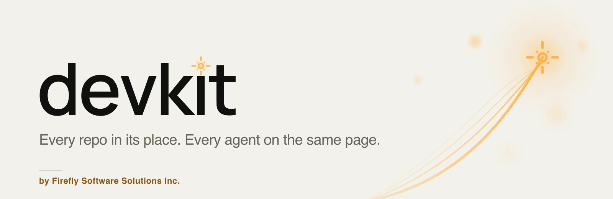
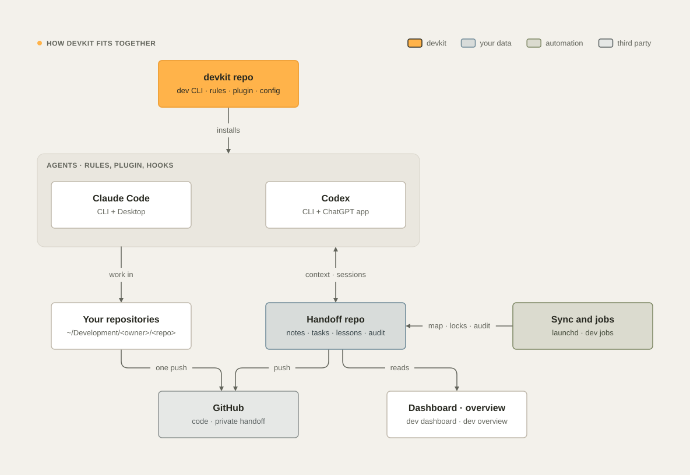

<picture>
  <source media="(prefers-color-scheme: dark)" srcset="docs/images/hero-dark.webp">
  
</picture>

# devkit

[](https://github.com/fireflysoftwaresolutions/devkit/releases/latest)
[](https://github.com/fireflysoftwaresolutions/devkit/actions/workflows/ci.yml)
[](LICENSE)


devkit is how Firefly Software developers work with Claude Code and Codex. Every repository is in a predictable
place. Every project has a living handoff note and a task board that a team, its Macs, and its agents share safely.
Every agent session starts from the current state, keeps you informed while it works, and ends by recording what
changed. The workspace never fills up with stray worktrees, sibling copies, or gigabytes of forgotten build output. One
install sets up the toolchain, git, Claude Code (CLI and Desktop), Codex (CLI and the ChatGPT app), skills, plugins,
Docker and the background automation, and keeps them that way.

[Why](#why-devkit) ·
[Install](#install) ·
[A quick tour](#a-quick-tour) ·
[From plan to operate](#from-plan-to-operate) ·
[Features](#features) ·
[For your agents](#for-your-agents) ·
[When devkit fails](#when-devkit-itself-fails) ·
[How it fits together](#how-it-fits-together) ·
[What's inside](#whats-inside) ·
[Docs](#documentation) ·
[Credits](#credits-and-license)

## Why devkit

| Without devkit | With devkit |
| --- | --- |
| Each session rediscovers the project | The session starts with the project's handoff note, tasks, locks, git state, commands, and the last status |
| Two people (or two agents) pick up the same task | `dev task start` locks it on every machine at once; every change records who, when, and why |
| "How is it going?" | Agents report progress with an ETA computed from their real pace, and you get a notification when they finish or get stuck |
| A crew question or a CI result waits until you type something | One wait, `dev watch --wait`, wakes an idle session for each crew question, decision, ready step, and CI result; a turn that would leave nothing to wake it is sent back |
| Worktrees and `repo-pr12` copies pile up; disks fill | One managed worktree location, a guard that blocks stray ones, and safe automatic cleanup once work is merged |
| Push → CI → fix → push → CI … | `dev ci --run` runs what CI runs, here; `dev push` pushes once, only with that evidence; `dev ci status` follows the one CI run with an ETA on GitHub, GitLab, Bitbucket, or Azure |
| PRs with empty descriptions, merges past red checks | `dev pr create` fills the PR template and refuses an empty "What and why"; `dev pr merge` waits for green checks and reviews; `dev release` tags and publishes by the policy |
| Every project releases its own way, or not at all | `dev delivery` detects and records a delivery policy (versioning, test gate, changelog, release flow); the guard refuses tags that break it |
| An agent's `rm -rf` or `cp` destroys work | `dev rm`, `dev mv`, and `dev cp` use the Trash, refuse open or unsaved files, and `dev rm --undo` restores them; the guard steers raw deletes to them |
| `claude/vigilant-jang-ec71c0` branches and AI attribution | Trunk-based naming (`feat/PROJ-142-invoice-export`) and no attribution, enforced for both agents |
| Claude and Codex behave differently, and settings drift | One set of rules, skills, and hooks for both; drift is blocked and repaired; `dev config diff` previews everything |
| Agents skip the skill that fits the job | Required skills follow the files, commands, and kind of work, in any language: added to subagent briefs, and checked before a turn ends |
| Nobody knows what is in flight | A shared handoff repository with initiatives, projects, task boards, a team view, status reports, and a dashboard, synced within seconds of every commit, push, and PR |
| The same mistake, made again next month | Blameless lessons, recalled before the work they apply to; devkit measures whether agents heeded them, and a lesson that keeps repeating becomes a test or a guard rule |
| Every agent rediscovers the same devkit bug | A public bug registry: a detour found once reaches every agent, and votes rank what the next hotfix fixes |
| "What did the agent do last night?" | Scheduled jobs you can see and change, and an audit trail of every change, guard decision, and job run, for the whole team |
| "Did the agent even read the rules?" | Every reply starts with the `[Firefly> DevKit]` status block; devkit checks it, scores it, records it, and reports deviations |

## Install

devkit is for Macs with Apple silicon: it installs its tools with Homebrew, and Homebrew no longer installs on Intel
Macs. An Intel Mac that already has Homebrew can still run it. In Terminal, run:

```bash
curl -fsSL https://raw.githubusercontent.com/fireflysoftwaresolutions/devkit/main/install.sh | bash
exec zsh && dev doctor                                             # every check passes
```

The installer makes sure Homebrew, git, Python, and the GitHub CLI are present, downloads the newest devkit release to
`~/Development/fireflysoftwaresolutions/devkit`, signs you in to GitHub, and starts the setup wizard. The wizard asks
for your workspace, your handoff repository (yours, or one your team shares), which agents to configure, your stacks
and the Docker VM, shows the plan, and applies it: the toolchain for your stacks, git signed in with your GitHub
identity, Claude Code and Codex, the devkit plugin and the curated skills in both, and the scheduled jobs. The hooks
and the guard then run a read-only, checksummed copy of that release, so no edit can switch them off by accident. It is
safe to run again, and `dev update` later moves devkit to the newest release and pins it.

New to the terminal? [Your first install, step by step](docs/getting-started.md#your-first-install-step-by-step)
explains every screen, and the [tutorials](docs/surfaces.md) walk through a first task in Claude Code, Claude
Desktop's Code tab, Codex CLI, or Codex in the ChatGPT app.

To read the script before you run it:

```bash
curl -fsSL https://raw.githubusercontent.com/fireflysoftwaresolutions/devkit/main/install.sh -o install.sh
less install.sh
bash install.sh
```

Pass options after `bash -s --`, for example `curl -fsSL … | bash -s -- --yes`:

| Option or variable | Effect |
| --- | --- |
| `--yes` | Accept every default in the setup wizard |
| `--skip-packages` | Configure only; do not install the toolchain packages for your stacks |
| `--no-setup` | Get devkit and its prerequisites, but do not sign in or run the wizard |
| `DEVKIT_HOME` | Where devkit goes (default `~/Development/fireflysoftwaresolutions/devkit`) |
| `DEVKIT_REPO` | The repository to clone, for example your fork |
| `DEVKIT_REF` | A tag or branch to check out instead of the newest release |

Set a variable for `bash`, not for `curl`: `curl -fsSL … | DEVKIT_REF=v26.11.3 bash`. Everything the installer and the
wizard change on your Mac, and how to undo each change, is listed in
[Getting started › What devkit touches](docs/getting-started.md#what-devkit-touches-and-how-to-undo-it).

## A quick tour

```text
dev                          your workspace at a glance
dev dashboard                the live command center; it opens on Now: does anything need you?
dev overview                 every initiative and project: status, progress, Now tasks, latest status
dcd billing                  jump into a project                     dwt feat/invoice-export   …or into a new worktree
dev task                     the project's board                      dev task add "Export invoices as CSV" --type feature --now
dev task start 2             claim it (locked on every machine)       dev task done 2      dev task release 2
dev task delegate 3 --to jordan --why "Jordan owns the event bus"     hand it over, with the message to send
dev plan new "Refund events" --kind spec                              a versioned spec; dev plan revise <file> --why "…"
dev initiative show payments one initiative across its projects       dev task -i payments
dev team                     who is working on what, on every machine
dev progress                 live runs with ETA                       dev time   where the time goes
dev crew graph               the run, its crew lanes, decisions, and messages   dev crew next   who to launch next
dev watch --wait             wake on the next crew question, decision, or CI result   dev watches   every wait
dev report --days 7          a status report for the team, in Markdown
dev claude api -w feat/x     Claude Code in a managed worktree        dev codex api   Codex in the project
dev branch new feat/invoice-export                                    a branch from an up-to-date main
dev commit -m "feat(invoice): add CSV export"                         a Conventional Commit, never on main
dev ci --run                 run what CI runs, here, and record it    dev push   one push, with that evidence
dev pr create                the PR, from the template                dev pr checks --watch   wait for CI
dev pr merge                 when checks and reviews allow it         dev release   tag and publish by the policy
dev ci status --watch        the branch's pipelines: jobs, current step, ETA (GitHub, GitLab, Bitbucket, Azure)
dev ci watch --wait --pr 12  wake when that PR's CI ends              dev backup   this branch, when no CI starts
dev lesson add "…" --happened "…" --cause "…" --prevent "…" --file …   a lesson, recalled before that work
dev bug                      devkit's own known bugs and their detours   dev bug top   what the next hotfix fixes
dev jobs                     the scheduled jobs and their last runs   dev audit --team   what devkit did, everywhere
dev delivery                 the project's release policy and gaps     dev delivery apply --why "…"   record it
dev files · find · grep · diff   token-light views of the tree, names, contents and changes
dev rm build/out.log         to the Trash, refuses unsaved work        dev rm --undo   put it back
dev sec scan                 secrets, dependencies, code, IaC and workflows
dev gc                       what can be reclaimed safely (dry run)
dev doctor                   verify the whole setup                   dev agents test   a live check of both agents
dev ext ls                   pinned plugins, skills, and MCP servers  dev ext outdated   what upstream has now
dev update --check           is a newer devkit out? (read-only)       dev update   move to it, in your terminal
```

<picture>
  <source media="(prefers-color-scheme: dark)" srcset="docs/images/dashboard/home-1440-dark.webp">
  
</picture>

All commands are in [docs/commands.md](docs/commands.md).

## From plan to operate

<picture>
  <source media="(prefers-color-scheme: dark)" srcset="docs/images/diagrams/lifecycle-map-dark.svg">
  
</picture>

Every stage of the lifecycle has a devkit command and a skill, so nothing falls between them. The table with each
stage's guide is in [Concepts › From plan to operate](docs/concepts.md#from-plan-to-operate).

## Features

| Area | What you get | Guide |
| --- | --- | --- |
| Workspace | One canonical path per repository on any git host, managed worktrees, safe cleanup | [Concepts](docs/concepts.md) and [Disk and cleanup](docs/disk-and-cleanup.md) |
| Handoff | A private (or team) handoff repository with notes, the projects map, task boards, and activity, kept current by a sync after each session and every hour | [Concepts](docs/concepts.md#the-handoff-repository) |
| Teams and machines | Versioned work items with locks that every machine sees and that run out when nobody works on the item's branch, items that close when their branch merges, reasons for every change of scope, versioned plans, append-only session logs, presence, `dev team` | [Teams and machines](docs/teams.md) |
| Work states | What devkit shows stays true: work items, runs, crew lanes, decisions, waits and CI watches, the install, and branches each end when their work ends, and `dev doctor` and the dashboard report what drifted, with the command that fixes it | [Work states](docs/work-states.md) |
| Initiatives | Cross-project goals with workstreams, cross-project tasks, honest progress, and adoption of older handoff repositories | [Initiatives](docs/initiatives.md) |
| Progress and communication | `dev progress` with active time, per-step estimates and dependencies, a critical-path ETA range, a plan that changes only with evidence, reminders, notifications, one wait that wakes an idle agent for every devkit event (`dev watch --wait`), a short welcome when a session starts, `dev time`, message templates, `dev report` | [Progress and communication](docs/progress-and-communication.md) |
| The crew | 25 specialist agents, named by role, and the tech lead (Morpheus), the main session that leads them, for Claude Code and Codex from one roster: slots that follow your usage, lanes with their own time, file scopes the guard enforces, messages, routing and delegation, guided or automatic decisions, and a status block every member must end with | [The crew](docs/crew.md) |
| Status block | Every reply starts with a `[Firefly> DevKit]` block (done, check, progress, next) that devkit checks, scores, and shows everywhere; while a run is active it always says which step of how many is running | [Concepts](docs/concepts.md#the-status-block) |
| Dashboard | A live, local, read-only command center that opens on Now (does anything need you, and when does the running work land?), then tasks, background work, team and crew, projects, initiatives, activity, explorer, and health | [Dashboard](docs/dashboard.md) |
| Claude Desktop and ChatGPT | The same setup in Claude Desktop's Code tab and the ChatGPT app's Codex; a devkit extension with 20 tools for Desktop chat and Cowork | [Agents](docs/agents.md#claude-desktop-and-the-chatgpt-app) |
| Delivery | `dev ci`, local integration, one push and one CI run, CalVer, a push budget, and no blind re-runs | [Delivery](docs/delivery.md) |
| Git and GitHub | `dev branch`, `commit`, `rebase`, `push`, `pr`, `run`, `release`, and `issue`: local CI evidence before every push, the PR template filled and checked, gated merges, releases by the policy, WIP commits instead of a shared stash | [Git and GitHub](docs/git-and-github.md) |
| Delivery policy | `dev delivery` detects how a project versions, tests, and releases, recommends a policy, and records it; sessions see it and the guard enforces its tags | [Delivery › The delivery policy](docs/delivery.md#the-delivery-policy) |
| CI/CD status | `dev ci status [--watch]` for GitHub Actions, GitLab CI, Bitbucket Pipelines, and Azure Pipelines: jobs, current step, elapsed time, and an ETA | [Commands › dev ci status](docs/commands.md#dev-ci-status---watch---branch-name----all-branches---all-jobs---limit-n---json) |
| CI/CD pipelines | `dev ci audit` finds what makes a pipeline slow, unreliable, or unsafe on all four hosts, and `--fix` applies the safe GitHub fixes; `dev ci init` writes a pinned pipeline with security scans and signed releases; `dev ci watch` follows every run after a push, reports each result once, and hands a failure, diagnosed, to the Release engineer (Link); `dev ci watch --wait` wakes an agent that waits on one run, and the session's one `dev watch --wait` covers every run devkit follows | [CI/CD pipelines](docs/ci-cd.md) |
| Testing | `dev test` runs the last failures first, then only what your changes can break; `dev test audit` finds tests that cannot fail, and `dev test prove` checks that new tests fail without the change; `dev ci --run --resume` repeats only what a fix affects | [Testing](docs/testing.md) |
| Unfinished work | `dev stubs` finds TODOs, placeholders, and stubs without a task; the end of a turn and every commit refuse them | [Commands › Quality](docs/commands.md#quality) |
| Files | `dev files`, `find`, `grep`, and `diff` with compact, capped output; `dev rm`, `mv`, and `cp` with the Trash, undo, and refusals instead of lost work | [Commands › Files](docs/commands.md#files) |
| Lessons | Blameless lessons from mistakes, recalled before the work they apply to, measured by whether agents heeded or missed them, screened before any agent sees them, turned into tests and guard rules when they repeat, and consolidated every night by `dev sleep` without losing any that still matter | [Lessons](docs/lessons.md) |
| Bug registry | When devkit itself fails, agents get the known detour from a public registry in GitHub Issues, share the ones they find under trust rules, and report what nobody solved, with devkit facts only; votes rank the bugs for hotfixes | [The bug registry](docs/bug-registry.md) |
| Scheduled jobs and audit | Sync, sleep, cleanup, repair, audit, update check, health, and lesson review as launchd jobs you can see and reschedule; an audit trail of everything devkit changed or decided, with secrets redacted | [Scheduled jobs and the audit trail](docs/jobs-and-audit.md) |
| Git hosts and clouds | The CLIs for GitLab, Bitbucket, Azure DevOps, AWS, Azure, Google Cloud, DigitalOcean, Kubernetes, and OpenTofu, installed and checked for sign-in | [Getting started](docs/getting-started.md#the-setup-wizard) |
| Security | `dev sec scan` (gitleaks, osv-scanner, Semgrep, Trivy, zizmor), a secret check before every commit, devkit run isolated from Python's environment, and the DevSecOps skills and plugins | [Skills and plugins](docs/skills-and-plugins.md), [Guard rules](docs/guard.md) |
| Guard | A pre-tool hook that blocks what wastes time or disk or breaks shared records, holds irreversible actions for your grant, and explains the right way. It is a seatbelt, not a sandbox: it catches an agent's mistakes and common prompt injection, and your own review stays the boundary, since agents work with your own `gh` account and keys | [Guard rules › What the guard is and is not](docs/guard.md#what-the-guard-is-and-is-not) |
| Backups and continuity | `dev backup` copies branches that exist only on this Mac to the remote when that starts no CI run, with a policy per project and embargoes; a session keeps its run, crew, and your requests through compaction | [Delivery](docs/delivery.md#back-up-early-ci-once), [Continuity](docs/continuity.md) |
| Skills | A curated, pinned catalog for both agents, optional groups, and required skills enforced per kind of work; the impeccable design engine for frontend work, run through `dev impeccable` with its digest checked | [Skills and plugins](docs/skills-and-plugins.md) |
| Extensions | `dev ext` lists every third-party plugin, skill, and MCP server with its pin, shows what upstream has now, reports drift, and lets you add your own or turn one off, in your terminal | [Skills and plugins › Who changes extensions](docs/skills-and-plugins.md#who-changes-extensions-and-how-drift-shows) |
| Shell | Tab completion for zsh and bash, generated from `dev` itself; `dcd` and `dwt`; fzf pickers for work items, projects, and branches when you turn them on (`dev setup shell`) | [Getting started › Tab completion](docs/getting-started.md#tab-completion-and-the-zsh-helpers) |
| Updates | `dev update` moves devkit to the newest release and pins it, and names the running sessions to restart; a session still on the older release never undoes it; `dev update --check` says, read-only, whether one is out and what changes, and a daily job asks for you | [Getting started › Updating](docs/getting-started.md#updating) |
| Models and tokens | Your model stays yours; the Lookup scout (Sparks), read-only; Codex profiles, a cap on parallel threads, and routing rules | [Models and tokens](docs/models-and-tokens.md) |
| Templates | Plans, specs, spikes, bug fixes, ADRs, typed tasks, and a pull request description | [Templates](docs/templates.md) |
| Docs and diagrams | `dev docs check`, plus validated, branded SVG diagrams in a dark and a light version | [Diagrams](docs/diagrams.md) |
| Docker | Colima with Compose, Buildx, and Testcontainers | [Docker](docs/docker.md) |

## For your agents

devkit is also a plugin for **Claude Code** and **Codex**, installed automatically:

- **Context in, record out.** Each session receives the project's handoff note, tasks, locks, initiatives, branch,
  PRs, commands, the last status, and the known pitfalls; its commits, status, and session line are recorded and the
  handoff repository is pushed within seconds.
- **A welcome.** Each session opens with `dev status` in at most five lines: whether anything needs you, what is
  running, what is next, and where you are. It shows in Claude Code and Codex, in the terminal and in the desktop
  apps.
- **Kept informed.** Agents post a plan with an estimate, progress updates with an ETA, and a final report; the hooks
  answer "how is it going?" from real records and remind a quiet agent to update you.
- **Nothing waits unseen.** An idle session's `dev watch --wait` wakes it for each crew question, answer, decision,
  ready step, and CI result, and a crew member waits for its own answer with `dev watch --wait --for me`.
- **A crew.** 25 specialist agents (the Senior engineer, the Frontend and Backend engineers, the Software
  architect, the Code reviewer, the Release engineer, and the rest) that the main session leads as the tech lead
  (Morpheus), in parallel lanes with their own files and time.
- **Slash commands:** `/devkit:status` · `/devkit:overview` · `/devkit:task` · `/devkit:handoff` · `/devkit:standup` ·
  `/devkit:progress` · `/devkit:crew-status` · `/devkit:test` · `/devkit:stubs` · `/devkit:ship` · `/devkit:ci` ·
  `/devkit:dashboard` · `/devkit:doctor` · `/devkit:reconcile` (skills of the same name in Codex).
- **Skills:** `using-devkit`, `handoff`, `communicating`, `working-efficiently`, `crew`, `wait-and-wake`, `work-state`,
  `workspace`, `delivery`, `release-policy`, `testing`, `cicd`, `learning-loop`, `root-cause`, `research`,
  `functional-analysis`, `backend`, `devsecops`, `docs`, and `diagrams`, plus a curated, pinned set for architecture, Angular, React, Spring, testing, security, and
  observability. Required skills are enforced for each kind of work.
- **Rules:** one set of global instructions for both agents: the status block on every turn, method, plain American
  English, progress and time, learning from mistakes, token use, files and disk, worktrees, branches, commits, delivery, backend practice, required
  skills, the team protocol, and handoff.
- **Guard:** a pre-tool hook that blocks what wastes time or disk and holds irreversible actions for your grant, and
  explains the right way in one sentence. It is a seatbelt, not a sandbox: keep reviewing what agents do.
- **Continuity:** after a compaction, a resume, or `/clear`, the session gets devkit's record of its run, the crew
  working now, the decisions waiting, and your latest requests, which wins over the summary.

## When devkit itself fails

When a `dev` command crashes, a hook fails, or the guard refuses something it should allow, devkit says the bug is its
own, not your project's, and looks it up in a public bug registry kept in this repository's GitHub Issues. If someone
already found a workaround, your agent gets it and carries on. If not, the agent looks for one and shares what works,
or reports the bug and asks you. Reports carry devkit facts only (the version, the command, the exception class,
devkit's own function names), never paths, names, code, or output from your projects, and anything with free text
waits for your review. devkit posts only after you consent, under your own GitHub account; security-sensitive reports
go to private vulnerability reporting instead. Votes rank the bugs, so each hotfix fixes what hurts most. See
[The bug registry](docs/bug-registry.md).

## How it fits together

<picture>
  <source media="(prefers-color-scheme: dark)" srcset="docs/images/diagrams/architecture-dark.svg">
  
</picture>

The ideas behind it are in [docs/concepts.md](docs/concepts.md).

## What's inside

| Path | What |
| --- | --- |
| `bin/dev`, `lib/devkit/` | The `dev` CLI (Python 3.9+, standard library only) |
| `plugin/` | The devkit plugin for Claude Code and Codex: skills, slash commands, the crew's agents (generated from `config/crew.json`), identity |
| `agents/AGENTS.md` | The global instructions generated into `~/.claude/CLAUDE.md` and `~/.codex/AGENTS.md` |
| `config/` | What devkit manages, such as Claude and Codex settings, hooks, plugins, MCP servers, profiles, pinned skills, skill rules, git, and docs defaults |
| `templates/` | Plan, spec, spike, bug-fix, and ADR templates; task templates; the pull request template; the handoff repository README; the pinned CI/CD pipelines of `dev ci init` (`templates/ci/`) |
| `install.sh`, `Brewfile` | Bootstrap and toolchain |
| `shell/` | zsh integration (`dcd`, `dwt`, the opt-in pickers, Docker environment) and the Tab completion for zsh and bash, generated from the parser (`shell/completions/`) |
| `tools/brand/` | Renders devkit's icon and banners from the Firefly brand elements |
| `docs/` | The guides, diagram specs, and images |
| `tests/` | Unit tests (`python3 -m unittest discover -s tests -t .`) |

## Documentation

| Guide | For |
| --- | --- |
| [Getting started](docs/getting-started.md) | Your first install step by step, the setup wizard, the pinned copy, Tab completion and the zsh helpers, onboard a developer, update, uninstall |
| [Where to use devkit](docs/surfaces.md) | The surfaces compared: what devkit does in Claude Code, Claude Desktop, Codex CLI, and the ChatGPT app |
| Tutorials | A first task with the crew in [Claude Code](docs/tutorials/claude-code.md), [Claude Desktop's Code tab](docs/tutorials/claude-desktop.md), [Codex CLI](docs/tutorials/codex-cli.md), and [Codex in the ChatGPT app](docs/tutorials/chatgpt-codex.md); [Claude Desktop chat and Cowork](docs/tutorials/desktop-chat-and-cowork.md) for status and plans |
| [Concepts](docs/concepts.md) | Layout, how work is organized, the handoff repository, worktrees, the guard, the status block, the session-start welcome, and the background sync |
| [Teams and machines](docs/teams.md) | Work items and locks, shipped and stale items, reasons, and history, versioned plans, session logs, presence, merge rules |
| [Work states](docs/work-states.md) | The states of work items, runs, crew lanes, decisions, waits and CI watches, the install, and branches: what moves each, and how to repair drift |
| [Initiatives](docs/initiatives.md) | Cross-project initiatives, progress, adopting an older handoff repository |
| [The crew](docs/crew.md) | The 25 specialist agents and the tech lead (Morpheus): who does what, slots, lanes, scopes, messages, delegation, guided or automatic decisions, moot and withdrawn decisions, how your answers count, and rooms (planned) |
| [Continuity](docs/continuity.md) | What a session keeps through compaction, resume, and `/clear`, and `dev session` |
| [Progress and communication](docs/progress-and-communication.md) | `dev progress`, the time model and ETA, notifications, waiting and waking, `dev time`, message templates, status reports |
| [Commands](docs/commands.md) | Every `dev` command and option, including git and GitHub, `dev progress`, `dev crew`, `dev test`, `dev stubs`, lessons, jobs, the file commands, and `dev ci` |
| [Dashboard](docs/dashboard.md) | The live command center: the server, Now, the views, Background work, the crew, drawers, shortcuts, routes |
| [Configuration](docs/configuration.md) | Every key of `~/.config/devkit/config.json`, personal rules, environment variables |
| [Agents](docs/agents.md) | What is configured in Claude Code and Codex, hooks, devkit always on |
| [Skills and plugins](docs/skills-and-plugins.md) | The devkit plugin, required skills, the curated catalog, `dev impeccable`, `dev ext` and drift, what was left out |
| [Models and tokens](docs/models-and-tokens.md) | Models, effort, subagents, the Lookup scout (Sparks), Codex profiles |
| [Templates](docs/templates.md) | Plans and specs, tasks, the pull request template |
| [Git and GitHub](docs/git-and-github.md) | Branches, commits, local CI evidence, pushes, pull requests, CI runs, releases, and issues through `dev` |
| [Testing](docs/testing.md) | `dev test`: failures first, then the blast radius; tests that can fail; TDD with devkit |
| [CI/CD pipelines](docs/ci-cd.md) | `dev ci audit`, `--fix`, `dev ci init`, `dev ci watch`, and the agent's wait, `dev ci watch --wait`, on GitHub, GitLab, Bitbucket, and Azure |
| [Delivery](docs/delivery.md) | Local-first GitOps: the delivery policy, one integration, one push, one CI run, following CI, releases |
| [Lessons](docs/lessons.md) | Learning from mistakes: lessons, recall before the work, heeded and missed, held lessons, lesson rules, `dev sleep` |
| [The bug registry](docs/bug-registry.md) | When devkit itself fails: known detours, what is sent and never sent, trust, consent, `dev bug`, hotfix rankings |
| [Scheduled jobs and the audit trail](docs/jobs-and-audit.md) | The background jobs and their schedules, logs, and journal; the audit trail |
| [The audit trail](docs/audit.md) | What each record holds, the hash chain and `dev audit verify`, exports, retention, and the GDPR rights of the people recorded |
| [Guard rules](docs/guard.md) | Everything the guard blocks, and why, including typing into a terminal session and commands it cannot read |
| [Diagrams](docs/diagrams.md) | `dev diagram` and the diagram design rules |
| [Disk use](docs/disk.md) | `dev du`, what is safe to delete, Colima's disk, `dev free` |
| [Disk and cleanup](docs/disk-and-cleanup.md) | `dev gc` safety rules and automatic cleanup |
| [Docker](docs/docker.md) | Colima, Compose, Buildx, Testcontainers |
| [Troubleshooting](docs/troubleshooting.md) | Logs, common problems, pin refusals and rollback, resetting |
| [Developing devkit](docs/development.md) | Code layout, tests, brand assets, release process |

## Credits and license

devkit is designed and maintained by **Andrés Contreras Guillén** for **Firefly Software Solutions Inc.**

Copyright © 2026 Firefly Software Solutions Inc. Licensed under the Apache License 2.0; see [LICENSE](LICENSE).
Third-party skills and tools installed by devkit keep their own licenses; see [NOTICE](NOTICE).

Contributions are welcome: the [contributing guide](CONTRIBUTING.md) explains how to propose a change and the checks
a pull request must pass. Report a vulnerability privately, as the [security policy](SECURITY.md) describes, never in
a public issue.
