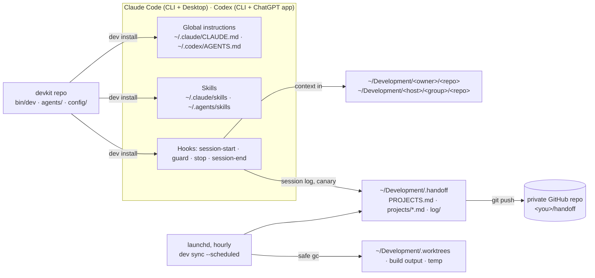

<div align="center">

```
                                        ·   ˚  ✦   ⋆  ·  ✧
    ╲  ╱      ██████╗ ███████╗██╗   ██╗██╗  ██╗██╗████████╗
 ▗▄▖ ◉◉ ▗▄▖   ██╔══██╗██╔════╝██║   ██║██║ ██╔╝██║╚══██╔══╝
 ▝▀▘▐██▌▝▀▘   ██║  ██║█████╗  ██║   ██║█████╔╝ ██║   ██║
    ▐▓▓▌      ██║  ██║██╔══╝  ╚██╗ ██╔╝██╔═██╗ ██║   ██║
     ▀▀  ✦    ██████╔╝███████╗ ╚████╔╝ ██║  ██╗██║   ██║
   ·   ˚      ╚═════╝ ╚══════╝  ╚═══╝  ╚═╝  ╚═╝╚═╝   ╚═╝
```

**One workspace · every repo in its place · agents that hand off.**

The development environment standard for you, Claude Code and Codex on macOS.

`v1.0.0` · macOS 14+ · Apple silicon · Python 3.9+ (stdlib only)

</div>

---

## Why devkit exists

AI coding agents are fast, but left to their defaults they waste time and disk in the same ways every day:

| Problem | What devkit does about it |
|---|---|
| Every session rediscovers the project from scratch | A **handoff note** per project is injected at session start (purpose, state, next steps, gotchas, recent sessions), plus the repo's commands and git state. |
| Worktrees and sibling copies (`repo-pr12`, `repo-ci`) pile up | One managed location, `dev wt` with safety checks, a **guard** that blocks stray `git worktree add`/clones, and automatic removal once the PR is merged. |
| Gigabytes of duplicated `node_modules`, `.venv`, `dist`, `target/` | Copy-on-write `node_modules` for worktrees, **safe garbage collection** of regenerable build output and stale temp. |
| Scratch files land in repositories, home or random folders | A defined scratch location, the guard on every write, global rules shared by both agents. |
| Push → CI → fix → push → CI … | **Local-first delivery**: `dev ci` shows exactly what CI runs; the guard stops CI loops and blind re-runs; one integration branch, one push, one CI run. |
| Claude and Codex behave differently | **One set of global instructions, skills, hooks and rules** generated for both, verified by `dev doctor`, and an **instruction canary** (`DevKit ·`) proving every reply followed them. |
| No overview of what is in flight | A live **projects map** (`PROJECTS.md`) and activity log in a private GitHub repo, synced every hour and at the end of every session. |
| Every laptop and every developer is set up differently | `install.sh` + `dev install`: toolchain, git identity from `gh`, Claude Code, Codex, skills, Docker, automation — idempotent and reproducible. |

## Quick start

```bash
gh auth login -s repo,read:org,workflow,gist          # once, if gh is not signed in
gh repo clone ancongui/devkit ~/Development/ancongui/devkit
~/Development/ancongui/devkit/install.sh              # toolchain + configuration (safe to re-run)
exec zsh && dev doctor                                 # verify everything is green
```

Then just work: open Claude Code or Codex (CLI, Claude Desktop or the ChatGPT app) inside any project under
`~/Development`. Context, rules, skills, the guard and tracking are already there.

## Everyday use

```text
dev                       dashboard: where you are, what is active, what needs attention
dcd kit                   jump to a project (fzf picker when several match)
dev clone acme/api        → ~/Development/acme/api            (any host: dev clone git@gitlab.com:grp/svc.git)
dev claude api -w feat/x  Claude Code in a managed worktree for feat/x   (dev codex … for Codex)
dev ci                    what GitHub Actions runs — run it locally before the single push
dev handoff               the project's handoff note (--edit to change it)
dev gc                    what can be reclaimed safely (dry run; --apply to do it)
dev docker up             Docker on a Colima VM (Rosetta, virtiofs, Testcontainers-ready)
dev doctor                verify the whole setup
```

Full reference: [docs/commands.md](docs/commands.md).

## How it fits together



Concepts in depth: [docs/concepts.md](docs/concepts.md).

## Documentation

| Guide | For |
|---|---|
| [Getting started](docs/getting-started.md) | Installing on a new Mac, onboarding a developer, first checks |
| [Concepts](docs/concepts.md) | Layout, handoff, worktree lifecycle, guard, canary, background sync |
| [Commands](docs/commands.md) | Every `dev` command and option |
| [Configuration](docs/configuration.md) | `~/.config/devkit/config.json`, personal rules, environment variables |
| [Agents](docs/agents.md) | What is configured in Claude Code and Codex, and how hooks work |
| [Skills and plugins](docs/skills-and-plugins.md) | The curated catalog, why each item is there, what was left out |
| [Delivery](docs/delivery.md) | Local-first GitOps: one integration, one push, one CI run |
| [Guard rules](docs/guard.md) | Everything the guard blocks, and why |
| [Disk and cleanup](docs/disk-and-cleanup.md) | `dev gc` safety rules, `dev du`, automatic cleanup |
| [Docker](docs/docker.md) | Colima, Compose, Buildx, Testcontainers |
| [Troubleshooting](docs/troubleshooting.md) | Logs, common problems, resetting |
| [Developing devkit](docs/development.md) | Code layout, tests, release process |

## Requirements

- macOS on Apple silicon, Homebrew (installed by `install.sh` if missing), a GitHub account with `gh`.
- Read access to this private repository (ask the owner to add you as a collaborator).
- Claude Code and/or Codex accounts. Everything else is installed by `install.sh`.

## Credits and licence

devkit is designed and maintained by **Andrés Contreras Guillén** for **Firefly Software Solutions Inc.**

Copyright © 2026 Firefly Software Solutions Inc. All rights reserved. Proprietary — see [LICENSE](LICENSE).
Third-party skills and tools installed by devkit keep their own licences — see [NOTICE](NOTICE).
