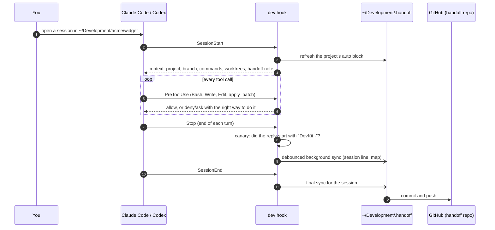

# Concepts

## Workspace layout

Everything lives under the dev root (`~/Development` by default, see [Configuration](configuration.md)).

```text
~/Development/
├── <owner>/<repo>/                    GitHub repositories (the default host), lowercase
├── <host>/<group>/<…>/<repo>/         any other git host: gitlab.com/…, bitbucket.org/…, gitlab.acme.io/…
├── _local/<name>/                     projects with no remote yet
├── .worktrees/<project id>/<branch>/  managed git worktrees
├── .tmp/                              scratch files (purged after 7 days)
└── .handoff/                          your private handoff repository
```

| Rule | Why |
|---|---|
| One canonical path per repository | Agents, scripts and you always know where a project is. No `repo-pr12`, `repo-ci`, `repo-copy`. |
| Host folders contain a dot (`gitlab.com`) | GitHub user and organisation names cannot contain dots, so a host folder never collides with an owner folder. |
| Worktrees live outside the repositories | Searches and test runners in the main checkout never pick up worktree copies. |
| Scratch is separate and expires | Temporary files never end up in a repository or in your home folder. |

devkit enforces the layout with the [guard](#the-guard) and moves misplaced repositories with
[`dev adopt`](commands.md#dev-adopt-path).

### Project ids

A project id is the project's path relative to the dev root, in lowercase:

| Remote | Project id | Path |
|---|---|---|
| `https://github.com/Acme/Widget.git` | `acme/widget` | `~/Development/acme/widget` |
| `git@gitlab.com:group/sub/svc.git` | `gitlab.com/group/sub/svc` | `~/Development/gitlab.com/group/sub/svc` |
| `https://user@bitbucket.org/ws/repo.git` | `bitbucket.org/ws/repo` | `~/Development/bitbucket.org/ws/repo` |
| `https://dev.azure.com/org/project/_git/repo` | `dev.azure.com/org/project/repo` | `~/Development/dev.azure.com/org/project/repo` |
| no remote | `_local/<folder name>` | `~/Development/_local/<name>` |

The same id names the project's handoff note (`.handoff/projects/<id>.md`) and its worktree folder
(`.worktrees/<id>/<branch>`). Host folders can be shortened with `host_dirs` (for example `gitlab.com` → `gitlab`).

## The handoff repository

`~/Development/.handoff` is a private git repository (default `<your-github-login>/handoff`, configurable). It is
the memory shared by you, Claude Code and Codex across sessions and machines.

| Path | Content | Written by |
|---|---|---|
| `PROJECTS.md` | Live map: every project, stack, branch, state, worktrees, open PRs, last activity, size, attention items, canary rate | `dev sync` |
| `registry.json` | The same data, machine-readable | `dev sync` |
| `projects/<id>.md` | One handoff note per project | agents + `dev sync` |
| `plans/<id>/` | Specs and implementation plans, kept out of the code repositories | agents |
| `log/YYYY-MM.md` | Activity log: worktree removals, pruned build output, adoptions | `dev gc`, `dev adopt` |

### Handoff notes

```markdown
# acme/widget

<!-- dev:auto:start -->
- **Path:** … · **Remote:** … · **Stack:** … · **Commands:** …
- **Main checkout:** … · **Worktree** … · **Open PRs:** …
<!-- dev:auto:end -->

## Purpose
## Current state
## Next steps
## Decisions and gotchas

## Session log
- 2026-11-05 18:40 · claude · `feat/x` · 3 commit(s): … <!-- s:5f2c9a1b7d3e -->
- 2026-11-05 18:42 · claude · feat/x · integrated #12 and #17; next: release notes
```

- The **auto block** is regenerated by `dev sync` and at session start. Never edit inside it.
- The **sections** are maintained by the agents with the devkit `handoff` skill (and by you).
- The **session log** gets one automatic line per session that changed something: start time, agent, branch,
  commits made during the session, uncommitted files. Lines carry a hidden key (`<!-- s:… -->`) so later refreshes of
  the same session replace their line instead of adding new ones. Agents add their own one-line summary.

At session start the agent receives the note's human sections (up to about 5,000 characters) together with the git
state, so it continues from "Next steps" instead of rediscovering the project.

## Worktree lifecycle

**When.** The default is to work in the current checkout on a branch. A worktree is for parallel work on the same
repository: when the user asks, or when two sessions must change the same repository at the same time.

**Where.** `dev wt new <branch>` creates `~/Development/.worktrees/<project id>/<branch with / replaced by ->`:

- an existing local branch is checked out; an existing remote branch is tracked; otherwise a new branch starts
  from `origin/<default>` (or `--base`);
- files listed in the repository's `.worktreeinclude` (glob patterns, for example `.env`) are copied when git
  ignores them;
- `node_modules` is cloned copy-on-write from the main checkout when the lockfile is byte-identical (APFS clones use
  almost no disk); Python projects run `uv sync`, which links from uv's cache.

The same `node_modules` clone happens at session start when an agent opens a fresh worktree that has none.

Claude Code's own worktrees (`<repo>/.claude/worktrees/…`) and the Codex app's (`~/.codex/worktrees/…`) are
recognised too. Raw `git worktree add` anywhere else is blocked by the guard.

**Removal.** `dev wt rm <branch|path>` and the automatic cleanup remove a worktree only when nothing can be lost:

- no uncommitted or untracked changes, no commits that exist on no remote;
- no process is working inside it (agent session, shell, editor, dev server);
- its PR is merged or closed (re-checked live on GitHub before removal), or its branch has no commits beyond
  `origin/<default>` — after a grace period of 24 hours idle;
- Codex app worktrees are never removed by devkit (the app keeps the 15 most recent and cleans up itself).

PR state comes from `gh` and is therefore available for GitHub only. On GitLab, Bitbucket and other hosts, a
worktree is cleaned up only when its commits are already contained in the default branch (merge commits and fast
forwards; squash merges are not detected). Details: [Disk and cleanup](disk-and-cleanup.md).

## The guard

A pre-tool-use hook runs before every shell command and file write of Claude Code and Codex. It enforces the
workspace rules: layout, managed worktrees, canonical clones, no backup copies, no writes outside the workspace,
no destructive commands, no plain force pushes, a CI push budget, no blind CI re-runs, no AI attribution. Each denial
explains the right way, so the agent corrects itself in one step. It fails open: a bug in the guard never blocks
work. Full rules: [Guard rules](guard.md).

## Instruction canary

The global instructions (section 0 of `agents/AGENTS.md`) require the final message of every turn to start with
`DevKit ·` and a one-line status, for example:

```text
DevKit · kit-consulting · integrated PRs 12/17/22 on release/26.11.4 · local suite green, ready to push once
```

The rule lives **only** in the global instruction files. The session-start hook deliberately does not repeat it, so
a reply without the marker means the global instructions were not loaded or not followed, which a hook-injected
reminder would hide.

Only sessions whose start was recorded by devkit's SessionStart hook are tracked, so sessions that were already
running when devkit was installed are not counted. After every turn in such a session under the dev root, the Stop
hook reads the final reply (Codex passes it as
`last_assistant_message`; for Claude Code devkit reads the session transcript) and records whether its first
non-empty line starts with `DevKit`. In Claude Code a missing marker also shows a warning to you immediately. The
results are in `dev canary`, on the dashboard, in `dev doctor` (fails below 90% over 7 days) and in `PROJECTS.md`.

## Background sync

| Trigger | What runs |
|---|---|
| Session start (both agents) | Records the session's starting commit, refreshes the project's auto block, injects context |
| Stop, at most every 10 minutes per session | `dev sync --offline` in the background: session line, map, commit and push |
| Session end | The same sync, then the session record is closed |
| launchd `com.devkit.sync`, hourly | `dev sync --scheduled`: refresh PR states and sizes, apply the safe cleanup, rewrite the map and notes, commit and push, rotate logs |

Syncs take a lock, so they never run concurrently, and commit only when something changed.



See also: [Commands](commands.md) · [Agents](agents.md) · [Guard rules](guard.md)
