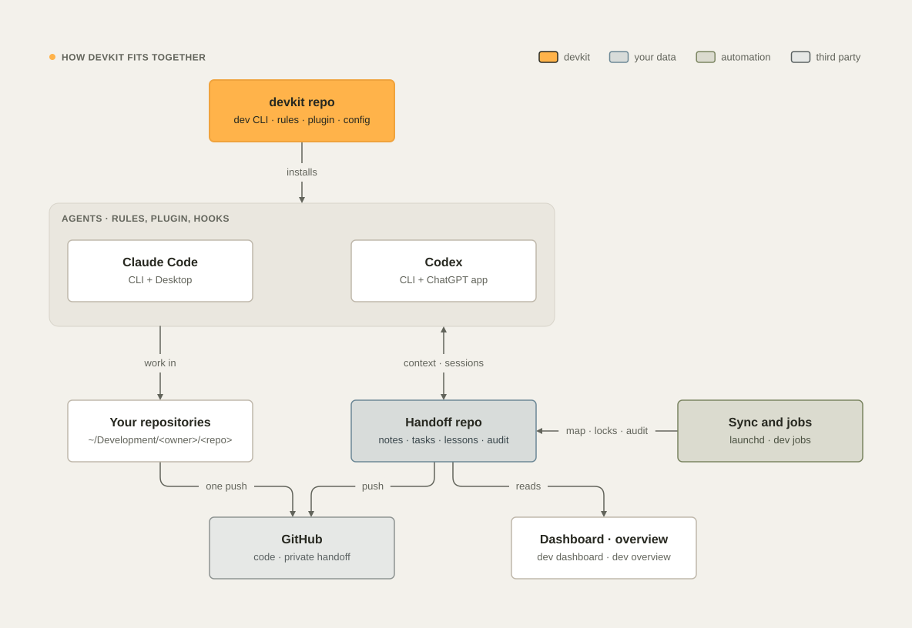
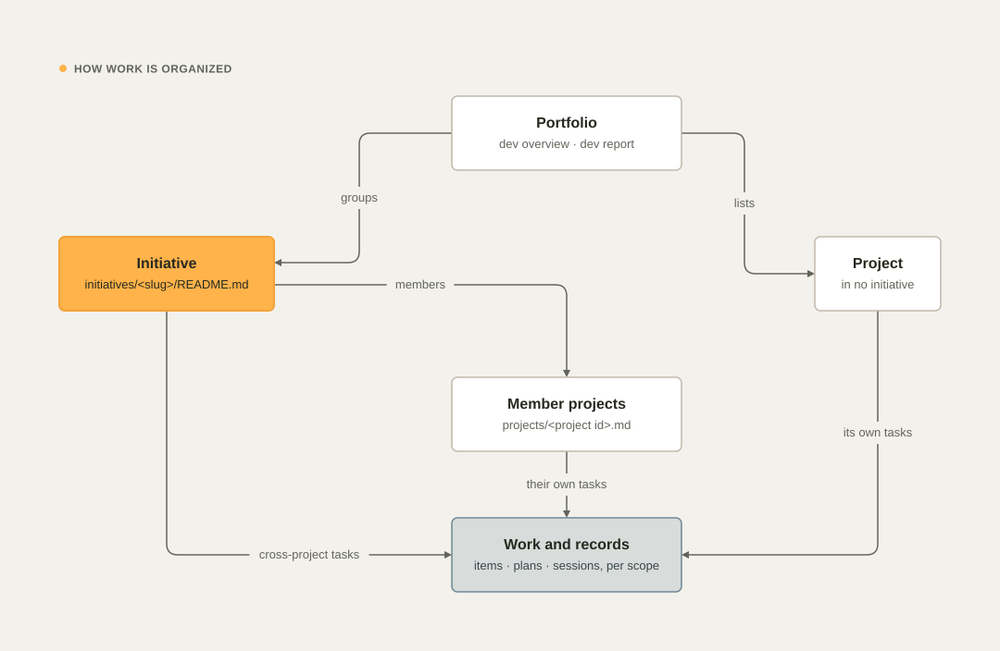
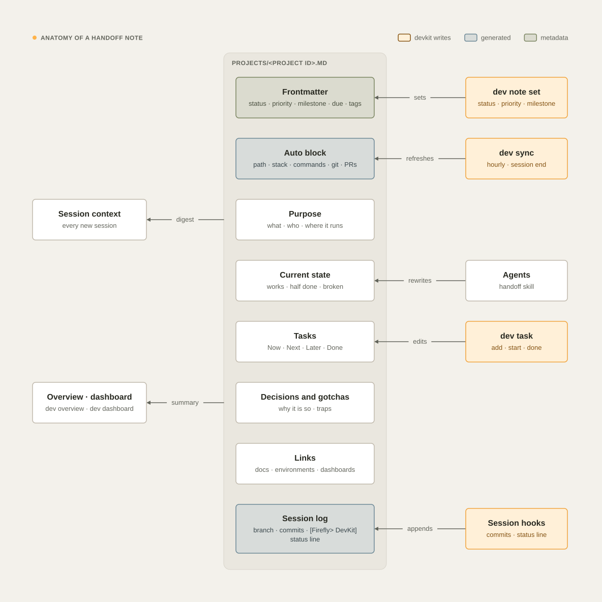
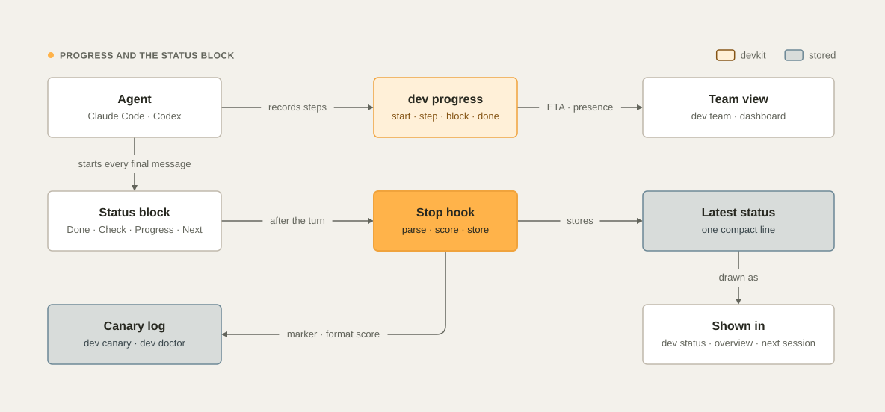

# Concepts

This page explains the ideas behind devkit: how its parts fit together, where everything lives, how work is
organized, how it covers the lifecycle from plan to operate, what the handoff repository holds, how worktrees come and
go, what agents may do and what devkit still checks, what the status block proves, and when devkit syncs.

## How devkit fits together

devkit is three things at once: the `dev` command, the rules and skills it installs into Claude Code and Codex, and
the hooks that run inside every agent session to give it context, check what it does, and record the work. What it
knows about your work lives in git (your repositories and the private handoff repository) and in a state folder on
each Mac.

<picture>
  <source media="(prefers-color-scheme: dark)" srcset="images/diagrams/architecture-dark.svg">
  
</picture>

| Part | What it does | Where it lives | More |
| --- | --- | --- | --- |
| `dev` and its pinned copy | The command you and the agents run. `dev install` pins a read-only copy of a release, and the hooks run that copy, so an edit in the checkout never changes a live session | the devkit checkout; `~/.local/share/devkit/releases/<version>-<commit>/` | [Developing devkit › Trying a change](development.md#trying-a-change-in-your-own-sessions) |
| Global instructions | One set of rules for both agents: the status block, the way of working, delivery | `agents/AGENTS.md`, installed as `~/.claude/CLAUDE.md` and `~/.codex/AGENTS.md` | [Agents › Global instructions](agents.md#global-instructions) |
| The plugin | The skills (how to do each kind of work), the slash commands, and the crew's agents | `plugin/` | [Skills and plugins](skills-and-plugins.md) |
| Hooks | Run at every agent event: give the session its context, record calls and steps, add advice to a tool call, deliver crew messages, and check each final message and each member's report | `bin/dev hook <event>`, from the pinned copy | [Agents › Hooks](agents.md#hooks) |
| The pre-tool hook | The hook before each tool call: it records the call, routes a crew member's devkit calls to its lane, and adds advice; it never refuses a call | `dev hook pre-tool` | [Agents act with your permissions](#agents-act-with-your-permissions) |
| The canary | The status block's marker proves that the rules are loaded; the end-of-turn hook checks it, scores it, and stores the block as the project's latest status | `dev canary` | [The status block](#the-status-block) |
| The crew and its gates | The main session is the tech lead (Morpheus) and leads 25 specialist agents. The RACI decides who does and who approves each kind of work; each member works in a lane with its own files and time, and its report passes the crew gates before its step ends | `config/crew.json`; the team's changes in the handoff repository's `crew/` | [The crew](crew.md) |
| The handoff repository | The shared state of all work: the portfolio, initiatives, projects, work items, plans, session logs, lessons, and delivery policies | `~/Development/.handoff`, a private git repository | [The handoff repository](#the-handoff-repository) and [Teams and machines](teams.md) |
| The state folder | What one Mac knows now: progress runs and crew lanes, crew messages and decisions, the call ledger, waits, continuity checkpoints, the audit trail, the bug registry's cache, and logs | `~/.local/state/devkit/` | [Work states](work-states.md) |
| Continuity | Keeps a session's run, its crew, the decisions waiting, and your latest requests through compaction, resume, and `/clear` | the state folder | [Continuity](continuity.md) |
| Lessons | Mistakes recorded once and recalled before the work that could repeat them | the handoff repository's `lessons/` | [Lessons](lessons.md) |
| The bug registry | devkit's own failures: local matching supplies known detours; validated safe reports retry automatically, while sensitive and legacy rich payloads stay held | the state folder's cache, `dev bug` | [The bug registry](bug-registry.md) |
| Scheduled jobs and the audit trail | Sync, cleanup, repair, and the nightly `dev sleep` run on their own; every change and decision is recorded | launchd, `dev jobs`, `dev audit` | [Scheduled jobs and the audit trail](jobs-and-audit.md) |

### What happens in a turn

1. **Session start.** The hook gives the agent its context: the project, its handoff note and Now tasks, the known
   pitfalls, the delivery policy, and the catalog of kinds of work. You see a short [welcome](#the-session-start-welcome).
   After a compaction or a resume, the [continuity brief](continuity.md) comes first.
2. **Your request.** The tech lead declares the request's kinds of work by their ids and routes each by the RACI: one
   kind of work under ten minutes, it does itself; otherwise it plans steps with dependencies, assigns each to its
   Responsible member with the files it owns, and launches them.
3. **Every tool call.** The pre-tool hook records it and, for a crew member, routes its devkit calls to its lane. It
   adds advice when the call goes past the member's lane (its file scope, its scratch folder, the crew's slots) or
   repeats a known lesson, and the call runs. After the call, the hooks record it and deliver what waits for the
   caller: crew questions, decisions for you, steps ready to launch, CI results.
4. **Every member's end.** Its lane closes, and its report must start with its status block, show the step it
   recorded with `dev progress step`, and pass the crew gates (the proofs of its procedure, its skills, no unfinished
   work, tests that can fail). Review steps approve the work of others.
5. **The end of the turn.** The Stop hook checks the final message's presentation: the status block (with the
   Progress line while a run is active), names with their roles, and the reply language. You have already read that
   message, so a miss never sends the turn back: devkit records it, and the next prompt reminds the agent. The hook
   also checks the required skills, unfinished work, tests that cannot fail, a plan changed without a revision, the
   handoff note, and that a wait is armed while members or CI can still report. It sends the turn back once for what
   is missing there, and the agent then writes only what is new since its last reply.
6. **Between turns.** `dev watch --wait` wakes the idle session for every devkit event, and the syncs keep the
   handoff repository current for your other Macs and your team.

[A request from start to release](tutorials/request-to-release.md) follows one request through these steps.

### Who checks what

The rules are in the instructions and skills; devkit checks the ones that matter at the point where they apply:

| Rule | Checked by |
| --- | --- |
| Every development reply starts with the status block | The Stop hook, scored by `dev canary` |
| A step goes to the member the RACI makes Responsible | `dev progress assign`, unless `--why` records the reason |
| A member edits only its files and writes scratch only in its folder | The pre-tool hook, as advice to the member |
| A step ends on evidence, and the run ends when every Accountable member approved | `dev progress step`, `dev progress done` |
| A member's report carries its block, its recorded step, and its proofs | The SubagentStop hook (the crew gates) |
| The skills for the files and commands of the work are loaded | The Stop hook |
| A push carries local CI evidence; merges and releases follow the checks and the delivery policy | `dev push`, `dev pr merge`, and `dev release` (a raw `git push` or `gh` command checks none of it) |

## Workspace layout

Everything lives under the dev root (`~/Development` by default; see [Configuration](configuration.md)).

```text
~/Development/
├── <owner>/<repo>/                    GitHub repositories (the default host), lowercase
├── <host>/<group>/<…>/<repo>/         any other git host: gitlab.com/…, bitbucket.org/…, gitlab.acme.io/…
├── _local/<name>/                     projects with no remote yet
├── .worktrees/<project id>/<branch>/  managed git worktrees
├── .tmp/                              scratch files (purged after 7 days)
└── .handoff/                          your private handoff repository
```

| Rule | Why |
| --- | --- |
| One canonical path per repository | Agents, scripts, and you always know where a project is. No `repo-pr12`, `repo-ci`, or `repo-copy`. |
| Host folders contain a dot (`gitlab.com`) | GitHub user and organization names cannot contain dots, so a host folder never collides with an owner folder. |
| Worktrees live outside the repositories | Searches and test runners in the main checkout never pick up worktree copies. |
| Scratch is separate and expires | Temporary files never end up in a repository or in your home folder. |

`dev clone`, `dev new`, and `dev wt new` put projects and worktrees in this layout, and
[`dev adopt`](commands.md#dev-adopt-path) moves misplaced repositories into it.

### Project ids

A project id is the project's path relative to the dev root, in lowercase.

| Remote | Project id | Path |
| --- | --- | --- |
| `https://github.com/Acme/Widget.git` | `acme/widget` | `~/Development/acme/widget` |
| `git@gitlab.com:group/sub/svc.git` | `gitlab.com/group/sub/svc` | `~/Development/gitlab.com/group/sub/svc` |
| `https://user@bitbucket.org/ws/repo.git` | `bitbucket.org/ws/repo` | `~/Development/bitbucket.org/ws/repo` |
| `https://dev.azure.com/org/project/_git/repo` | `dev.azure.com/org/project/repo` | `~/Development/dev.azure.com/org/project/repo` |
| no remote | `_local/<folder name>` | `~/Development/_local/<name>` |

The same id names the project's handoff note (`.handoff/projects/<id>.md`), its work items (`.handoff/items/<id>/`)
and its worktree folder (`.worktrees/<id>/<branch>`). You can shorten host folders with `host_dirs` (for example
`gitlab.com` → `gitlab`).

## How work is organized

devkit keeps one hierarchy for everyone who shares a handoff repository:
**portfolio → initiatives → projects → tasks, plans, and sessions**.

<picture>
  <source media="(prefers-color-scheme: dark)" srcset="images/diagrams/work-hierarchy-dark.svg">
  
</picture>

| Level | What it is | Where it lives | Main commands |
| --- | --- | --- | --- |
| Portfolio | Every initiative and project | `PROJECTS.md`, `TASKS.md`, `registry.json` | `dev overview`, `dev report`, `dev dashboard` |
| Initiative | Projects that work toward one goal: an integration, a platform, a program. Optional | `initiatives/<slug>/README.md` | `dev initiative`, `dev task -i <slug>` |
| Project | One repository | `projects/<project id>.md` | `dev status`, `dev task`, `dev note set` |
| Work item | One task, feature, bug, or spike, which carries a lock and a changelog | `items/<scope>/<ID>.md` | `dev task add\|start\|done` |
| Plan | A plan, spec, spike, bug-fix plan or decision record, versioned | `plans/<scope>/<date>-<slug>.md` | `dev plan new\|revise\|approve` |
| Session | One line per agent or human session | `sessions/<scope>/YYYY-MM.md` | the hooks, `dev handoff --log` |

A scope is a project id or `initiatives/<slug>`. [Initiatives](initiatives.md) and
[Teams and machines](teams.md) cover the details.

## From plan to operate

devkit covers the whole development lifecycle. Each stage has a command and a skill, and each feeds the next, so
nothing falls between them.

<picture>
  <source media="(prefers-color-scheme: dark)" srcset="images/diagrams/lifecycle-map-dark.svg">
  
</picture>

| Stage | devkit | Skill | Guide |
| --- | --- | --- | --- |
| Plan | `dev plan new --kind plan\|spec\|spike\|bugfix\|adr` | Superpowers (brainstorming, writing-plans), `architecture` | [Templates](templates.md) |
| Task | `dev task add`, `dev task start` | `using-devkit` | [Teams and machines](teams.md) |
| Build | `dev progress`, `dev crew`, `dev test`, `dev stubs`, `dev files`, `dev grep`, `dev diff` | the required skills for the work, `crew`, `testing` | [Skills and plugins](skills-and-plugins.md#required-skills), [The crew](crew.md), [Testing](testing.md) |
| Test gate | `dev ci --run`, `dev sec scan` | `delivery`, `devsecops` | [Git and GitHub › Local CI evidence](git-and-github.md#local-ci-evidence) |
| Review and PR | `/code-review`, `dev pr create` with the PR template | `communicating` | [Git and GitHub › Pull requests](git-and-github.md#pull-requests) |
| Integrate | one `release/<version>` or `integration/<topic>` branch, `dev push` | `delivery` | [Delivery](delivery.md) |
| Release | `dev pr merge`, `dev release`, `dev delivery` | `release-policy` | [Git and GitHub › Releases](git-and-github.md#releases) |
| CI status | `dev ci watch`, `dev ci watch --wait`, `dev watch --wait`, `dev ci status --watch`, `dev ci audit` | `cicd`, `wait-and-wake`, `communicating` | [CI/CD pipelines](ci-cd.md) |
| Deploy | a tag and its pipeline (GitOps) | `delivery` | [Delivery](delivery.md) |
| Handoff | `dev handoff --log`, `dev lesson add` | `handoff`, `learning-loop` | [Concepts › Handoff notes](#handoff-notes), [Lessons](lessons.md) |

### Who does the work, and how long it takes

When a task needs more than one kind of expertise, the main session leads devkit's crew as the tech lead (Morpheus):
25 specialist agents, named by role, each in its own lane, with its own files and time, within the session's crew slots (see
[The crew](crew.md)). Every run's plan has steps with
estimates and dependencies; devkit counts only active time and gives the ETA as a range along the critical path, so
parallel lanes shorten it and waiting for you does not (see
[Progress and communication › Time and estimates](progress-and-communication.md#time-and-estimates)).

## The handoff repository

`~/Development/.handoff` is a private git repository (by default `<your-github-login>/handoff`). It is the memory
that you, Claude Code and Codex share across sessions, machines, and developers.

| Path | Content | Written by |
| --- | --- | --- |
| `PROJECTS.md` | Live map: initiatives, then every project with stack, branch, state, worktrees, open PRs, last activity, size, attention items, and the canary rate | `dev sync` |
| `TASKS.md` | Every open task across projects and initiatives (Now, Next, Later), blocked, and overdue items | `dev sync` |
| `ACTIVITY.md` | Sessions and operations of the last 30 days | `dev sync` |
| `registry.json` | The same data, machine-readable (`dev overview --json`, the dashboard) | `dev sync` |
| `projects/<id>.md` | One handoff note per project | agents, `dev note`, `dev sync` |
| `initiatives/<slug>/` | One folder per initiative: `README.md`, plus `source.md`, `MIGRATION.md`, and `docs/` for adopted programs | member projects, `dev initiative` |
| `items/<scope>/<ID>.md` | Work items, one versioned file each | `dev task` only |
| `plans/<scope>/` | Plans and specs, versioned, kept out of the code repositories | `dev plan`, agents |
| `sessions/<scope>/YYYY-MM.md` | Append-only session log | the hooks, `dev handoff --log` |
| `presence/<user>@<machine id>.json` | What each machine is doing now: live sessions, progress, held locks. Each Mac has a stable machine id; its hostname is a display label (see [Teams and machines › Machine identity](teams.md#machine-identity)) | `dev sync` on that machine |
| `policies/<scope>.json` | The delivery policy of a project (or the release train of an initiative), versioned with its history | `dev delivery apply` only |
| `crew/crew.json` · `crew/README.md` | The team's changes to the crew's roster and RACI, versioned with who and why, and their summary for people | `dev crew set`, `dev crew raci --set` |
| `lessons/<scope>/L-….md` | Lessons from mistakes, versioned; `lessons/archive/` holds forgotten ones, `lessons/usage/<user>@<machine id>.json` each machine's usage counts | `dev lesson`, `dev sleep` |
| `audit/<user>@<machine id>/YYYY-MM.jsonl` | Each machine's audit trail | the `audit` job |
| `log/YYYY-MM.md` | Append-only operations log: worktree removals, cleanups, adoptions, imports, restored settings | `dev` |
| `.gitattributes` | Merge rules that keep machines from conflicting | `dev install` |

Change the generated files, `items/`, `sessions/`, `presence/`, `policies/`, and `lessons/` only through the commands in
the table: devkit rebuilds the generated files from the records, and a direct edit is lost or conflicts on the next
sync. A project session writes only its own project's note and plans (section 11 of the global instructions);
`dev rm` refuses to delete devkit's managed folders and generated files.

### Handoff notes

```markdown
---
status: active          # active | paused | blocked | done | archived     (dev note set status=…)
priority: normal        # high | normal | low
milestone: v2.4 release
due: 2026-12-01
tags: [payments, api]
---
# acme/widget

<!-- dev:auto:start -->
- **Path:** … · **Remote:** … · **Stack:** … · **Commands:** …
- **Main checkout:** … · **Worktree** … · **Open PRs:** …
<!-- dev:auto:end -->

## Purpose
## Current state
## Tasks
<!-- dev:tasks:start -->
generated from the work items
<!-- dev:tasks:end -->
## Decisions and gotchas
## Links
```

<picture>
  <source media="(prefers-color-scheme: dark)" srcset="images/diagrams/handoff-note-dark.svg">
  
</picture>

- The **frontmatter** holds status, priority, milestone, due date, tags, and an optional manual `progress`.
  `dev note set` writes it.
- The **auto block** is regenerated by `dev sync` and at session start. Never edit inside it.
- The **Tasks block** is generated from the work items. Change tasks with `dev task`, never in the note.
- The **sections** are kept up to date by the agents with the devkit `handoff` skill, and by you.
- The **size budget** is about 150 lines of authored text. `dev doctor` excludes complete generated auto and Tasks
  blocks only when their exact standard markers occupy separate lines. Malformed, unclosed, or nested blocks still
  count. Shorten the authored sections or move long material into linked plans; keep generated blocks intact.
- **Session lines** go to `sessions/<project id>/YYYY-MM.md`: one line per session that changed something, with the
  start time, `user@host`, the agent, the branch, the commits made, uncommitted files, and the status. A hidden key
  (`<!-- s:… -->`) makes later refreshes of the same session replace their line. Notes created before 26.11.0 keep
  their old `## Session log` section, which devkit still reads.

At session start the agent receives a digest of the note (Purpose, Current state, Now and Next tasks, Decisions and
gotchas, Links, and the recent sessions, up to about 4,000 characters) together with the git state, its initiatives,
the locks that matter and the latest status, so it continues instead of rediscovering the project.

### Work items in short

Each task, feature, bug, or spike is one file, `items/<scope>/<ID>.md`, with an id like `T-fwk7a2…` that is unique
across machines. Every change bumps its version, adds a changelog line (who, which machine, which agent, when and
why) and makes one commit. `dev task start` takes a lock that other machines see at once, and changes of scope need a
reason. The lock is renewed only while a session works on the item's branch, and `dev pr merge` closes the items of
the branch it merges. The full model is in [Teams and machines](teams.md).

Work items, runs, crew lanes, decisions, CI watches, the pinned install, and branches each move through a few states,
and devkit reports a record that no longer matches what happened. [Work states](work-states.md) explains what moves
each one, where you see it, and how to repair it.

## Worktree lifecycle

**When.** The default is to work in the current checkout on a branch. A worktree is for parallel work on the same
repository: when the user asks, or when two sessions must change the same repository at the same time.

**Where.** `dev wt new <branch>` creates `~/Development/.worktrees/<project id>/<branch, with / replaced by ->`:

- an existing local branch is checked out, an existing remote branch is tracked, and otherwise a new branch starts
  from `origin/<default>` (or `--base`);
- files listed in the repository's `.worktreeinclude` (glob patterns, for example `.env`) are copied when git
  ignores them;
- `node_modules` is cloned copy-on-write from the main checkout when the lockfile is byte-identical (APFS clones use
  almost no disk); Python projects run `uv sync`, which links from uv's cache.

The same `node_modules` clone happens at session start when an agent opens a fresh worktree that has none.

Claude Code's own worktrees (`<repo>/.claude/worktrees/…`) and the Codex app's (`~/.codex/worktrees/…`) are
recognized too. Create every other worktree with `dev wt new`, never with raw `git worktree add`, which puts it
outside the layout.

**Removal.** `dev wt rm <branch|path>` and the automatic cleanup remove a worktree only when nothing can be lost:

- no uncommitted or untracked changes, and no commits that exist on no remote;
- no process is working inside it (agent session, shell, editor, dev server);
- its PR is merged or closed (checked again on GitHub right before removal), or its branch has no commits beyond
  `origin/<default>`, after a grace period of 24 hours idle;
- Codex app worktrees are never removed by devkit (the app keeps the 15 most recent and cleans up itself).

PR state comes from `gh`, so it is available for GitHub only. On GitLab, Bitbucket, and other hosts, a worktree is
cleaned up only when its commits are already in the default branch (merge commits and fast-forwards; squash merges
are not detected). The rules are in [Disk and cleanup](disk-and-cleanup.md).

## Agents act with your permissions

devkit is not a security boundary. Agents run with the permissions you give them in the agent's own settings, by
default with no prompts (Claude Code's `bypassPermissions`, Codex's `danger-full-access`), and what they run is at
your risk, with your credentials: your `gh` account, your SSH keys, and your tokens. devkit records and advises: it
never refuses a tool call, never holds one for your approval, and asks you for no grant. To limit what agents can do,
use the agent's permission mode, branch protection on your Git host, and narrow credentials, as the
[security policy](../SECURITY.md#devkit-is-not-a-security-boundary) describes.

The pre-tool hook (`dev hook pre-tool`) runs before each tool call of Claude Code and Codex. It:

- records the call in the call ledger, which tells devkit [who is calling](crew.md#who-is-calling);
- routes a crew member's `dev progress` and `dev crew` calls to its lane, and marks who runs `dev watch` and
  `dev session`;
- appends the required skills, the known pitfalls, and the report format to the brief of a crew launch;
- adds advice to the call's context, and lets the call run: a write outside a member's file scope or scratch folder,
  a write by a read-only member, a launch past the crew's slots, an edit of a file a working member holds, a lane call
  it cannot route (which then runs as the main session), a commit that would take unfinished work, and the
  [lessons](lessons.md) anchored on the command or file.

When the hook itself fails, it logs the error and the call runs.

devkit's own commands still check their own work. These checks belong to the command, not to the agent's
permissions: they stop that command, and a raw `git` or `gh` command skips them.

| Command | What it refuses |
| --- | --- |
| `dev branch new` | A branch name that breaks the [naming rule](git-and-github.md#branch-names) |
| `dev commit` | A header that is not a Conventional Commit, a `fix` or `revert` with no root cause, AI attribution, staged secrets |
| `dev push` | The default branch, a non-conforming name, a push without local CI evidence, a diverged branch without `--force-with-lease`, WIP commits, an embargoed branch |
| `dev release` | A tag that breaks the [delivery policy](delivery.md#the-delivery-policy), a release without CI evidence, open items of merged branches |
| `dev backup`, `dev sync` | An embargoed branch, and a copy that would start a CI run |
| `dev rm`, `dev mv`, `dev cp` | Open or unsaved files, worktrees and devkit's managed folders, a destination outside the layout, backup-style names, sibling copies of a repository |
| `dev progress assign` | A member the RACI does not make Responsible for the step, unless `--why` records the reason |
| `dev config set` | A value the configuration schema rejects |

## The status block

The global instructions (section 0 of `agents/AGENTS.md`) require the final message of every development turn to
start with the status block: a bold header with the `[Firefly> DevKit]` marker, then short bullets (Done, Check, and
Next always; Progress while a `dev progress` run is active; Crew and You only when they apply).

```markdown
**[Firefly> DevKit]** kit-consulting · `release/26.11.4` · Release 26.11.4
- **Done:** merged PRs 12, 17 and 22 into the release branch and fixed the two conflicts.
- **Check:** ✓ local suite green, 214 tests
- **Progress:** 3 of 5 steps · 1 skipped · now 5. review of the merge · 48m active of ~1h00m · ETA ~10m–20m
- **Next:** the Code reviewer finishes the review, then the tech lead pushes once and opens the release PR.
```

| Part | Rule |
| --- | --- |
| Header | `**[Firefly> DevKit]**` exactly (bold, square brackets, `Firefly>` with the chevron), then the repository name, the branch in backticks and the task's title in a few plain words. `-` for a part that does not apply |
| **Done:** | What the agent did or found, in one sentence |
| **Check:** | A glyph, then the evidence: `✓` verified in this session, `⚠` partly verified or not verified, `✗` failed, `–` nothing to verify (a question or a plan) |
| **Progress:** | Required while a `dev progress` run is active (running or blocked), copied as `dev progress step` or `dev progress note` prints it: `3 of 7 steps · now 4. the API · 24m active of ~40m · ETA ~15m–25m`. A final message without it, or with other step counts than the run's, is recorded, and the next prompt gives the line to use (see [Progress and communication › The Progress line](progress-and-communication.md#the-progress-line)) |
| **Crew:** | Only when crew members worked in this turn or are working: each as `<Role> (<Name>)` with what it works on, `▸` working, `✓` done, `✗` failed or lost |
| **You:** | Only when there is something only the developer can do or decide: an open decision, an approval, or an action on their machine or account |
| **Next:** | The next step, and who takes it |

Each bullet is one plain sentence of about 100 characters at most, with no internal ids unless they help the reader
(a PR number helps; a task id does not). If a rule could not be followed or something failed, the block says so.

**Nothing comes before the block.** Not the verdict, a correction, a greeting, or a comment on the last command's
output: those go right below it, and "lead with the point" applies to that text. The final message is everything the
agent writes after its last tool call, so a reply that only says it is waiting for background work starts with the
block too. The update that `dev progress step` prints already is the block.

### Development work only

devkit's process is for development: writing, reviewing, debugging, testing, building, deploying, or releasing
software, operating developer tools, repositories, CI and devkit, and questions about a codebase. A recipe, a
general question, or consulting work done with the Firefly consulting kit (decks, documents, research, proposals)
gets a normal answer, with no status block, no required skills, and no nudges. Developing the consulting kit itself
is development work.

devkit decides per turn, at the end of it, from what the turn did, never from your words: you write in any language.
The Stop hook counts a turn as development work when any of these is true:

- **The agent declared it:** its final message starts with the status block.
- **It ran development commands:** a commit, push, or tag, a test or build run, or a `dev` command.
- **It changed files inside a repository.**
- **It used repository tools** (reading, searching, editing, a shell) in a session that works inside a repository.

A turn that used the Firefly consulting kit counts only when it also ran a strong development command, such as a
commit, a push, or a test run, so a deck built inside a repository stays consulting work.

| Request | Turn | devkit |
| --- | --- | --- |
| "Dame una receta de tortilla de patatas" | a web search, outside a repository | nothing |
| "Hazme un deck para Example Bank" | the consulting kit's skills | nothing |
| "Fix the failing test in the parser" | edits, a test run | the status block, required skills, reminders |
| "continúa" after a development turn | edits, a test run | the same as any development turn |

`DEVKIT_SCOPE=all` turns the scope off, so every turn is checked as before (useful to test the canary).

### What devkit does with it

<picture>
  <source media="(prefers-color-scheme: dark)" srcset="images/diagrams/status-flow-dark.svg">
  
</picture>

- **It is a canary.** The rule lives only in the global instruction files, and it applies to every development turn
  without exception: short answers, questions back to you, status updates, replies while background work runs, and replies in
  any language. The session-start hook deliberately does not repeat it, so the first turn is a clean test: a reply
  without the marker means the global instructions were not loaded or not followed. Only after a session has missed it
  once does every later prompt carry a reminder.
- **It is checked after every development turn.** In sessions that devkit tracks under the dev root, the Stop hook reads the final
  reply (Codex passes it as `last_assistant_message`; for Claude Code devkit reads the session transcript) and records
  whether its first non-empty line starts with the marker. In Claude Code a missing marker also shows you a warning at
  once. The hook never asks the agent to write the reply again, because you have already read it. With
  `canary.enforce` on (the default), your next prompt carries a short reminder that says what went wrong: the block is
  missing, or it is there but some lines come before it, quoting the first one. The agent follows it in that turn's
  final message and does not repeat the earlier reply. When the turn goes back for other work, such as a skill to load,
  the reminder joins that send-back instead, and a reply that then carries the block is counted apart, as corrected,
  so the rate measures first replies. Each miss is also written to the audit trail, and `dev canary` counts the
  reminders per rule and day beside the turns the Stop hook sent back.
- **Its format is scored.** devkit checks the bold marker, `<project> · <branch>`, the Done, Check, and Next bullets,
  the check glyph, the bullet length and the absence of task ids, and keeps the share of well-formed blocks.
- **It is stored and shown.** devkit stores the block as one compact line,
  `kit-consulting · release/26.11.4 ❯ Release 26.11.4 ❯ merged PRs … ❯ ✓ local suite green ❯ next → push once…`,
  as the project's latest status. `dev status` draws it as a block: brand pills for `Firefly❯ DevKit`, project and
  branch, and task, then labeled Done, Check, Progress, and Next rows (the check colored by its glyph). `dev overview`
  shows the same line as pills on one line. With `ui.powerline` on, Nerd Font arrows join the pills. The next session
  receives the latest status in its context, and the session line carries it.
- **Older forms still count.** One-line forms and the legacy `DevKit ·` marker from before 26.11.0 are accepted as
  carrying the marker, so sessions that loaded older instructions are not reported as misses, but they are scored as
  not following the format.

Only sessions whose start devkit recorded are tracked, so sessions that were already running when devkit was
installed are not counted. Each result records the surface the session ran on (the terminal, Claude Desktop's Code
tab, the ChatGPT app's Codex, or an IDE). The results are in `dev canary`, on the dashboard, in `dev doctor` (which
fails below 90% over 7 days), in `dev overview`, and in `PROJECTS.md`; the last three break the rate down by surface
and count the replies corrected after a reminder.

## The session-start welcome

When a session starts in Claude Code or Codex, devkit shows you a short welcome: `dev status` in at most five lines,
said once. It answers your first questions in this order: whether anything needs you, what is running, what is
next, and where you are.

```text
devkit · billing · 1 thing needs you
! Decision waits: export cancelled invoices too?
▸ Invoice export · step 3 of 7 · ~15 min left · 2 crew working
› Next: wire the export endpoint once the index migration lands
· feat/invoice-export · 3 changed files · CI running, watched
```

The first line carries the verdict on its own, because some apps show only that line. Every other line starts with
a mark, always in this order:

| Mark | Line | What it shows |
| --- | --- | --- |
| — | The headline | `devkit · <project> · <verdict>`. The verdict is `1 thing needs you`, `N things need you`, `work in progress`, `nothing needs you`, `new project`, or `see dev status` when devkit could not read what needs you |
| `!` | Needs you | Only what you alone can do, or what this session must know before it acts: the session runs an older devkit, a decision waits for you (oldest first; `in another session` when its run belongs to another one), an escalation between agent sessions waits for you (`Escalation waits: “…”`), another session's question waits for this one (`Question from Codex (acme/api) waits: dev session inbox`), another session works in this same checkout or on this branch, another session holds a claim on this project (`Codex holds the release of this project until 15:40`), extensions were accepted or changed outside devkit, or the project is outside the folder layout. From the third, the second line reads `And N more: dev status lists them` |
| `▸` | Running | The run: its goal, its step of the total, the time left, and how many crew members work; `in another session` when another live session owns it. After a resume, what happened since you left. A second `▸` line names the other live agent sessions of this project and of its initiatives' projects, such as `Also live: Codex on fix/login · Claude Code in web`; a session a need line already names is left out (see [Teams and machines › Sessions on one Mac](teams.md#sessions-on-one-mac)) |
| `✓` | Last | The latest status block's Done, with its age |
| `›` | Next | The run's next step, else the latest status block's Next, else the first task of the handoff note |
| `·` | Where | The branch, its changes, and the last CI result devkit recorded: `CI passed 2 days ago`, `CI failed: unit tests`, or `CI running, watched` when a CI watch follows the run |
| `+` | Update | A newer devkit release, at most once a day: `run dev update in a terminal` |

### What each start shows

| Start | Lines | What it shows |
| --- | --- | --- |
| Startup in a project | 1 to 5 | The headline, what needs you, the run, `Also live:`, Last, Next, the branch, and the update. When they do not all fit, the update goes first, then Next, then Last, then `Also live:` |
| Startup outside a project | 1 to 4 | `devkit · workspace · <verdict>`, what needs you and the run with their project's name, and `Recent:` the three projects active last, with their age |
| Resume | 1 to 3 | The headline, what needs you, and `Since you left:` the crew members that finished and the CI result recorded after your last turn |
| `/clear` | 0 or 1 | The headline when something needs you, `run open, step N of M` while a run works, and nothing otherwise |
| Compaction | 0 or 1 | What devkit carried into the new context, such as `devkit · kept 3 requests, the run, 1 decision`, and nothing when it carried nothing |

A brand-new repository reads `devkit · reading-list · new project`, then `› No history yet: say what you want to
build` and `· main · no commits yet`.

### Where it shows

| App | Where you see the welcome |
| --- | --- |
| Claude Code in a terminal | At the top of the session, after `SessionStart:startup says:` (or `resume`, `clear`, `compact`) |
| Claude Desktop, Code tab | At the top of a Local session, the same text |
| Codex CLI and Codex in the ChatGPT app | With the first turn, as the message of devkit's session-start hook, before the reply |
| Claude Desktop chat and Cowork | Nowhere: they run no hooks. Ask for the status; the devkit extension's `devkit_project_status` and `devkit_resume` give the same facts |

### What it never does

The welcome reads devkit's recorded state only: no network, no model call, and no second look at the repository (it
reuses the session context's). A source it cannot read leaves its line out, and when it cannot read what needs you,
the verdict is `see dev status`, never `nothing needs you`. It never fails the hook. It shows no ids, paths, or
Markdown, and names crew members by role and name. Headless runs (`claude -p`, `codex exec`, devkit's own model
calls), crew members' sessions, and scratch repositories in a temporary folder get none. The agent's context says
which lines you saw, so its first reply does not repeat them and asks the waiting decisions first.

### The welcome and the wait

The welcome tells you once what waited while no session was there. After that, the one wait wakes the agent when
something new arrives (see
[Progress and communication › Waiting and waking](progress-and-communication.md#waiting-and-waking)), and both
start their lines with the same `devkit ·` prefix. On a resume, `Since you left` lists what finished while the session was closed, which no
wait could tell it. `CI running, watched` means a CI watch follows that run, so its result reaches the session that
waits on it.

## Background sync and scheduled jobs

| Trigger | What runs |
| --- | --- |
| Session start (both agents) | Records the session's starting commit, refreshes the project's generated blocks, restores managed settings in the background, injects the context, and queues a sync that pulls the claims of other machines |
| First prompt of a session that missed session start | Registers the session and injects the same context |
| A commit, push, merge, tag, PR, or release, by an agent or a `dev` command | A background `dev sync --offline` within about 15 seconds; events in that window share one run (see [Teams and machines › Near-real-time sync](teams.md#near-real-time-sync)) |
| Stop, at most every 2 minutes per session | The same sync: session line, renewal of this machine's locks, presence, map, commit, and push |
| Session end | The same sync, then the session record is closed |
| `dev task start`, `release`, `done` | The lock change is committed and pushed at once |
| Other `dev task`, `dev plan`, `dev lesson`, `dev delivery apply`, and `dev handoff --log` changes | One commit each, pushed by a queued background sync |
| The scheduled jobs | `sync` every hour (pull, release expired locks, refresh PR states and sizes, rewrite the map, notes, and dashboard, commit and push, rotate logs), `sleep` at 03:30, `gc` at 04:00, `repair` every 6 hours, `audit` at 05:00, `update-check` at 09:15, `doctor` on Mondays, `lessons` on Fridays (see [Scheduled jobs and the audit trail](jobs-and-audit.md)) |

Syncs take a lock, so they never run at the same time, and commit only when something changed. A push rejected
because another machine pushed first is rebased and tried once more.

<picture>
  <source media="(prefers-color-scheme: dark)" srcset="images/diagrams/session-lifecycle-dark.svg">
  
</picture>

See also [Commands](commands.md), [Agents](agents.md), [Security policy](../SECURITY.md), [Teams and machines](teams.md), and
[Work states](work-states.md).
