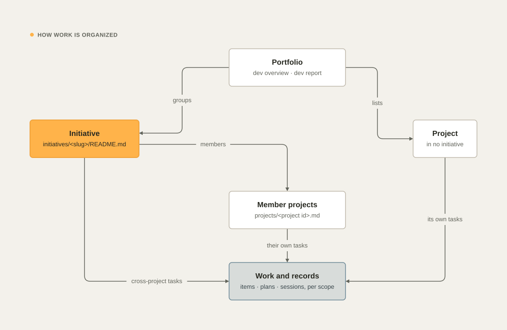
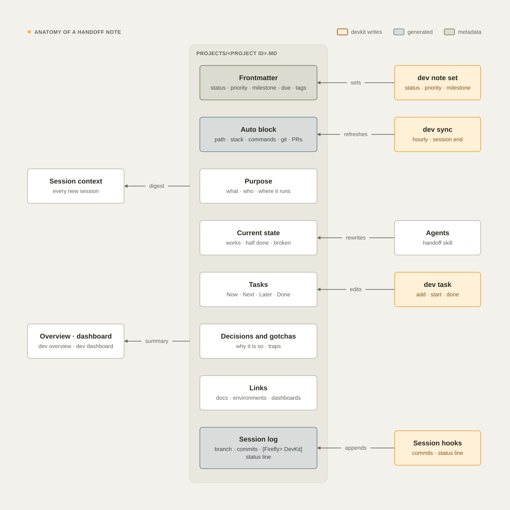
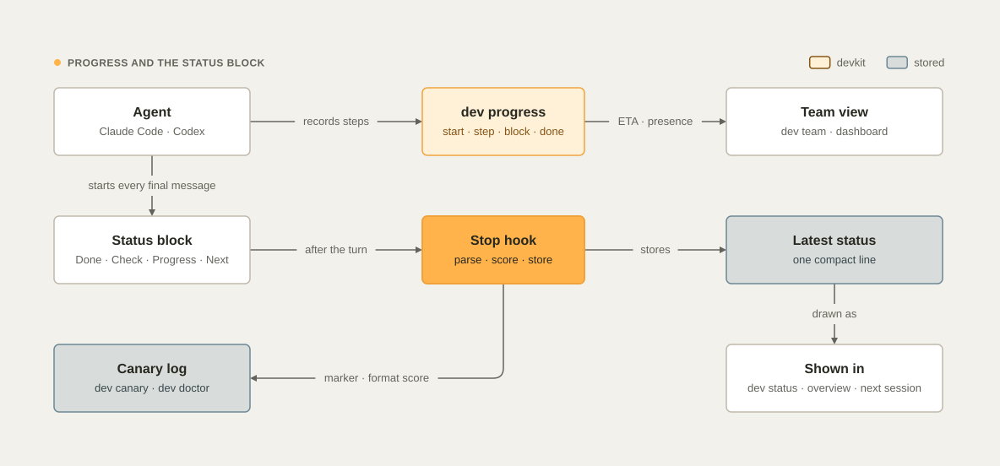

# Concepts

This page explains the ideas behind devkit: where everything lives, how work is organized, how it covers the
lifecycle from plan to operate, what the handoff repository holds, how worktrees come and go, what the guard does,
what the status block proves, and when devkit syncs.

## Workspace layout

Everything lives under the dev root (`~/Development` by default; see [Configuration](configuration.md)).

```text
~/Development/
├── <owner>/<repo>/                    GitHub repositories (the default host), lowercase
├── <host>/<group>/<…>/<repo>/         any other git host: gitlab.com/…, bitbucket.org/…, gitlab.acme.io/…
├── _local/<name>/                     projects with no remote yet
├── .worktrees/<project id>/<branch>/  managed git worktrees
├── .tmp/                              scratch files (purged after 7 days)
└── .handoff/                          your private handoff repository
```

| Rule | Why |
| --- | --- |
| One canonical path per repository | Agents, scripts, and you always know where a project is. No `repo-pr12`, `repo-ci`, or `repo-copy`. |
| Host folders contain a dot (`gitlab.com`) | GitHub user and organization names cannot contain dots, so a host folder never collides with an owner folder. |
| Worktrees live outside the repositories | Searches and test runners in the main checkout never pick up worktree copies. |
| Scratch is separate and expires | Temporary files never end up in a repository or in your home folder. |

devkit enforces the layout with the [guard](#the-guard) and moves misplaced repositories with
[`dev adopt`](commands.md#dev-adopt-path).

### Project ids

A project id is the project's path relative to the dev root, in lowercase.

| Remote | Project id | Path |
| --- | --- | --- |
| `https://github.com/Acme/Widget.git` | `acme/widget` | `~/Development/acme/widget` |
| `git@gitlab.com:group/sub/svc.git` | `gitlab.com/group/sub/svc` | `~/Development/gitlab.com/group/sub/svc` |
| `https://user@bitbucket.org/ws/repo.git` | `bitbucket.org/ws/repo` | `~/Development/bitbucket.org/ws/repo` |
| `https://dev.azure.com/org/project/_git/repo` | `dev.azure.com/org/project/repo` | `~/Development/dev.azure.com/org/project/repo` |
| no remote | `_local/<folder name>` | `~/Development/_local/<name>` |

The same id names the project's handoff note (`.handoff/projects/<id>.md`), its work items (`.handoff/items/<id>/`)
and its worktree folder (`.worktrees/<id>/<branch>`). You can shorten host folders with `host_dirs` (for example
`gitlab.com` → `gitlab`).

## How work is organized

devkit keeps one hierarchy for everyone who shares a handoff repository:
**portfolio → initiatives → projects → tasks, plans, and sessions**.

<picture>
  <source media="(prefers-color-scheme: dark)" srcset="images/diagrams/work-hierarchy-dark.svg">
  
</picture>

| Level | What it is | Where it lives | Main commands |
| --- | --- | --- | --- |
| Portfolio | Every initiative and project | `PROJECTS.md`, `TASKS.md`, `registry.json` | `dev overview`, `dev report`, `dev dashboard` |
| Initiative | Projects that work toward one goal: an integration, a platform, a program. Optional | `initiatives/<slug>/README.md` | `dev initiative`, `dev task -i <slug>` |
| Project | One repository | `projects/<project id>.md` | `dev status`, `dev task`, `dev note set` |
| Work item | One task, feature, bug, or spike, which carries a lock and a changelog | `items/<scope>/<ID>.md` | `dev task add\|start\|done` |
| Plan | A plan, spec, spike, bug-fix plan or decision record, versioned | `plans/<scope>/<date>-<slug>.md` | `dev plan new\|revise\|approve` |
| Session | One line per agent or human session | `sessions/<scope>/YYYY-MM.md` | the hooks, `dev handoff --log` |

A scope is a project id or `initiatives/<slug>`. [Initiatives](initiatives.md) and
[Teams and machines](teams.md) cover the details.

## From plan to operate

devkit covers the whole development lifecycle. Each stage has a command and a skill, and each feeds the next, so
nothing falls between them.

<picture>
  <source media="(prefers-color-scheme: dark)" srcset="images/diagrams/lifecycle-map-dark.svg">
  
</picture>

| Stage | devkit | Skill | Guide |
| --- | --- | --- | --- |
| Plan | `dev plan new --kind plan\|spec\|spike\|bugfix\|adr` | Superpowers (brainstorming, writing-plans), `architecture` | [Templates](templates.md) |
| Task | `dev task add`, `dev task start` | `using-devkit` | [Teams and machines](teams.md) |
| Build | `dev progress`, `dev crew`, `dev test`, `dev stubs`, `dev files`, `dev grep`, `dev diff` | the required skills for the work, `crew`, `testing` | [Skills and plugins](skills-and-plugins.md#required-skills), [The crew](crew.md), [Testing](testing.md) |
| Test gate | `dev ci --run`, `dev sec scan` | `delivery`, `devsecops` | [Git and GitHub › Local CI evidence](git-and-github.md#local-ci-evidence) |
| Review and PR | `/code-review`, `dev pr create` with the PR template | `communicating` | [Git and GitHub › Pull requests](git-and-github.md#pull-requests) |
| Integrate | one `release/<version>` or `integration/<topic>` branch, `dev push` | `delivery` | [Delivery](delivery.md) |
| Release | `dev pr merge`, `dev release`, `dev delivery` | `release-policy` | [Git and GitHub › Releases](git-and-github.md#releases) |
| CI status | `dev ci watch`, `dev ci watch --wait`, `dev watch --wait`, `dev ci status --watch`, `dev ci audit` | `cicd`, `wait-and-wake`, `communicating` | [CI/CD pipelines](ci-cd.md) |
| Deploy | a tag and its pipeline (GitOps) | `delivery` | [Delivery](delivery.md) |
| Handoff | `dev handoff --log`, `dev lesson add` | `handoff`, `learning-loop` | [Concepts › Handoff notes](#handoff-notes), [Lessons](lessons.md) |

### Who does the work, and how long it takes

When a task needs more than one kind of expertise, the main session leads devkit's crew as the tech lead (Morpheus):
25 specialist agents, named by role, each in its own lane, with its own files and time, within the crew's slots (see
[The crew](crew.md)). Every run's plan has steps with
estimates and dependencies; devkit counts only active time and gives the ETA as a range along the critical path, so
parallel lanes shorten it and waiting for you does not (see
[Progress and communication › Time and estimates](progress-and-communication.md#time-and-estimates)).

## The handoff repository

`~/Development/.handoff` is a private git repository (by default `<your-github-login>/handoff`). It is the memory
that you, Claude Code and Codex share across sessions, machines, and developers.

| Path | Content | Written by |
| --- | --- | --- |
| `PROJECTS.md` | Live map: initiatives, then every project with stack, branch, state, worktrees, open PRs, last activity, size, attention items, and the canary rate | `dev sync` |
| `TASKS.md` | Every open task across projects and initiatives (Now, Next, Later), blocked, and overdue items | `dev sync` |
| `ACTIVITY.md` | Sessions and operations of the last 30 days | `dev sync` |
| `registry.json` | The same data, machine-readable (`dev overview --json`, the dashboard) | `dev sync` |
| `projects/<id>.md` | One handoff note per project | agents, `dev note`, `dev sync` |
| `initiatives/<slug>/` | One folder per initiative: `README.md`, plus `source.md`, `MIGRATION.md`, and `docs/` for adopted programs | member projects, `dev initiative` |
| `items/<scope>/<ID>.md` | Work items, one versioned file each | `dev task` only |
| `plans/<scope>/` | Plans and specs, versioned, kept out of the code repositories | `dev plan`, agents |
| `sessions/<scope>/YYYY-MM.md` | Append-only session log | the hooks, `dev handoff --log` |
| `presence/<user>@<host>.json` | What each machine is doing now: live sessions, progress, held locks | `dev sync` on that machine |
| `policies/<scope>.json` | The delivery policy of a project (or the release train of an initiative), versioned with its history | `dev delivery apply` only |
| `lessons/<scope>/L-….md` | Lessons from mistakes, versioned; `lessons/archive/` holds forgotten ones, `lessons/usage/` each machine's usage counts | `dev lesson`, `dev sleep` |
| `audit/<user>@<host>/YYYY-MM.jsonl` | Each machine's audit trail | the `audit` job |
| `log/YYYY-MM.md` | Operations: worktree removals, cleanups, adoptions, imports, restored settings | `dev` |
| `.gitattributes` | Merge rules that keep machines from conflicting | `dev install` |

The guard keeps the generated files, `items/`, `sessions/`, `presence/`, `policies/`, and `lessons/` out of reach of direct edits, and keeps a
project session from writing another project's note or plans (see [Guard rules](guard.md#the-handoff-repository)).

### Handoff notes

```markdown
---
status: active          # active | paused | blocked | done | archived     (dev note set status=…)
priority: normal        # high | normal | low
milestone: v2.4 release
due: 2026-12-01
tags: [payments, api]
---
# acme/widget

<!-- dev:auto:start -->
- **Path:** … · **Remote:** … · **Stack:** … · **Commands:** …
- **Main checkout:** … · **Worktree** … · **Open PRs:** …
<!-- dev:auto:end -->

## Purpose
## Current state
## Tasks
<!-- dev:tasks:start --> generated from the work items <!-- dev:tasks:end -->
## Decisions and gotchas
## Links
```

<picture>
  <source media="(prefers-color-scheme: dark)" srcset="images/diagrams/handoff-note-dark.svg">
  
</picture>

- The **frontmatter** holds status, priority, milestone, due date, tags, and an optional manual `progress`.
  `dev note set` writes it.
- The **auto block** is regenerated by `dev sync` and at session start. Never edit inside it.
- The **Tasks block** is generated from the work items. Change tasks with `dev task`, never in the note.
- The **sections** are kept up to date by the agents with the devkit `handoff` skill, and by you.
- **Session lines** go to `sessions/<project id>/YYYY-MM.md`: one line per session that changed something, with the
  start time, `user@host`, the agent, the branch, the commits made, uncommitted files, and the status. A hidden key
  (`<!-- s:… -->`) makes later refreshes of the same session replace their line. Notes created before 26.11.0 keep
  their old `## Session log` section, which devkit still reads.

At session start the agent receives a digest of the note (Purpose, Current state, Now and Next tasks, Decisions and
gotchas, Links, and the recent sessions, up to about 4,000 characters) together with the git state, its initiatives,
the locks that matter and the latest status, so it continues instead of rediscovering the project.

### Work items in short

Each task, feature, bug, or spike is one file, `items/<scope>/<ID>.md`, with an id like `T-fwk7a2…` that is unique
across machines. Every change bumps its version, adds a changelog line (who, which machine, which agent, when and
why) and makes one commit. `dev task start` takes a lock that other machines see at once, and changes of scope need a
reason. The lock is renewed only while a session works on the item's branch, and `dev pr merge` closes the items of
the branch it merges. The full model is in [Teams and machines](teams.md).

Work items, runs, crew lanes, decisions, CI watches, the pinned install, and branches each move through a few states,
and devkit reports a record that no longer matches what happened. [Work states](work-states.md) explains what moves
each one, where you see it, and how to repair it.

## Worktree lifecycle

**When.** The default is to work in the current checkout on a branch. A worktree is for parallel work on the same
repository: when the user asks, or when two sessions must change the same repository at the same time.

**Where.** `dev wt new <branch>` creates `~/Development/.worktrees/<project id>/<branch, with / replaced by ->`:

- an existing local branch is checked out, an existing remote branch is tracked, and otherwise a new branch starts
  from `origin/<default>` (or `--base`);
- files listed in the repository's `.worktreeinclude` (glob patterns, for example `.env`) are copied when git
  ignores them;
- `node_modules` is cloned copy-on-write from the main checkout when the lockfile is byte-identical (APFS clones use
  almost no disk); Python projects run `uv sync`, which links from uv's cache.

The same `node_modules` clone happens at session start when an agent opens a fresh worktree that has none.

Claude Code's own worktrees (`<repo>/.claude/worktrees/…`) and the Codex app's (`~/.codex/worktrees/…`) are
recognized too. The guard blocks raw `git worktree add` anywhere else.

**Removal.** `dev wt rm <branch|path>` and the automatic cleanup remove a worktree only when nothing can be lost:

- no uncommitted or untracked changes, and no commits that exist on no remote;
- no process is working inside it (agent session, shell, editor, dev server);
- its PR is merged or closed (checked again on GitHub right before removal), or its branch has no commits beyond
  `origin/<default>`, after a grace period of 24 hours idle;
- Codex app worktrees are never removed by devkit (the app keeps the 15 most recent and cleans up itself).

PR state comes from `gh`, so it is available for GitHub only. On GitLab, Bitbucket, and other hosts, a worktree is
cleaned up only when its commits are already in the default branch (merge commits and fast-forwards; squash merges
are not detected). The rules are in [Disk and cleanup](disk-and-cleanup.md).

## The guard

A pre-tool hook runs before every shell command and file write of Claude Code and Codex. It enforces the workspace
rules: layout, managed worktrees, canonical clones, no backup copies, no writes outside the workspace, no destructive
commands, permanent deletes and overwrites through `dev rm`, `dev mv`, and `dev cp`, no plain force pushes, a CI push
budget, no blind CI re-runs, merges and releases through `dev pr merge` and `dev release`, no shared stash, no commit
gated on a pipe, branch names, tags that follow the delivery policy, no AI attribution, no secrets in commits,
isolation in the handoff repository, and no settings that switch devkit off. Each denial explains the
right way, so the agent corrects itself in one step.

The guard is a seatbelt, not a sandbox: it catches an agent's mistakes and the common forms of prompt injection, and
a determined program can still find a form it does not recognize. Most of it fails open, so a bug in the guard does
not block your work. The checks where failing open would let an action through fail closed instead: the
irreversible-action gate, which refuses a command that names an irreversible action when the gate itself fails, and
the lane check, which refuses a crew member's command it cannot check. The full list is in
[Guard rules](guard.md).

## The status block

The global instructions (section 0 of `agents/AGENTS.md`) require the final message of every development turn to
start with the status block: a bold header with the `[Firefly> DevKit]` marker, then short bullets (Done, Check, and
Next always; Progress while a `dev progress` run is active; Crew and You only when they apply).

```markdown
**[Firefly> DevKit]** kit-consulting · `release/26.11.4` · Release 26.11.4
- **Done:** merged PRs 12, 17 and 22 into the release branch and fixed the two conflicts.
- **Check:** ✓ local suite green, 214 tests
- **Progress:** 3 of 5 steps · 1 skipped · now 5. review of the merge · 48m active of ~1h00m · ETA ~10m–20m
- **Next:** the Code reviewer finishes the review, then the tech lead pushes once and opens the release PR.
```

| Part | Rule |
| --- | --- |
| Header | `**[Firefly> DevKit]**` exactly (bold, square brackets, `Firefly>` with the chevron), then the repository name, the branch in backticks and the task's title in a few plain words. `-` for a part that does not apply |
| **Done:** | What the agent did or found, in one sentence |
| **Check:** | A glyph, then the evidence: `✓` verified in this session, `⚠` partly verified or not verified, `✗` failed, `–` nothing to verify (a question or a plan) |
| **Progress:** | Required while a `dev progress` run is active (running or blocked), copied as `dev progress step` or `dev progress note` prints it: `3 of 7 steps · now 4. the API · 24m active of ~40m · ETA ~15m–25m`. A final message without it, or with other step counts than the run's, is sent back once with the line to use (see [Progress and communication › The Progress line](progress-and-communication.md#the-progress-line)) |
| **Crew:** | Only when crew members worked in this turn or are working: each as `<Role> (<Name>)` with what it works on, `▸` working, `✓` done, `✗` failed or lost |
| **You:** | Only when there is something only the developer can do or decide: an open decision, an approval, or an action on their machine or account |
| **Next:** | The next step, and who takes it |

Each bullet is one plain sentence of about 100 characters at most, with no internal ids unless they help the reader
(a PR number helps; a task id does not). If a rule could not be followed or something failed, the block says so.

**Nothing comes before the block.** Not the verdict, a correction, a greeting, or a comment on the last command's
output: those go right below it, and "lead with the point" applies to that text. The final message is everything the
agent writes after its last tool call, so a reply that only says it is waiting for background work starts with the
block too. The update that `dev progress step` prints already is the block.

### Development work only

devkit's process is for development: writing, reviewing, debugging, testing, building, deploying, or releasing
software, operating developer tools, repositories, CI and devkit, and questions about a codebase. A recipe, a
general question, or consulting work done with the Firefly consulting kit (decks, documents, research, proposals)
gets a normal answer, with no status block, no required skills, and no nudges. Developing the consulting kit itself
is development work.

devkit decides per turn, at the end of it, from what the turn did, never from your words: you write in any language.
The Stop hook counts a turn as development work when any of these is true:

- **The agent declared it:** its final message starts with the status block.
- **It ran development commands:** a commit, push, or tag, a test or build run, or a `dev` command.
- **It changed files inside a repository.**
- **It used repository tools** (reading, searching, editing, a shell) in a session that works inside a repository.

A turn that used the Firefly consulting kit counts only when it also ran a strong development command, such as a
commit, a push, or a test run, so a deck built inside a repository stays consulting work.

| Request | Turn | devkit |
| --- | --- | --- |
| "Dame una receta de tortilla de patatas" | a web search, outside a repository | nothing |
| "Hazme un deck para Example Bank" | the consulting kit's skills | nothing |
| "Fix the failing test in the parser" | edits, a test run | the status block, required skills, reminders |
| "continúa" after a development turn | edits, a test run | the same as any development turn |

`DEVKIT_SCOPE=all` turns the scope off, so every turn is checked as before (useful to test the canary).

### What devkit does with it

<picture>
  <source media="(prefers-color-scheme: dark)" srcset="images/diagrams/status-flow-dark.svg">
  
</picture>

- **It is a canary.** The rule lives only in the global instruction files, and it applies to every development turn
  without exception: short answers, questions back to you, status updates, replies while background work runs, and replies in
  any language. The session-start hook deliberately does not repeat it, so the first turn is a clean test: a reply
  without the marker means the global instructions were not loaded or not followed. Only after a session has missed it
  once does every later prompt carry a reminder.
- **It is checked after every development turn.** In sessions that devkit tracks under the dev root, the Stop hook reads the final
  reply (Codex passes it as `last_assistant_message`; for Claude Code devkit reads the session transcript) and records
  whether its first non-empty line starts with the marker. In Claude Code a missing marker also shows you a warning at
  once. With `canary.enforce` on (the default), the hook asks the agent to reply again with the block, and says what
  went wrong: the block is missing, or it is there but some lines come before it, quoting the first one. A reply that
  carries the block after such a reminder is counted apart, as corrected, so the rate measures first replies. Each miss
  is also written to the audit trail.
- **Its format is scored.** devkit checks the bold marker, `<project> · <branch>`, the Done, Check, and Next bullets,
  the check glyph, the bullet length and the absence of task ids, and keeps the share of well-formed blocks.
- **It is stored and shown.** devkit stores the block as one compact line,
  `kit-consulting · release/26.11.4 ❯ Release 26.11.4 ❯ merged PRs … ❯ ✓ local suite green ❯ next → push once…`,
  as the project's latest status. `dev status` draws it as a block: brand pills for `Firefly❯ DevKit`, project and
  branch, and task, then labeled Done, Check, Progress, and Next rows (the check colored by its glyph). `dev overview`
  shows the same line as pills on one line. With `ui.powerline` on, Nerd Font arrows join the pills. The next session
  receives the latest status in its context, and the session line carries it.
- **Older forms still count.** One-line forms and the legacy `DevKit ·` marker from before 26.11.0 are accepted as
  carrying the marker, so sessions that loaded older instructions are not reported as misses, but they are scored as
  not following the format.

Only sessions whose start devkit recorded are tracked, so sessions that were already running when devkit was
installed are not counted. Each result records the surface the session ran on (the terminal, Claude Desktop's Code
tab, the ChatGPT app's Codex, or an IDE). The results are in `dev canary`, on the dashboard, in `dev doctor` (which
fails below 90% over 7 days), in `dev overview`, and in `PROJECTS.md`; the last three break the rate down by surface
and count the replies corrected after a reminder.

## Background sync and scheduled jobs

| Trigger | What runs |
| --- | --- |
| Session start (both agents) | Records the session's starting commit, refreshes the project's generated blocks, restores managed settings in the background, injects the context, and queues a sync that pulls the claims of other machines |
| First prompt of a session that missed session start | Registers the session and injects the same context |
| A commit, push, merge, tag, PR, or release, by an agent or a `dev` command | A background `dev sync --offline` within about 15 seconds; events in that window share one run (see [Teams and machines › Near-real-time sync](teams.md#near-real-time-sync)) |
| Stop, at most every 2 minutes per session | The same sync: session line, renewal of this machine's locks, presence, map, commit, and push |
| Session end | The same sync, then the session record is closed |
| `dev task start`, `release`, `done` | The lock change is committed and pushed at once |
| Other `dev task`, `dev plan`, `dev lesson`, `dev delivery apply`, and `dev handoff --log` changes | One commit each, pushed by a queued background sync |
| The scheduled jobs | `sync` every hour (pull, release expired locks, refresh PR states and sizes, rewrite the map, notes, and dashboard, commit and push, rotate logs), `sleep` at 03:30, `gc` at 04:00, `repair` every 6 hours, `audit` at 05:00, `update-check` at 09:15, `doctor` on Mondays, `lessons` on Fridays (see [Scheduled jobs and the audit trail](jobs-and-audit.md)) |

Syncs take a lock, so they never run at the same time, and commit only when something changed. A push rejected
because another machine pushed first is rebased and tried once more.

<picture>
  <source media="(prefers-color-scheme: dark)" srcset="images/diagrams/session-lifecycle-dark.svg">
  
</picture>

See also [Commands](commands.md), [Agents](agents.md), [Guard rules](guard.md), [Teams and machines](teams.md), and
[Work states](work-states.md).
