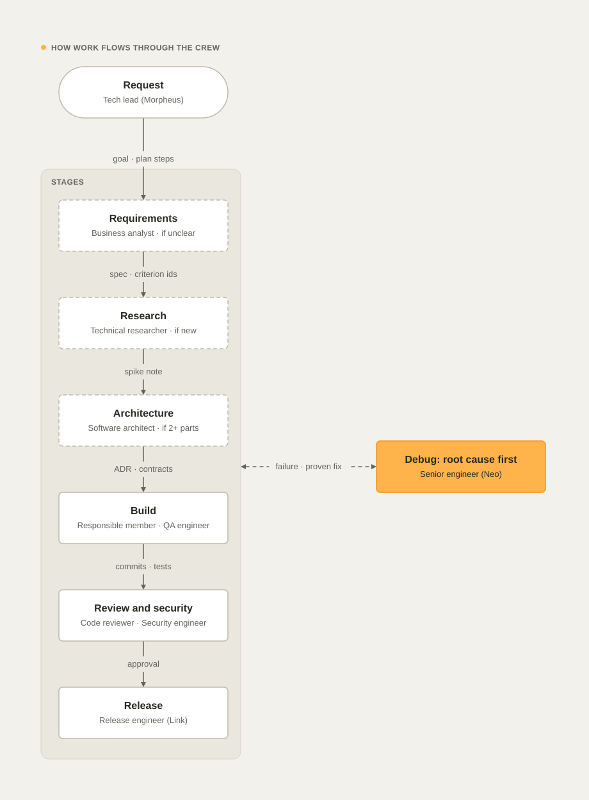

# The crew: devkit's specialist agents

devkit gives Claude Code and Codex a crew of 25 specialist agents, each with a professional role and a name from The
Matrix, plus the tech lead (Morpheus), the role the main session takes when it leads them. Each member has one role,
a short personality, the skills it loads, the files it may change, and what it returns. One file,
`config/crew.json`, defines them for every surface, and devkit coordinates them: plan steps with dependencies, a
RACI per kind of work, each session's crew slots, one progress lane per member with its own time, file scopes with
advice when a member writes outside its own, messages between members, and checks every member's report must pass.

<picture>
  <source media="(prefers-color-scheme: dark)" srcset="images/diagrams/crew-coordination-dark.svg">
  
</picture>

## Who is on the crew

| Role (name) | What they do | Tools | Tier |
| --- | --- | --- | --- |
| Tech lead (Morpheus) | Tech lead and delivery manager (the main session) | all | the session's |
| Product owner (Councillor Hamann) | Priority, scope, and milestones | review | strong |
| Business analyst (The Oracle) | Business and requirements analysis | review | strong |
| Software architect (The Architect) | Design, contracts, and technology choices | build | strong |
| Technical researcher (Roland) | Spikes and evaluations | all | strong |
| Senior engineer (Neo) | Features and fixes across layers | all | standard |
| Frontend engineer (Trinity) | UI, accessibility, and front-end performance | all | standard |
| Backend engineer (Tank) | Services, APIs, and integrations | all | standard |
| Database engineer (Dozer) | Schemas, migrations, and queries | all | standard |
| Mobile engineer (Switch) | iOS, Android, and cross-platform apps | all | standard |
| AI engineer (Rama-Kandra) | LLM features, retrieval, and evaluations | all | strong |
| DevEx engineer (Kid) | Developer experience and tooling | all | standard |
| UX designer (Sati) | UX and visual design | build | strong |
| QA engineer (Mouse) | Tests and quality | all | standard |
| Code reviewer (Seraph) | Independent code review | review | strong |
| Security engineer (The Keymaker) | Threat models, auth, secrets, and supply chain | build | strong |
| Red team tester (Agent Smith) | Adversarial testing | review | strong |
| Compliance reviewer (Persephone) | Compliance, privacy, and licensing | review | strong |
| Release engineer (Link) | CI/CD and releases | all | standard |
| SRE (Niobe) | Infrastructure and site reliability | all | standard |
| Incident commander (Commander Lock) | Production incidents and postmortems | all | strong |
| Performance analyst (The Merovingian) | Performance and observability | review | strong |
| Migration engineer (The Trainman) | Migration and modernization | all | strong |
| Data analyst (Apoc) | Data and analytics | build | standard |
| Technical writer (Ghost) | Documentation, runbooks, and diagrams | build | standard |
| Lookup scout (Sparks) | Fast read-only lookups | read | fast |

**Tools:** `all` reads, writes, and runs commands; `build` is the same without web access; `review` reads and runs
commands but never edits; `read` only reads and searches.

**Tier:** the model and effort a member runs with.

| Tier | Claude Code | Codex |
| --- | --- | --- |
| `strong` | the session's model at high effort | the `deep` profile's model at high effort |
| `standard` | the session's model and effort | the session's model and effort |
| `fast` | Haiku at low effort | the `fast` profile's model and effort |

The Lookup scout (Sparks), the only `fast` member, does mechanical lookups; `scout` is its alias. The names are
identities, not role-play: every member writes plainly and professionally. The tech lead replies to you in your
language, and the crew's briefs, reports, and records stay in American English (see
[Configuration › Reply language](configuration.md#reply-language)).

**Roles first.** devkit writes a member as _Backend engineer (Tank)_ in everything it shows (the crew views, the
progress update, messages, decisions, refusals, briefs) and calls the main session the tech lead. Agents write them
the same way, or by the role alone, in any language. A member's report whose prose names a member without the role
is sent back once (`canary.roles`). A tech lead's final message is never sent back for it: the developer has already
read the reply, so the miss is recorded and reminded at your next development prompt (`canary.remind`). Commands and code keep
the ids (`--to tank`).

`dev crew` prints the roster and who is working now; `dev crew show <name>` shows one member in full.

## How the crew reaches each surface

| Surface | How members are launched | What devkit installs |
| --- | --- | --- |
| Claude Code (terminal) and Claude Desktop's Code tab | Agent tool, `subagent_type: devkit:<id>` | `plugin/agents/<id>.md` in the devkit plugin |
| Codex CLI and the ChatGPT app | `spawn_agent` with `agent_type: <id>` and the step's name as `task_name` | `~/.codex/agents/<id>.toml` |
| Claude Desktop chat and Cowork | not launched there | the `devkit_crew` tool of the devkit extension shows the crew, the live lanes, and open questions |

`dev crew sync` regenerates the Claude agents from `config/crew.json`, and `dev install --only codex` writes the Codex
roles. Edit a member there, never in the generated files.

Codex fires no PreToolUse hook for `spawn_agent`, so devkit records a Codex launch when its agent starts
(SubagentStart). Pass the plan step's name as `task_name`, in lowercase with words joined by underscores, as
`dev crew brief` prints it: the launch then binds to that step, takes a crew slot, and counts toward the depth limit
like a Claude Code launch, and the member gets its required skills, known pitfalls, and report format as context.
Codex has no hook before its agent starts, so a launch over the crew's limits is marked when it starts: its step
comes back to you with a notice, and the member is told to stop and report. Two spawns of
one member at once, before Codex records which agent each started, take no step, and you are told. Launch in the
order `dev crew next` shows to avoid that (see [Agents › Hooks](agents.md#hooks)).

A genuine child tool hook can recover a missed Codex start only when the parent spawn call and result match the
child's metadata, task, and role. Incomplete or conflicting proof leaves it read-only without a step or scope until
a later valid hook retries; see [Codex identity failures](agents.md#codex-identity-failures). The native `task_name`
selects the step. Existing lanes recheck the current run, role, and recorded owner; reassignment revokes old write
access before the replacement starts, even when the old lane had no restricted scope. A blocked reviewer must
record its own evidence after recovery; the parent cannot supply that approval in its place.

## Leading the crew

The main session leads when work needs more than one kind of expertise. The `crew` skill is the full manual; the
short version:

1. **Plan with dependencies,** and declare each step's kind of work in brackets:

   ```bash
   dev progress start "Invoice export" --plan "requirements=20m [requirements]; \
     design=30m after requirements [architecture]; api=1h after design [backend]; \
     ui=1h after design [frontend]; tests=30m after api, ui [testing]; review=20m after tests [review]"
   ```

2. **Assign the steps that go to a member,** with the files it owns:

   ```bash
   dev progress assign api --to Tank --scope "services/invoices/**,tests/invoices/**" --activity backend
   dev progress assign ui --to Trinity --scope "web/src/invoices/**" --activity frontend
   ```

   Write scopes relative to the repository: they match the same files in every checkout of it, the main checkout
   and each worktree. `assign` and `dev crew delegate --scope` rewrite an absolute or `~` path inside one checkout to
   that form and tell you. They refuse a path that spans more than one checkout or names a worktree that is not
   there, a deleted one included; give the files relative to the repository instead.

   A scope that `assign` gets as paths in one checkout (`<worktree>/lib/**`) counts in that checkout only: the
   overlap check of `assign`, the edit check, the edit advice, `dev crew owner`, and `dev commit` in a lane hold it
   to that checkout's files. The notice `assign` posts names that checkout, and `dev crew owner` and `dev crew next`
   show it after the scope (`scope lib/** in ~/Development/.worktrees/…`).
   Members in two worktrees can then own the same files without a clash; bringing their changes together is merge
   work. Both scopes need their worktree's paths: a scope relative to the repository counts in every checkout, so it
   still clashes. To bind a working member's scope, assign its step again to the same member with the paths of its
   worktree (`dev progress assign api --to Tank --scope "<worktree>/services/invoices/**"`); the step stays in its
   lane. When `assign` refuses an overlap, it says where each scope counts and gives these commands.

3. **Brief and launch** them, all parallel members in one message:

   ```bash
   dev crew brief Tank "Add the CSV export endpoint" --scope "services/invoices/**" --step api --activity backend
   ```

   The brief has the member's identity, the task, the scope, the skills to load, the known pitfalls of its kind of
   work and files, what to return and how to report, and it prints the exact launch line for Claude Code and for
   Codex. The launch names the step, which is how the step binds to the member's lane.

4. **Follow and answer.** `dev crew graph` draws the project's live sessions, each as one graph: the steps with
   their state, owner, and kind of work, each lane once under the step it works now (working, stale, or ended, as
   `dev crew owner` reads it), decisions waiting for the developer, approvals owed, and open messages. Outside a
   project, or with `--global`, it draws every live session on this Mac. Answer
   questions as they come (`dev crew answer M2 "…"`), and keep the developer informed with `dev progress step`, whose
   update shows every lane. Before ending a turn while members work, arm `dev watch --wait`: it wakes the idle tech
   lead for their questions, decisions for the developer, steps that become ready, members that stop or are lost,
   and CI results (see
   [Progress and communication › Waiting and waking](progress-and-communication.md#waiting-and-waking)).

5. **Check and integrate** each member's work, then run the full suite once (`dev ci --run`).

### Parallel or in sequence

| Situation | Decision |
| --- | --- |
| Under about ten minutes of work, or you already hold the context | do it yourself |
| The next step needs this step's output | in sequence |
| Two parts change the same files or shared state | in sequence, or one member does both |
| Independent parts with fixed contracts and separate files | in parallel, one member per part |
| Reviews of the same change (the Code reviewer, the Security engineer, the Red team tester) | in parallel |
| The interfaces between the parts are not settled | the Software architect first, then in parallel |
| Hours of separate work | parallel sessions in worktrees (`dev wt new`) |

A member starts cold and uses a full context of its own, so parallel work costs more tokens: it pays when it saves
real time on independent work, and it is waste on small or coupled tasks. Follow-ups go to the same member (Claude
`SendMessage`, Codex `send_input`), which keeps its context. Assign the follow-up's step to that member first
(`dev progress assign <step> --to <member>`): its lane takes the step with its scope as soon as it runs no other
step, so the member's `dev progress step` can close it. A step nobody assigned stays the tech lead's.

## Kinds of work and the RACI

Every piece of work has a kind: one of the 35 ids in `config/crew.json`, such as `backend`, `ux`, `debug`, or `docs`.
For each kind, the crew's RACI names who does it (Responsible), who approves it (Accountable), who is consulted before
or during it, and who is informed after it.

```bash
dev crew raci              # the whole matrix
dev crew raci backend      # one kind of work
dev crew raci Tank         # what one member does, approves, and is consulted or informed on
```

devkit finds a step's kind of work from anchors that mean the same in any language, in this order:

1. **Declared:** `--activity <id>` on `dev progress assign` or `dev crew brief`, or `[id]` after a step in a plan
   (`api=1h after design [backend]`), on `dev progress start --plan` and `dev progress add`. An unknown id is refused.
2. **The member's role:** the Responsible kind of work of the member the step is assigned to.
3. **The files:** the files in the step's scope, such as `*.tsx` for frontend work, migrations for database work, and
   workflow files for CI/CD.

Only when none of these answers does devkit fall back to the English words of the step's name, and words never refuse
a step: only a declared kind of work does. Declare the kind of work, and the language of the step's name does not
matter.

The kind of work decides three things:

- **Who may take the step.** `dev progress assign` refuses a member the RACI does not make Responsible, unless
  `--why` gives the reason, which is recorded (`raci.override` in the audit trail).
- **Who approves it.** `dev progress done` refuses to end the run until each Accountable member has approved the work
  they own; `--why` ends it without that approval and records the reason.
- **What the brief carries.** The skills, knowledge, and known pitfalls of that kind of work.

**Approvers.** An approval is an explicit verdict given after the work: the Check ✓ of a review step that follows it,
`dev progress step --approves "<steps>"`, or the developer's answer to a decision asked with `--approves`. A crew
member's verdict, its review step's Check or its `--approves`, counts only at the end of its lane, when the crew gates
pass its report without a finding (see [Every report is checked](#every-report-is-checked)). A report the gates sent
back or only recorded approves nothing, and the work stays owed until a review whose report passes. The tech lead's
`--approves` counts at once. An approver's ✓ with `--approves` on a step that ended unverified also closes it, done with
that verdict as its evidence, as a review step's ✓ closes the unverified work it follows; a ✗ leaves it unverified. The
command's line says why the step is unverified, such as a read-only member's shell write, so the ✓ is given knowingly. A
verdict covers only the work it saw: one given before the step last ended unverified closes and approves nothing, and a
reopen drops the verdicts members still hold on the step and tells them to give it again once the new work ends. A
review covers the work that ended before its lane took it: work reopened, or taken again by a new launch, that ends
after that is neither closed nor approved by the review's ✓, and the tech lead is told to have the new work reviewed.
As soon as that work starts again, from done or from unverified, the review and any other step running on it are
flagged for recheck, so the run does not end before they are checked again. An author's lane that stops with no work recorded on its unverified step since that step ended keeps the time it ended,
so a verdict given in between still counts. Nobody
approves their own kind of work: when the Accountable member did the work, the Code reviewer (Seraph) approves code and
configuration, and the tech lead the rest. In the team's RACI, compliance is approved by the Security engineer and
incidents by the tech lead.

A review never goes to its author: `dev progress assign` refuses a review step for a member whose lane ran a step it
follows, directly or through other work (a review after an integration of the Backend engineer's API is not the Backend
engineer's either; an earlier review on the way counts no author, so its reviewer may review the fix after it), and no
lane of that member takes it from the queue or by naming it, not even a new launch that names a review left unverified:
that review stays unverified, and the tech lead is told to give it to another member. A step keeps the lanes that ran it
when it is reopened: its review still avoids their members, and it is approved as their work, never as the tech lead's.
devkit compares crew members, never lane names: a lane that names no crew member, such as a general-purpose agent whose
description does not start with `<Member>:`, takes no review, and `dev progress assign` gives a review to no label
outside the roster. A review given to a member before it did the work stays its member's in the plan, but that member's
`dev progress step --step "<review>"` is refused, records nothing, and says the review never joins its lane: the tech
lead gives it to another member. devkit also starts no step in a member's call: when a member closes its step, only the
free lanes take what waits for them. The tech lead's next step starts in the tech lead's own call, and only when it is
the tech lead's own work: never a review, which waits for its reviewer, and never a step whose kind of work another
member is Responsible for.

### Root cause, research, and requirements

Three kinds of work follow a devkit skill that sets their procedure, and the skill rules require that skill for them
(see [Skills and plugins › The rules](skills-and-plugins.md#the-rules)):

| Kind of work | Does it · approves it | Required skill | What the skill makes sure of |
| --- | --- | --- | --- |
| `debug`: debugging and root-cause analysis | Senior engineer (Neo) · Code reviewer (Seraph) | `root-cause` | Nothing is fixed before its cause is reproduced and proven by an experiment, and every `fix` or `revert` commit states the cause (`dev commit --cause`) |
| `research`: technical research and spikes | Technical researcher (Roland) · Software architect (The Architect) | `research`, also required for `architecture` work | Every claim about a technology holds for the version the lockfile pins, carries its source and date, and lands in a spike note the next session finds |
| `requirements`: requirements and acceptance criteria | Business analyst (The Oracle) · Product owner (Councillor Hamann) | `functional-analysis` | Business rules and acceptance criteria can be tested, each criterion has an id, and the test that proves it carries that id |

`debug` work consults the QA engineer (Mouse) and the Performance analyst (The Merovingian) and informs the tech
lead; `dev crew raci debug` shows it. The `root-cause` procedure is not only the Senior engineer's: every member whose
work fails follows it first. When the same command fails twice with the same error in a session, devkit tells the
agent to stop changing code and find the root cause, and lists the matching lessons and known devkit bugs.

## How work flows

Every request moves through the same stages, and the tech lead plans a step only for the stages that apply. Each
stage hands an artifact to the next one, and the next member's brief carries its path. The `crew` skill has the same
table for the tech lead to route by.

<picture>
  <source media="(prefers-color-scheme: dark)" srcset="images/diagrams/crew-flow-dark.svg">
  
</picture>

| Stage | Who | When | Hands over | Where it lives |
| --- | --- | --- | --- | --- |
| Request | Tech lead (Morpheus) | Always | The goal, and plan steps with their kinds of work | The run (`dev progress`) |
| Requirements | Business analyst (The Oracle), with `functional-analysis` | A feature, or an unclear request | A spec with numbered rules and acceptance criteria with ids | `dev plan new --kind spec`, in the handoff plans folder |
| Research | Technical researcher (Roland), with `research` | A technology choice, or behavior nobody verified at the pinned version | A spike note with the version, the date, the sources, and a recommendation | `dev plan new --kind spike` |
| Architecture | Software architect (The Architect) | Two or more components change, or a contract does | An ADR and the contracts | `docs/adr/` when the repository keeps one, otherwise `dev plan new --kind adr` |
| Build | The Responsible member of the step's kind of work, and the QA engineer (Mouse) for the test plan | Every change | Commits, with tests that carry the criterion ids | The branch |
| Debug | Senior engineer (Neo), with `root-cause` | Whenever something fails, at any stage | The proven cause, the fix, and its regression test | The commit's `Root cause:` paragraph, and a lesson when the mistake can repeat |
| Review and security | Code reviewer (Seraph); Security engineer (The Keymaker) for auth, data, money, files, or infrastructure | Before the pull request is ready | Findings, and the approval (a review step's Check ✓) | The review step's report |
| Release | Release engineer (Link) | The local suite is green | The pull request, the tag, and the release notes | The pull request and `CHANGELOG.md` |

A request that changes one file in a known way skips straight to build. A feature built on a new library goes through
every stage. A failure at any stage goes to debug first: the member who hit it follows the `root-cause` skill, and
after two failed attempts it asks the tech lead, who sends the problem to the Senior engineer.

## How devkit coordinates them

### Lanes and time

Every member gets its own progress lane: the SubagentStart hook opens it, and SubagentStop closes it. Its time is its
own active time, and a step assigned to it is done when it finishes with evidence. The plan's estimate becomes a
critical path: lanes run in parallel and dependencies wait, so the ETA counts the longest chain, not the sum (see
[Progress and communication](progress-and-communication.md#time-and-estimates)).

One launch makes one lane. Each launch is recorded under the ID of the tool call that made it, and its lane binds to
that launch alone, so two members launched together never swap lanes:

- **The step it names.** A bound lane takes the ready step its launch's description names, never just the member's
  first step. `dev progress assign` gives a step to the member's working lane at once when that lane's launch names
  the step or the lane runs no other step. Before a Claude Code launch starts, the pre-tool hook checks its
  description the same way: when it names none of the member's steps and one waits for its launch, the hook puts that
  step's name in the description and tells the tech lead; when two or more wait or it names two or more equally,
  the tech lead gets the exact description that takes each, and a launch that still names two equally takes the
  oldest step waiting for the member. A follow-up launch that names one of the member's steps that is already done,
  and none of the steps waiting for it, is left unchanged and takes no step. Codex launches pick their step by `task_name` and are
  not changed; a `task_name` that names a done step takes none.
- **The steps given to it.** A pending step keeps its assignment on the step itself, so a lane that ends, stops, or
  resumes never drops it. `dev progress assign` with a launch description (`--to "<launch description>"`) binds the
  step to that lane; with a role (`--to Tank`), any lane of the member may take it. A lane that runs no step takes,
  in order: the step its launch names, an answered blocked step, the steps bound to that lane, then the steps given
  to its member, each oldest first and once its dependencies are done. The step's scope becomes the lane's, and the
  member is told (`“<step>” is your step now`) at its next hook or in its `dev watch --wait`. A step that joined a
  lane only from its member's queue, and that the lane recorded nothing on, never blocks a step of the brief: when
  the member closes another step its launch names (`dev progress step "…" --step "<name>" --check "…"`), the
  joined step yields, first for the member's next lane and never again for this one. A step its launch does not
  name waits its turn: closing it is refused, with nothing recorded, until the joined step closes, and the refusal
  says the launch does not name it. A new launch takes a
  step bound to an older lane once that lane has ended. When the member works in two or more lanes, the first lane
  that frees takes a step given to the member, and the tech lead's notice gives the
  `dev progress assign "<step>" --to "<launch description>"` line that gives it to one lane instead. When the tech
  lead gives a waiting step to another member, each lane it was bound to gets a notice that names the step and its
  new owner. Reopening a step while its member works gives it back to that member the same way.
- **The steps its evidence is about.** A member's `dev progress step "…" --check "…"` without `--step` closes its
  lane's only running step. With two or more running, it is refused and records nothing
  (`say which with --step`); with none, it records the evidence in the lane and prints ⚠ (`it closes no step`).
  With `--step "<name>"`, it closes that step of its lane. Either way the step ends at once, by the rules of the member's end (done only with a Check
  that starts with ✓, such as `--check "✓ 12 tests pass"`; unverified with ⚠, ✗, –, or words alone), and the next
  steps start while the member works on. The command's line shows ✓ only when a step's state changed: it says which
  step closed, names a step that joined the lane (`“<step>” is your step now`), or says why nothing changed, and a
  step that closed unverified gets a ⚠ line with how to mark its Check.
  A review step is the exception: it stays running and ends with the member's report, done only when the crew gates
  pass it, so a reviewer's lane may hold more than one review step at once: a review assigned to a reviewer who holds only
  reviews joins its lane at once, one launch that names more than one review binds them all, and the report ends every
  review the lane holds. On Claude Code, the member's close is refused, with nothing recorded, while a background
  command it started has not ended: the refusal names the commands, so the member runs it again once they end (their
  task notification) or stops the ones that are not the step's work with TaskStop. A `--step` the lane cannot close
  exits 2, records nothing, and says what to do: for a step that is not its own, ask the tech lead to assign it; for
  a step that waits for the lane, close the step ahead of it or wait for its dependencies; for its own step, add
  `--check`.
  `dev progress note "…" --step "<name>" --check "…"` keeps partial evidence on the step (its last five) and leaves
  it open: use it for a long or paused step. When a lane ends, it closes the step its launch names, a step it named with
  `--step`, and a step its report names. Any other step it held goes back to pending, still its member's, for the
  member's next lane, with the reason in the step's history. A step delegated into a working lane closes only on that
  lane's own evidence.
- **A blocked step frees its lane.** While a step waits for a decision (one asked in guided mode, or one that
  approves steps), it keeps its member but holds neither the lane nor its files: the member takes its next step, with
  that step's files. When the decision is answered, the blocked step runs again in that lane, or goes first in the
  lane's queue while the lane runs another step, or goes to the member's next lane if that lane ended. The tech
  lead's `dev progress begin` on a member's blocked step returns it the same way, so a lane never runs it beside
  another step.
- **A launch that failed** (an unknown agent type, an interrupt) starts no agent, so its record goes at once: it
  never labels another agent or holds a slot.
- **A resumed agent** keeps its own lane and takes no other member's step or label. When it runs no step, it takes
  its next step in the same order as any free lane, a step given to its member by role included, unless a new
  launch of its member is on its way: that launch takes the member's steps. It writes the files of the step it takes.
  It takes a crew slot like a launch: while none is free, it may read but not write, and the tech lead is told once
  (`crew.queued`); it takes its slot at its first tool call after one frees.
- **Files follow the running steps.** A lane's write scope is the union of the scopes of the steps it runs. A done,
  skipped, blocked, or unverified step gives its lane no files, so when a step and its files go to another lane, the
  first lane keeps none of them, and two lanes never write the same files. A lane that runs no step holds no file: an
  edit it makes gets advice that its lane runs no step, with the `dev crew ask` line to ask the tech lead for one, and
  `dev commit` refuses its files the same way.
- **A launch whose record was lost** gets a restricted lane: read-only, no step, no scope, no slot, recorded as
  `crew.unbound`, until the tech lead assigns it a step.
- **A stopped or silent member.** TaskStop fires no SubagentStop, so the PostToolUse hook ends the lane of an agent
  TaskStop stopped; devkit does the same when a member's transcript ends with its interruption. The lane ends
  `stopped`, and its running steps go back to pending, still its member's, for the member's next lane. A lane that
  stops reporting is `lost`, and its steps go back to pending the same way.
- **A report that meets a busy hook.** When SubagentStop finds the run locked by another hook, it saves the stop and
  applies it at the next hook, so no report is dropped (`crew.stop-deferred` in the audit trail).

[Work states](work-states.md#crew-lanes) explains every state of a lane and what moves it.

### File scopes

A step's `--scope` is a list of globs, relative to the repository. The edit check, `dev commit` in a lane, the MCP
scope check, `dev crew owner`, and the overlap check of `assign` all match it the same way, folder by folder:

| Glob | Holds |
| --- | --- |
| `*`, `?`, `[…]` | Characters inside one folder name or filename, never across `/`: `src/pkg/*.py` holds `src/pkg/a.py`, not `src/pkg/studio/host.py` |
| `**` | Any number of folders: `src/**` holds everything under `src/` |
| A folder, or a glob that matches one | Everything under that folder |
| A name with no wildcard, such as `docs/crew.md` | That file only, when the checkout has a file there or, with nothing there yet, when the name has a suffix; otherwise a folder, and everything under it |
| `*.md` | Markdown files at the repository's root only; write `**/*.md` for every Markdown file |

- A relative glob never holds a path outside its repository, such as the handoff plans or the tech lead's
  scratchpad, so `**` alone holds the repository and nothing else. It holds a path only when its real path, links
  resolved, is inside the repository too: `shared/**` holds nothing behind a tracked link `shared` that leads out of
  the repository.
- The edit check (the Write and Edit tools) also judges the file a write lands on: with links resolved, that file
  must be in the scope too: `docs/**` does not let a member edit `docs/core.py` when it links to `lib/core.py`.
  A new file is judged by its nearest existing folder, and the advice names where the write would land.
- A scope that names a whole checkout (`<worktree>/**`) becomes that checkout's top-level entries.
- Two scopes overlap only when one path matches both, compared without case, so two members can split one folder:
  `src/pkg/*.py` for one and `src/pkg/studio/host.py` for the other. A filename overlaps only a glob that can match
  it: `docs/crew.md` and `docs/**/bug*.md` do not overlap, while `docs/` and `docs/crew.md` do. Scopes given in two
  different checkouts never overlap; a scope relative to the repository overlaps a matching one in any checkout.

### Slots

Each session's crew has a number of slots, and a launch that does not fit gets advice with who is working:

- **Per session.** Slots are counted per session: each Claude Code or Codex session has its own `max_parallel`
  slots and its own reserve, and counts only its own crew. Two sessions on this Mac can each run four members. How
  many sessions run at once, and so how much of your quota they spend, is your choice. Only the usage lowering below
  applies to every session, because it reads your account's usage.
- **The limit.** `progress.max_parallel` (4 by default), which a team's `policy/progress.json` can cap. Your
  account's recorded usage lowers it in every session: `progress.quota_steps` keeps a share of the slots from 50, 70,
  and 85 % usage, the 5-hour and the weekly windows both count and the lower limit wins, and from
  `progress.quota_percent` (90 %) one member works at a time in each session until the window resets.
- **The cost of a launch.** A builder costs one slot, a review-only or read-only member half a slot, and the
  Lookup scout (Sparks) nothing (`progress.slot_weights`). Members' helpers count, and so does a member that works
  again after its lane ended: over the limit, it reads only until a slot frees.
- **The reserve.** `progress.reserve` (1) keeps a slot for what you ask while the crew works: plan steps queued in an
  earlier turn do not take it, and a launch for your request in the current turn does (`crew.reserve`). A message
  you type while the tech lead works counts as your latest request too. Claude Code's prompt hook for it carries
  the running turn's id, not the message's, so devkit reads it from the transcript at the next tool call; the
  message moves the request clock.
- **The order.** `dev crew next` lists the ready steps in the order to launch them: the longest critical path first,
  then your latest request, then the oldest. It records that order, and a launch out of it needs
  `dev crew next --first "<step>" --why "…"`.

`dev crew`, `dev crew next`, and the status block's Crew line show the slots in use and why the limit is lower
("2 of 3 slots in use (lowered from 6: weekly usage at 89 %)"), and each change of the limit is audited
(`crew.limit`). A member stopped with TaskStop frees its slot at once, and its step waits for a new launch. You change
these keys through `dev config set`. The keys are in
[Configuration](configuration.md#work-progress-and-display).

### Who is calling

Claude Code and Codex pass `agent_id` to every hook fired inside a subagent, and devkit uses it in two ways.

**A member's commands go to its lane.** devkit sends a member's `dev progress` and `dev crew` commands to that member's
lane, so a subagent can never advance the main plan by mistake. From a lane, `dev progress start`, `step`, `note`, and
`add` change the member's own lane. How a member may combine them with other commands depends on the agent:

- **Claude Code.** A member's command that holds lane calls anywhere the shell runs them (two steps in one list, a
  loop, a pipeline, `bash -c`, a background job, a prefix such as `NO_COLOR=1`) runs with
  `export DEVKIT_FROM_AGENT=<agent id>;` in front, so every `dev` call it starts acts as the member. Claude Code's
  own permission check still runs on the new command. A command that drops that variable (`unset`, `env -i`,
  `env -u`, an empty assignment), a lane call inside a program that gives the processes it starts an environment of
  its own, and a lane call whose double-quoted message runs a substitution are not stamped.
- **Codex.** Only the router places a lane call: the member runs it as the whole command, or joins it to `cd` and
  reads with `&&`, `||`, `;`, or a newline and pipes it into a read-only filter (`| tail -5`), with no `$(…)`,
  subshell, loop, or redirect into a file.

A lane call the router cannot place still acts as the member when its call carries the call token (below); without
the token, a command that changes state is refused. Either way the hook adds advice to run the call alone, as a
command of its own.

Quoted text, such as a plan with `;` between its steps, a commit message that mentions a command, or a message passed
from a quoted heredoc, is fine on both. Read-only crew commands run
anywhere, alone or in a compound command: `dev crew` with no subcommand, `graph`, `show`, `rules`, `history`, `next`,
`raci` without `--set`, `sync --check`, and any `--help`. Commands that change the team's crew or brief a member
(`dev crew set`, `raci --set`, `brief`) and `dev crew sync` are the tech lead's; a member that needs one asks the tech
lead.

**Each call carries a token that names its caller.** The PreToolUse hook records every shell call with the agent
that made it, from the hook's own input (the call ledger, in devkit's state, closed when the call ends), and puts
`DEVKIT_CALL=<call id>.<nonce>` in front of the call. Before anything else runs, the call's prefix writes its shell's
process id to a pin file (for a single plain `dev` call without that prefix, the `dev` process writes its own). The
token then names its caller only for a `dev` command that runs in that process or below it, and only while the call
is open, so another process cannot use the token even with a copy. If another process wrote the pin first, the prefix
moves that file aside, and the call names nobody. Project code that devkit runs for you (the steps of `dev ci --run`,
the tests of `dev test`, and git hooks that `dev commit` or `dev push` starts) runs without the token, so a `dev`
command in it changes no devkit state. A `dev` command reads its caller from the token once, when
it starts: a main-session call names the tech lead, and a member's call names that member, whatever other calls are
open or waiting at the same time. These work for the tech lead and for members alike:

- the tech lead's `dev progress begin` or `dev progress assign` while a member waits in `dev watch --wait` or runs a
  long call;
- one `dev` command inside another:
  `dev crew ack M3 --sha256 "$(dev crew read M3 --json | jq -r .digest)" --generation 1`;
- a script run by path from the call's own shell.

devkit keeps only a hash of the token, and removes the token's value from every command text it records. Each step
change a token-verified call makes names, in `dev progress history`, how devkit knew the caller (`how`, such as
`token`) and the call's id (`tid`).

| Agent and mode | Which calls carry the token | Its form |
| --- | --- | --- |
| Claude Code in `bypassPermissions` mode, and Codex with approval policy `never`, in sh, bash, or zsh | Every shell call of the main session and of each member | devkit's prefix, ending in `export DEVKIT_CALL=<value>; readonly DEVKIT_CALL;` |
| Claude Code in another permission mode, and other shells, such as fish | Only a call that visibly runs one plain `dev` command | `DEVKIT_CALL=<value> dev …` |
| Codex with an approval policy that asks | Only a plain `dev progress`, `dev crew`, `dev watch`, or `dev session` call, which devkit rewrites anyway | `DEVKIT_CALL=<value> dev …` |

Outside bypass mode on Claude Code, or a never-asks approval policy on Codex, only calls that visibly run `dev` carry
the token, so you get no more permission prompts than before. Never add an allow rule for `export` (such as
`Bash(export:*)`): it would allow any command that starts with an export.

**A state change devkit cannot verify is refused.** It is never taken as the tech lead's. The commands that change
a run, a session's records, the crew's records, work items, or plans need a caller the token verifies; reads and
waits, such as `dev crew read`, `dev crew inbox`, and `dev watch`, do not. devkit refuses the change, says why, and
records it in the audit trail when:

- the call carries no token in a session whose calls carry one (`caller.no-token`): run it again as a command of its
  own, in the foreground;
- the token's call has closed, or ran past its time limit (`caller.stale-token`). A background command's identity
  ends when it starts: run it in the foreground;
- the token belongs to another session or agent, or another shell uses it (`caller.foreign-session`,
  `caller.foreign-agent`, `caller.token-foreign-use`): run it in your own call;
- the token and the lane variable, or the Codex thread, name different callers (`caller.conflict`).

These commands need the tech lead, so a member's call is refused for them:

- `dev progress start` and `start --replace` in the main session, and `assign`, `begin`, `reopen`, `skip`, `confirm`,
  and `done`;
- `dev crew route --plan --apply`, `decide`, `withdraw`, and `mode`.

**On Codex.** Where devkit stamps every call (approval policy `never`, which `dev setup` writes), the token decides
and `CODEX_THREAD_ID` decides no state change. Where Codex asks, a plain `dev progress`, `dev crew`, `dev watch`, or
`dev session` call still carries the token. For any other call, the thread names a member, or the tech lead for
the session's root thread, only while that caller's own open call is exactly that `dev` command, typed alone; a
compound state change is refused with the fix: run it as one plain `dev` command. The root thread names the tech lead only after a member's verified call showed
that Codex gives members thread ids of their own. Any crew member can turn the root-thread mapping off for the rest of
the session with one call that carries the root's thread id: devkit records it as `codex.thread-shared`, and the tech
lead then runs plain `dev` commands. Reads and waits keep working either way. A session whose hook has never stamped a
token, such as one an older devkit started, keeps the earlier rules: there, a Codex tech lead's commands are allowed
and recorded as `caller.unverified`.

Claude Code gives a running conversation a new session id after a compaction. Every hook registration records the
agent's process, so the new id takes that process over from the older record, and the older session's open run
moves to the new id with its working lanes (`session.adopt`). A `dev` command picks, among its process's sessions,
the one whose call ledger holds its open call. When none does, it takes the one session of the same repository from
the last 12 hours that holds the call and that no live process holds: the conversation before its new id
registered.

[The audit trail › Caller identity records](audit.md#caller-identity-records) lists every record these checks write.

### Helpers

A member may launch a helper agent for a narrow lookup or a slice of its own files. devkit holds the helper to its
member's limits:

- the member's tool level and files, never more: a helper of a review-only member cannot edit, and a helper with a
  scope of its own stays inside both scopes;
- no plan step of its own;
- a crew slot at its member's cost, like any member;
- no launch deeper than `progress.max_depth` levels below the main session (2 by default, which allows the tech
  lead's members and then their helpers).

When a member needs another specialist, it asks the tech lead instead of launching one.

### Scratch folders

In the session's scratchpad, each member writes and deletes only in its own folder: `scratchpad/<member id>/`, or
`scratchpad/<member id>-<task>/` for one task (`scratchpad/tank-f3/`). A file tool's write outside it gets advice in
the member's context. A helper uses its member's folder. The shared top level and the other members' folders hold
their work, so a cleanup that stays in its own folder never deletes another member's files.

Each brief names the member's folder in its Scope section and tells the member to keep logs, probes, and temporary
files there. devkit creates the folder when the member's lane opens (SubagentStart), so a read-only member has one too. A
read-only member writes only inside its own folder; a shell write elsewhere is detected and counted for it (see
[Guardrails](#guardrails)). Nothing is created when the session has no scratchpad, or for a helper that names no
crew member.

### Messages

Any member can ask anything, of the tech lead (the default) or of another member:

```bash
dev crew ask "Should the export include voided invoices?"           # to the tech lead
dev crew ask --to Seraph "Please look at the rounding in total()"   # to another member
dev crew answer M3 "No: only issued and paid ones"
dev crew inbox                                                      # paged preview index; read and acknowledge bodies separately
dev watch --wait --for me --timeout 9                               # a member blocked on the answer, in the foreground
```

A member keeps working on what does not need the answer. When it is blocked, it waits for the answer with
`dev watch --wait --for me --timeout 9`, in the foreground and as a command of its own, so the wait takes its own
messages and never the tech lead's; with no answer, it ends with the question under "Needs from the tech lead." The
tech lead's idle session wakes for the question through its own `dev watch --wait` (see
[Progress and communication › Waiting and waking](progress-and-communication.md#waiting-and-waking)).

Messages target an exact native lane or the main session. A role or label works only when it resolves uniquely;
otherwise use the exact recipient from the refusal. `--pending-launch` explicitly binds a message once to the next
unique matching native launch. Replies stay with the original lane; an ended or interrupted lane does not silently
redirect them to another member with the same role. When an answer, a decision's result, or a withdrawal reaches a
lane that already ended, devkit also sends the tech lead a notice that names it, so the lead forwards it or launches
the member again.

If a recipient lane is replaced, the tech lead reads every page of the original message and sends a new message
explicitly to the exact replacement lane. Include the original reference and enough context to continue the work.
The new message is authored by the lead; preserve the original author, receipt, and history. Never impersonate
the old recipient or acknowledge on its behalf. No transfer or reopen command exists for this workflow.

Bodies retain up to 65,536 UTF-8 bytes. Whitespace and line endings are preserved. Use positional text, `--text-file`,
or `--stdin`, exactly one per send. File input is read once and stored by value; never send only a scratch path.
Reuse `--request-id` after uncertain output to retry the same operation without creating a duplicate. Without one,
devkit derives the key from the tool call and what the command sends, so two sends in one shell call are two messages
and the same send repeated in that call is one.

A message whose whole body fits in the preview the hook or the wait delivers (180 characters), and every notice from
devkit or CI watch, counts as read once that preview is delivered: it never comes back. A longer message is a
preview: it comes back about once a minute until its recipient reads and acknowledges it, or until its run ends:
`dev progress done` closes the messages nobody acknowledged and names them, and `dev crew read` still shows each one.
A reference may come from a shell variable in `dev crew read` and `dev crew ack`
(`for r in …; do dev crew read "$r" --json; done`); commands that decide or answer need their words as typed. Use
`dev crew inbox [--all] [--cursor CURSOR] [--json]` for the paged index, then `dev crew read REF --json`.
Follow each `next_cursor` with `--cursor` until `complete` is true. Each serialized page fits 6,144 bytes.
Only then acknowledge the returned digest and generation with `dev crew ack REF --sha256 DIGEST --generation N`.
Acknowledgment confirms receipt; it neither answers a question nor approves work. A successful answer may
acknowledge its question atomically. A broken pipe or host truncation leaves the full body recoverable. Desktop
alerts are not receipts: devkit sends one only for a message to the tech lead while no wait is armed for the main
session, and for a decision that waits for you; messages between crew members never alert.

A message an agent types is refused when it holds a secret: a token, a key, a credential in a URL, or a key name with
a value of a secret's shape. A key name followed by an ordinary word (`id-token: write`, `password: required`) or a
mask (`***`) is not one. Notices from devkit and CI watch quote what they saw, so they are stored with every secret
redacted instead of being refused.

Canonical references are `M<n>@r-<run_uuid>` and `D<n>@r-<run_uuid>`; bare aliases select the current run only.
Old session-qualified references work only when unique. Pages redact the whole body before splitting and visibly
escape unsafe Unicode controls. A redacted page is not a byte-exact copy of the stored body; its digest still
identifies the stored message. Cursors confer no authority and are checked on every read.

Canonical messages and archives live separately under `messaging-v2`. A message an earlier devkit delivered before
messages had receipts counts as delivered for good after the upgrade: it is never delivered again. Oversized bodies,
a full 16 MiB store, malformed state, or ambiguous targets fail explicitly without a shortened success. New runtimes
merge what an old runtime's hooks write to the run file (a message only it has, an answered or delivered flag) into
the canonical store, so a session not restarted yet loses nothing; restart all participating hosts after
installation. `dev gc` removes the message store of a run that ended or is gone after 30 days (the run file keeps
its own copy), and desktop notification attempts after 7 days.

Each message has a kind, and only a question waits:

| Kind | Sent by | Waits |
| --- | --- | --- |
| Question | `dev crew ask` by a member or the tech lead | Until someone answers it |
| Notice | CI watch and devkit: a CI result, a step or launch notice, a decision's result | No answer required; preview delivery is separate from explicit acknowledgment |
| Answer | `dev crew answer <id> "…"` | No further answer required; its author settles the named question, while the recipient acknowledges the answer separately |

`dev status` and the dashboard list the questions to the tech lead that nobody answered, each with its
`dev crew answer` command; a notice or an answer is never listed as open.

On Claude Code, a `SendMessage` from the tech lead to the member who asked answers the questions its text names
(`M3: …`): devkit marks each answered via SendMessage, keeps the text as the answer, and records
`crew.message-answered`. A `SendMessage` that names no question answers none, since it may be a new work item: the
questions stay open, and a devkit notice tells the tech lead which still wait and the `dev crew answer` command that
closes each. Codex's `send_input` answers nothing, so answer there with `dev crew answer` before you resume the
member. A question whose member ended and holds no running or blocked step is **moot**: nobody waits for it, it is
never listed as open and wakes nobody, and `dev watch` shows it as moot with the reason.

Message ids are numbered per run, so two runs of one project can both hold an `M3`. Where a run's message or
decision is shown to anyone but that run's own session and members, its id carries the run's session: `M3@9448c4d0`,
with at least 8 characters of the session id. `dev status` in your session shows your run's ids bare and every other
run's qualified; the dashboard, which belongs to no session, qualifies them all, and so does a continuity brief read
from another session.

```bash
dev crew answer M3@9448c4d0 "Yes, ship it"   # answers M3 of that run; the answer reaches the member who asked there
dev crew answer M3 "Yes, ship it"            # M3 of your own session's run
```

A bare id never answers another message than the one shown: when your run has no `M3`, or its `M3` waits for no
answer, while another run's `M3` waits, `dev crew answer M3` is refused and prints the qualified ids to use. A crew
member answers the messages of its own run only. When a run ends (`dev progress done`) or is replaced
(`dev progress start --replace`), its questions that still wait close with the reason (`crew.message-closed`): they
leave **Needs you**, the dashboard, and the continuity brief, and take no answer. To recover a closed question that
still matters, ask it again with `dev crew ask`.

### Every report is checked

Every member ends its report with its own status block:

```markdown
**[Firefly> DevKit · Backend engineer (Tank)]** billing · `feat/invoice-export` · CSV export endpoint
- **Done:** added GET /invoices/export with streaming CSV and a contract test.
- **Check:** ✓ 18 tests pass, including 3 integration tests against Postgres
- **Next:** the Frontend engineer can call it; the endpoint is documented in the OpenAPI file.
```

When a member someone launched stops, the SubagentStop hook checks, in this order, and sends the member back once for
each check that fails, naming every missing item and the command that fixes it:

1. **The status block.** The report starts with the member's own block, the way the Stop hook checks the main
   session's, and its prose names crew members by role.
2. **The step's record.** The member recorded its work with `dev progress step "…" --check "…"`, or, for a step
   that stays open (a long or paused one), with `dev progress note "…" --step <step> --check "…"`, which keeps the
   evidence on the step without closing it. A note without `--step` and `--check` is not a record.
3. **The crew gates,** read from the member's own transcript:

   | Gate | What the member owes |
   | --- | --- |
   | Proofs | Each named procedure has a matched execution and terminal result for the correct checkout; quoted commands, plans, and pending calls do not count |
   | Skills | The skills of each procedure phase it worked in, and the skills devkit's rules require for the files it changed |
   | Unfinished work | No stubs, placeholders, or untracked TODOs in the files it changed |
   | Tests | No test that cannot fail in the test files it changed |
   | Lessons | Two or more refusals answered with a lesson that was recorded or counted: a `dev lesson add` or `dev lesson recur` whose output shows the lesson's id with its check mark (a refused add or a recur of no lesson does not count, whatever its exit code), or a vote on the bug a refusal's marker names. A refusal the [bug registry](bug-registry.md) served a workaround for in the session, or one an open lesson of the project, its initiatives, or the global scope covers, owes nothing |
   | Background work | Every started command has ended; native completion or a correlated terminal output must establish its result before it can support verification |

The crew gates judge every stop. A member is sent back once per lane life (its launch, or a resume), and its next
stop is judged again: a clean report with Check ✓ passes, so a review it finishes ends done. A stop let through with
findings approves nothing; it is audited as `crew.gate` let through, and its findings reach the tech lead in one
notice. On Codex, the gates read a member's executed command without devkit's own stamps in front of it.

A completed failed check can support an honest failure report, but cannot approve the work. A positive verdict
requires successful execution evidence. `dev test plan`, help output, `dev ci --run --dry-run`, and
`dev ci --run --evidence` inspect or describe checks; they do not prove that checks ran. An explicit project override
must establish that the command checked the same checkout as the reviewed change.

A proof piped into a read-only filter (`dev test | tail -40`) shows it ran, but its receipt holds the filter's exit
code, so a positive report needs the proof run alone. `dev progress step` is the exception: when the member's lane
holds the update that same command recorded (its text and Check), the gate takes that record as the proof, and the
audit trail keeps the warning that the pipe hid the command's exit code.

**When the brief or the project forbids `dev ci --run`.** In a shared checkout, other members' uncommitted work fails
the full suite, and a project can have runner preparation that must not run twice. Only the tech lead can then meet
the proofs gate for the member, with either of these:

- A line in the brief, on a line of its own: `Waived proof: dev ci --run — <why>`. The reason is a sentence of at
  least 15 characters; a colon, a hyphen, or "because" can stand for the dash. Only a brief the main session
  launched counts, never one a member wrote for its helper, and no other proof can be waived.
- A passed `dev ci --run` or `dev ci --run --resume` on exactly the tree the member leaves, such as the tech lead's
  run after integration. devkit writes that record only after every step passed.

The member's own `dev ci --mark-passed` does not meet the proof: it attests a run, and a member does not attest its
own proof. Each waiver or run the gate accepts goes to the audit trail as `crew.gate` with the outcome `ok`, and
`dev audit --action crew.gate` lists them. Without either, the gate sends the member back as before, and its message
names both. A brief cannot change after the launch: when the tech lead forgot the waiver, the member asks with
`dev crew ask`, and the tech lead runs `dev ci --run` on the tree the member leaves.

Members with read-only tools have no shell, so they skip the proofs and lessons gates. The unfinished-work and test
gates count only what the member wrote itself: another member's uncommitted lines in a shared file are not its
findings. Every gate finding goes to the audit trail as `crew.gate`. With `crew.gates.enforce` set to `false`, the
gates only record; with `canary.enforce` set to `false`, the first two checks do not send the member back. A member
let through with background work still running (sent back once already, or with the gates not enforced) is named once
in the tech lead's next context, with the agent id to stop it: `TaskStop <agent id>`. Every other member the tech lead
launched that finishes is named once too, in one line with its agent id, because Claude Code can still list a
finished member as running: `TaskStop <agent id>` ends it. devkit names only an agent its launch records show the
main session launched: a member's own helpers, and agents with no launch record, get no line.

When the member stops for good, its step ends on evidence: done with a Check ✓ in its report, or, when it ends with
no report at all, with its own last `dev progress step --check` that starts with ✓. A report without a readable
status block never borrows an earlier ✓. Otherwise the step ends unverified, for the tech lead to close with evidence
or reopen. A review-only or
read-only member whose shell call wrote files ends unverified too. devkit records every Write, Edit, and MultiEdit
call with its file and its caller. A file that changed during the read-only member's shell call counts as the write
of whoever's own edit call touched it during that call (a working member, its helper, or the tech lead), and
nothing is flagged for it. Any other file counts as the read-only member's own write, even inside a working
member's scope, since a script of the read-only member can write there. It is `possible` when another writer was at
work on the file, and `certain` otherwise. Another writer was at work when an Edit, Write, or MultiEdit of the file
was still in flight (the tech lead's included), or when a writing shell call overlapped the read-only member's; when
a working member's scope holds the file, only that member's shell calls and the tech lead's count. A scope alone
credits nobody, so a write into an idle member's files unverifies the review. An edit tool's temporary file
(`<file>.tmp.<pid>.<hex>`) counts as its file.
An open step whose scope holds it keeps it, and the review that follows that step lists it (`scope.write` in the
audit trail). Keeping the step open while gate findings remain is planned.

**Review steps start on unverified work.** A step whose dependencies ended unverified waits, except a review step
(its kind of work is review, or its member works review-only): it starts, and its Check ✓ ends done the steps it
follows that its member approves, once the crew gates pass the member's report. A review recorded with ✗ (changes
requested) lets the step after it start, such as the fix; the reviewed work stays unapproved. When a lane ends, one
notice tells the tech lead which of its member's reviews and verdicts did not count, because the crew gates did not
pass its report. The run cannot end while a step is unverified or an approval is owed.

`dev canary` and `dev doctor` count the crew's reports apart from the main sessions' (`crew 12/13`), so you can always
see that the kit's rules still hold inside every agent. On Codex, devkit records a launch when its agent starts, and
a Codex member's report gets the same checks at its end (see [Agents › Hooks](agents.md#hooks) and
[Surfaces](surfaces.md#what-was-verified-on-codex) for what was verified live).

### CI failures go to the Release engineer

After the tech lead pushes or opens a pull request, `dev ci watch` follows the run in the background. A failure
reaches the tech lead as a crew message from CI watch, with the failed job, the first error, its class, and one next
action. When the fix is not trivial, the tech lead hands it to the Release engineer (Link)
(`dev crew brief link "Fix the failed CI run: <job>, <class>" --activity cicd`), at once in auto mode. Routing sends
work on workflow files to the Release engineer too. See [CI/CD pipelines › Watch every run](ci-cd.md#watch-every-run).

## Who does what: routing, delegation, and dispatch

Members can launch narrow helpers but not other crew members, so the crew coordinates through the run's plan, and
the tech lead is the one dispatcher.

```bash
dev crew route "add a nullable column for the export date"   # who fits best, with the reasons
dev crew route --plan --apply                                 # a member for every plan step nobody owns
dev crew delegate "add the export column" --to Dozer          # from anyone: a new step for another member
dev crew delegate "review the parser before merge" --to auto  # routed to the best fit
dev crew decline "add the export column" --why "needs a data migration plan first"
dev crew next                                                 # ready to launch, queued, waiting, busy, the slots
dev crew graph                                                # this project's live sessions as graphs
dev crew graph --global                                       # every live session on this Mac
```

- **Routing** suggests a member: `dev crew route` ranks the members by their keywords (`config/crew.json`), their
  role, and the files the task touches (`*.tsx` → the Frontend engineer, migrations → the Database engineer,
  workflow files → the Release engineer, Terraform → the SRE, tests → the QA engineer, docs → the Technical writer).
  With no clear match the work goes to the Senior engineer (Neo), the generalist. The keywords are English, so a
  route is a suggestion; what devkit enforces rests on the [kind of work](#kinds-of-work-and-the-raci).
- **Delegation** adds a step to the plan with who asked for it. If the member is already working, the step joins its
  lane and the member gets a message to name it with `--step` when it reports (it can decline with a reason, and the
  step goes back to the tech lead). Otherwise the tech lead is told to launch it.
- **Dispatch:** when a step's dependencies are done and its member is not working, the tech lead gets "ready to
  launch" with the exact `dev crew brief …` command, once, within the slots and in their order; in auto mode he
  launches all ready members that fit at once. At any time, `dev crew next` shows this list with every waiting step
  and its reason, and the slots.

## Guided or automatic

**Auto is the default:** the tech lead and the crew take the recommended option of each decision, record it, and go
on. **Guided** waits for your decisions: the member that asks stops until the tech lead resumes it with your answer.
In either mode, a decision that approves steps waits for you, because only your answer approves a step. The status
block's **You** line holds only what you alone can do: an action on your Mac or account, such as signing in; in
guided mode, each open decision; and in both modes, each decision that approves a step.
Neither mode holds a command for your approval: agents act with your permissions (see
[Concepts › Agents act with your permissions](concepts.md#agents-act-with-your-permissions)).

The mode decides who answers the crew's decisions, and three commands read it too:

| Command | Auto | Guided |
| --- | --- | --- |
| Ready to launch (the notice and `dev crew next`) | Tells the tech lead to launch every ready member now, in one message | Lists the ready members |
| `dev gc --apply`, run by an agent | Applies without asking for confirmation | Asks for confirmation; an agent has no terminal, so it needs `-y` |
| `dev backup` by an agent, under the `ask` policy | Backs up a private or internal repository | Leaves every branch on this Mac |

In your own terminal, `dev gc --apply` always asks, and `dev backup` asks once under the `ask` policy, in either mode.

An explicit run mode wins: one chosen with `dev crew mode` or `dev progress start --mode`. Otherwise each decision
reads the saved `work.mode`, whose default is `auto`. `dev crew mode` shows the effective mode and origin. `inherit`
clears the run override, so the next decision follows the current saved configuration. A run recorded by 26.11.18
or earlier has a mode and no origin. If you chose that mode with `dev crew mode`, it stays your choice after the
upgrade. Otherwise it was the configuration of its day, so the run follows the current configuration, and a run
recorded as guided works in auto unless you choose guided again with `dev crew mode guided`. Only the tech lead sets
the mode, on your word.

When a run switches to auto (`dev crew mode auto`, or `inherit` when the configuration says `auto`), it takes each
waiting decision that has a recommendation and approves no step. Each one is recorded as an automatic decision with
its recommended option, and the member that asked is unblocked and told the answer. The command lists the decisions
it took and each one that still waits for you, with the reason.

While the configuration is invalid (`dev config validate` fails), devkit reads the mode as guided, so decisions wait
for you. `dev crew mode` prints `Mode unknown`, and the crew status and the dashboard show the mode as `invalid`,
until you fix the file. Every `dev` command's error names the newest valid copy with the `cp` command that restores
it. See [Configuration](configuration.md#automatic-and-guided-operation).

```bash
dev progress start "Invoice export" --plan "…" --mode auto
dev crew mode auto                          # explicit automatic run mode
dev crew mode guided                        # back to asking first
dev crew mode inherit                       # follow the saved configuration again
dev crew decisions                          # every decision: pending, moot, decided, withdrawn, closed
dev crew decisions --pending                # only those that wait for you (moot ones do not)
dev crew decide D3 "B: reject the file"     # your answer (or an override of an automatic one)
dev crew withdraw D4 --why "the export no longer needs a date column"   # the tech lead closes one that no longer applies
```

How a decision travels:

1. A member reaches a decision point and runs
   `dev crew ask --decision "<question>" --options "A: <one choice> | B: <another>" --recommend A`, with
   `--approves "<steps>"` when your answer approves finished work. A decision has a question under 300 characters,
   2 to 4 options, each with its letter, and a recommendation that is one of them. Its options, as devkit offers
   them (with "(Recommended)"), stay under 300 characters together, so the audit keeps them whole: about 60
   characters each for four. devkit refuses any other shape and prints the corrected command.
2. **Auto:** the recommended answer is recorded as automatic at once, and the member continues its assigned work;
   main-only operations still go to the tech lead. An automatic decision never claims you gave the answer, and you
   can replace it later with `dev crew decide`. A decision asked with `--approves` is never automatic: only your
   answer approves a step, so it waits for you as in guided mode, and `dev crew ask` says so.
3. **Guided, and a decision that approves steps in either mode:** the member's step is blocked and frees its lane
   (see [Lanes and time](#lanes-and-time)). When the member has another step, its lane takes that step and its files
   at once, and the member may work on it; otherwise the member stops and reports that it waits for D3, so no tokens
   are spent while it waits. The tech lead sees the decision with his next action and asks you with Claude Code's
   question dialog (see [How the tech lead asks you](#how-the-tech-lead-asks-you)). Your answer is recorded with
   `dev crew decide`, and the tech lead resumes the member with it; the member keeps everything it knew. Recording
   the answer never brings back a member that ended or went stale: the step it blocked goes first to the member's
   next lane, a resume or a new launch, and the answer waits for it there.
4. The run cannot be closed while a decision waits for you. In auto, the tech lead's final report lists the automatic
   decisions, which `dev crew decisions` marks `auto · review`.

A decision belongs to its run, and only an open one needs you:

- **Moot.** When the member that asked has ended and no step is blocked on the decision, nobody waits for the
  answer. The decision stays pending but is moot: it shows on a quiet line under its run, never under **Needs you**,
  and it does not stop `dev progress done`. Your answer to it still counts if you give one.
- **Withdrawn.** `dev crew withdraw <id> --why "…"` closes a pending decision that no longer applies. Only the tech
  lead runs it. It frees the step blocked on the decision, which goes first to the member's next lane when the
  member that asked ended or went stale. It tells the asking member when it still works, or their next launch when
  the step waits for one, and records the reason in the run's history and the audit trail (`crew.withdrawn`). It is
  never your answer.
- **Closed with its run.** When the run ends (`dev progress done`) or is replaced (`dev progress start --replace`),
  each decision still pending in it, moot ones included, closes with the reason (`crew.decision-closed`).
- **Answered in its own session.** A decision of another session's run shows as `D3@9448c4d0`. Answer it in that
  session, where its tech lead records it: `dev crew decide` and `dev crew withdraw` refuse another session's
  qualified id, and take your own run's.

[Work states › Decisions](work-states.md#decisions) draws the whole lifecycle. Decisions recorded before 26.11.19
may carry an irreversible action, a target, or evidence fields; devkit still lists and closes them, and reads those
fields as absent.

### How the tech lead asks you

`dev crew decisions --ask` prints the pending decisions as question dialog calls, ready to send: at most four
questions per call (the rest go in a second call), each opening with `D<n> ·`, with one line on who asks and what it
blocks, and the recommended option first (its label ends in "(Recommended)"). `dev crew decisions --ask D4 D5` asks
only those, and `--json` prints the dialog's input. The tech lead may reword a question and add context, except a
question whose answer approves steps: `--ask` says to send it as it is, so your answer approves only the work it
names.

The tech lead records the answer you give with `dev crew decide <id> "<option or your words>"`. Text you type
yourself (**Other**) is your answer in your own words: it settles the question and picks no option. An automatic
decision and your answer are both only answers to the crew's question; neither replaces an independent review.

When decisions pile up while you are away, your next prompt tells the tech lead once to ask them together, in as
few dialog calls as possible; he is told again only when a new decision joins them. Codex's question dialog does not
reach devkit yet: in Codex, the tech lead shows the decisions in his reply, and you answer there.

## Guardrails

Each guardrail cites the rule of `dev crew rules` that checks it. A rule marked planned is not checked yet. The
guardrails are devkit's own commands and records, and advice in a member's context; none of them stops a tool call
(see [Concepts › Agents act with your permissions](concepts.md#agents-act-with-your-permissions)).

| Guardrail | What happens |
| --- | --- |
| Limited parallel members | a launch that does not fit its session's crew [slots](#slots) gets advice with who is working: `progress.max_parallel` (4 by default) per session, lowered by your account's usage in every session, a slot kept for your own request, review and read-only members at half a slot, and resumed agents and helpers counted (`E-parallel`, `E-resumed`) |
| Separate files for parallel members | `assign` refuses a scope that overlaps the scope of a working member's running steps (`E-separate-files`) |
| A member stays in its scope | an edit outside the files it was assigned gets advice in the member's context (`E-scope`); a review-only or read-only member's shell writes are detected and counted for it, while a builder's shell is not checked against its scope (`E-shell-scope`) |
| The main session respects a member's files | an edit by the main session inside a working member's scope gets advice that names the member (`E-main-scope`) |
| An ended or stale member | holds no file and no slot in any session's run and is not counted as working: `dev progress`, the Crew line, `dev crew next`, the continuity brief, and the dashboard read each lane as `dev crew owner <path>` does, and the scheduled sweep closes its lane with the reason; `dev crew delegate` and `dev progress assign` give it no new step (`E-owner`) |
| Read-only members never edit | the Code reviewer, the Red team tester, the Performance analyst, the Compliance reviewer, the Business analyst, the Product owner, and the Lookup scout (Sparks) have no edit tools, and their helpers have none either; an edit that reaches them anyway gets advice (`E-read-only`) |
| Helpers stay inside their member's limits | a helper gets its member's tools and files, takes a slot, and a launch deeper than `progress.max_depth` gets advice (`E-nested`) |
| Work goes to its Responsible member | `assign` refuses another member unless `--why` is recorded, judged on the declared kind of work, the member's role, or the files (`E-responsible`, `E-any-language`); words never refuse a step (`E-words-never-refuse`) |
| Every kind of work has an approver | the run ends only after each Accountable member approved (`E-approvals`), with an explicit verdict given after the work (`E-verdict`), and nobody approves their own kind of work (`E-no-self-approval`) |
| Steps change only with evidence | closing a step needs `--check`, and a member's step ends done only on its evidence, otherwise unverified (`E-evidence`); a step whose dependencies are open is refused, except a review step after unverified work (`E-deps`); a finished step whose dependency was reopened is rechecked before the run ends: it clears when it finishes again after that dependency, or with `dev progress confirm <step> --why "…"` (`E-recheck`); keeping a step open while gate findings remain is planned (`E-gate-findings`) |
| Mistakes are fixable and visible | `dev progress reopen` or `dev progress skip` with `--why`, and `dev progress add`; every change is in `dev progress history` (`E-fixable`) |
| A member that never reports back | after `progress.stale_agent_hours` (6) its lane is closed as lost and its step goes back to pending, for its member's next lane (`E-lost-lane`) |
| Every report is checked | the status block, the step's record, and the crew gates at SubagentStop (`E-status-block`, `E-step-records`, `E-proofs`, `E-skills`, `E-stubs`, `E-tests-fail`, `E-lessons`, `E-background`) |
| Only the tech lead plans, assigns, and decides | from a lane, `assign`, `begin`, `reopen`, `skip`, `confirm`, `done`, `decide`, `withdraw`, and `mode` are refused, and in the main session they need a call its token verifies: a script run by path from the call's own shell counts, a background command does not (`E-main-only`, `E-caller`) |
| Decisions | guided waits for your decisions; auto records the recommended option and goes on (`E-decisions`) |

## Everything is recorded

Every coordination event lands in two places: the run's history (`dev progress history`), which the status, the
dashboard and the handoff read, and devkit's audit trail (`dev audit`), published daily to the handoff repository:

| Audit action | When |
| --- | --- |
| `plan.done`, `plan.running`, `plan.pending`, `plan.blocked`, `plan.skipped` | every step change, by the tech lead, a member, or devkit |
| `crew.start`, `crew.finish`, `crew.lost`, `crew.stopped` | a member starts, finishes (with its active minutes), stops reporting, or is stopped before its report |
| `crew.stop-deferred` | a member's stop met a busy hook and is applied at the next one |
| `crew.bind`, `crew.resume`, `crew.launch-failed`, `crew.unbound` | a lane binds to its launch, a member resumes, a launch fails, or a lane runs restricted because its launch record was lost |
| `crew.limit`, `crew.reserve` | the effective slot limit changes, or a launch takes the slot kept for your request |
| `crew.claim`, `crew.queued` | a free lane takes a step given to it or to its member, or a resumed member waits for a slot (records written before 26.11.27 can also hold `crew.scope-handed`, a lane that lost its scope to the lane that took its files) |
| `session.adopt` | a session's open run moves to the new id Claude Code gave the conversation |
| `crew.message` | a question or answer between members |
| `crew.decision`, `crew.decided`, `crew.mode` | a decision point, its answer (and by whom), a change of mode |
| `crew.withdrawn`, `crew.decision-closed` | the tech lead withdrew a decision, or its run ended or was replaced, each with the reason |
| `crew.message-closed` | a question that still waited for an answer closed because its run ended or was replaced, with the reason (never its text) |
| `crew.message-answered`, `crew.message-moot` | a question answered by a SendMessage that names it (with the channel), or one nobody waits on any more because its member ended and holds no open step (with the reason) |
| `watch.wake` | a `dev watch --wait` woke its agent: the kinds of events, how many, and the time from the oldest event to the wake |
| `scope.write` | a file a read-only member's shell call changed, counted for whoever's own edit call touched it during that call, otherwise flagged for the read-only member |
| `crew.delegate`, `crew.decline` | work handed to another member, or handed back |
| `raci.override` | a step assigned to a member the RACI does not make Responsible, with the reason |
| `caller.refused`, `caller.unverified` | a tech lead's command refused because its caller is not the main session, or allowed without verification in a Codex session whose hook never stamped a call token |
| `caller.*`, `calls.*`, `codex.thread-shared` | a call token that failed a check, a state change without one, or a Codex thread fact (see [The audit trail › Caller identity records](audit.md#caller-identity-records)) |
| `canary.crew-miss`, `crew.unreported`, `crew.gate` | a member's report without its status block, a member that stopped without `dev progress step`, or a crew gate finding |
| `stop.block`, `canary.crew-roles` | a final message sent back for more work, with the rule, or a member's report that names crew members without their role |
| `canary.remind` | a presentation rule a final message missed (`roles` for names without their role), never a send-back of its own: recorded when your next development prompt reminds it, blocked when it joined a send-back for other work (`dev canary` lists it as added to a send-back) |

```bash
dev audit --action crew        # how the crew coordinated
dev audit --action plan        # every step change
```

## Changing the crew

devkit ships the roster and the RACI in `config/crew.json`. A team changes them in the handoff repository
(`crew/crew.json`), with who and why, and every session uses those changes:

```bash
dev crew set Tank skills "backend; java-springboot" --why "the services are Spring"
dev crew raci compliance --set "R=persephone A=keymaker C=… I=…" --why "nobody approves their own work"
dev crew history                 # the changes the team made, newest first
```

To change what devkit ships for everyone, edit `config/crew.json` in the devkit repository: a member's role, summary,
personality, `use_when`, skills, tools (`all`, `build`, `review`, `read`), or tier (`strong`, `standard`, `fast`).
Then:

```bash
dev crew sync                    # regenerate the Claude Code agents
dev install --only claude,codex  # reinstall the plugin and write the Codex roles
```

`dev crew sync --check` reports generated files that are out of date; `dev doctor` runs it too. Never edit
`plugin/agents/*.md` by hand: the next sync overwrites them.

## Rooms (planned)

Rooms are not available yet. This section describes what is planned, so you know what is coming; no command or
setting for rooms exists today.

Today the crew talks one to one: a member asks the tech lead or one other member with `dev crew ask`, and when three
members need each other's views, the tech lead relays them by hand. A **room** is a short, moderated working session
that puts 2 to 4 crew members on one question that gains from more than one angle: a review panel on one change, a
choice between designs, or a bug with competing explanations.

- **A charter first.** The tech lead opens the room with the question, what it must produce (a decision, a ranked
  list, a verdict, or a root cause), the exit criteria, and a budget of minutes, tokens, and rounds.
- **Independent answers, then challenges.** Each member answers alone, without seeing the others, so the first answer
  does not anchor the rest. Then the members may challenge each other, for at most two rounds.
- **A shared board, with evidence.** Members talk only through short posts. devkit stamps each post with its author
  and chains it to the one before, so no post can be changed or removed. A claim cites its evidence, such as a file
  and line or a command the member ran, or is marked as an opinion.
- **Bounded by devkit.** devkit, not a model, moves the room from phase to phase and closes it when its budget runs
  out, so a room never runs on.
- **One outcome, dissent kept.** The decider closes the room with one outcome, and any disagreement stays in the
  record. The outcome becomes the evidence for a plan step, a revised spec, or a decision put to you.

What a room gives you: two to four independent views on a hard question, disagreement kept instead of smoothed over,
and a cost you can see and cap. What does not change: a post is never your consent or your answer, because
your decisions still come only from your own answers (see [How the tech lead asks you](#how-the-tech-lead-asks-you)).
A room never widens a member's tools or files: members stay read-only unless the room names one writer, and parallel
edits to shared files never go to a room.

Rooms start as a trial, for review panels only. On real changes, a three-member review room is compared with a single
reviewer: the real problems each finds, the false alarms, and the time and tokens spent. After the trial, you decide
whether rooms become a regular route.

## Keeping the rules true

`dev crew rules` lists every rule the crew is given, the devkit check that enforces it, and its state: enforced,
advised (a hook tells the agent and refuses nothing), planned (with the plan step that adds it), or guidance. It
exits with `1` when a rule's check, or the function that gives its advice, is missing. The
consistency checks in devkit's test suite compare the rules, the commands, the hooks, the configuration keys, and
these pages with each other, so they cannot drift apart (see
[Developing devkit › Consistency checks](development.md#consistency-checks)).

See also [Progress and communication](progress-and-communication.md), [Continuity](continuity.md),
[CI/CD pipelines](ci-cd.md), [Concepts › Agents act with your permissions](concepts.md#agents-act-with-your-permissions),
and [Agents](agents.md).
