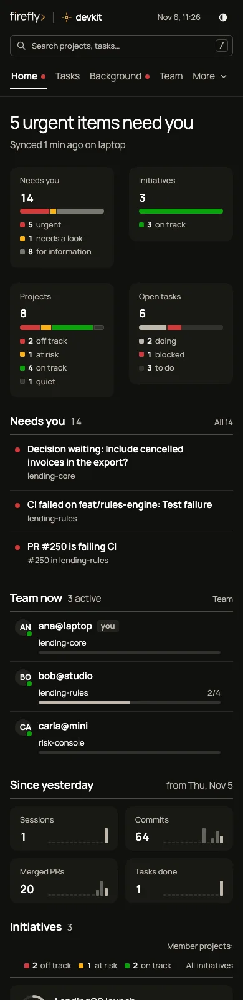
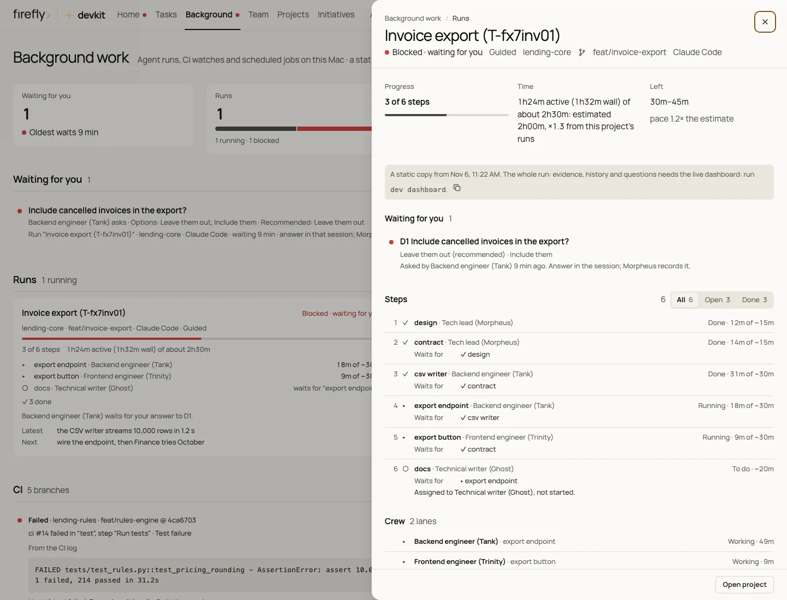
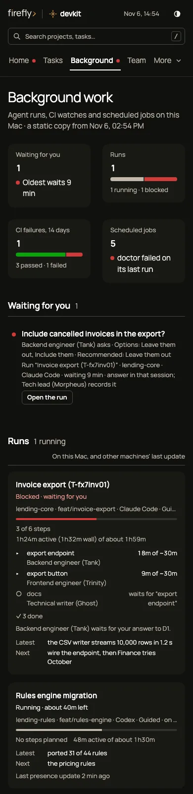
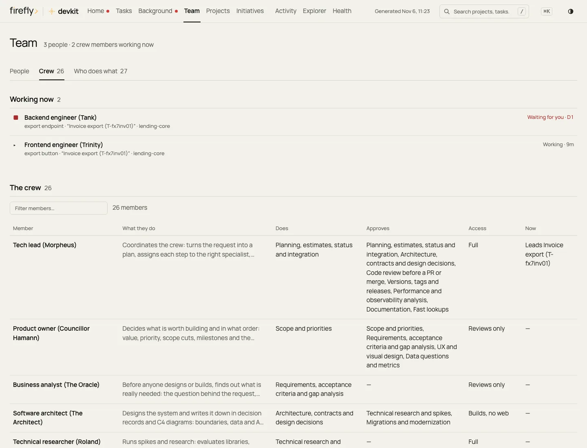
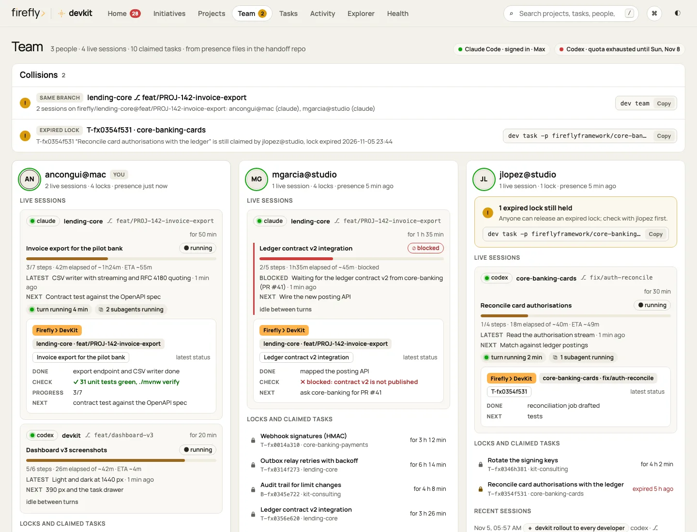
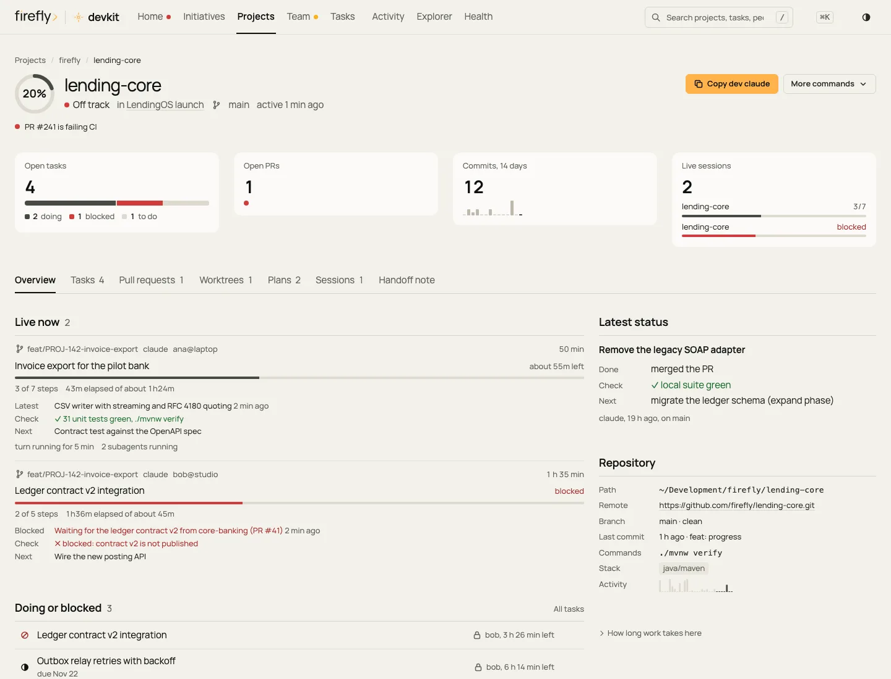
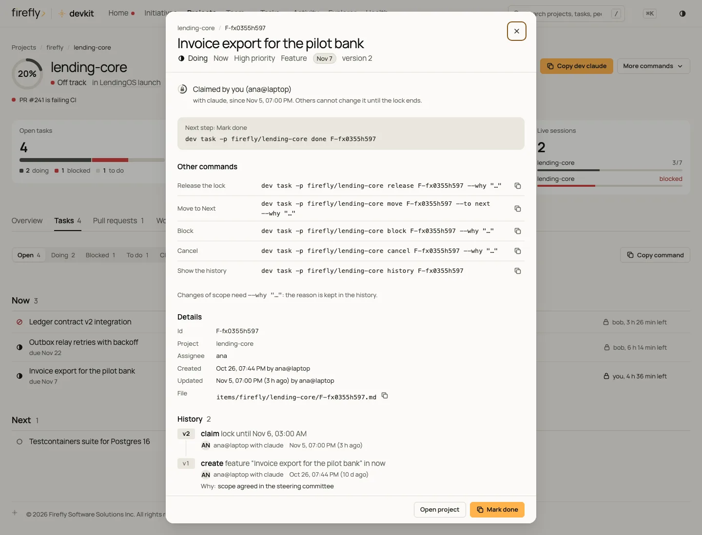

# Dashboard

`dev dashboard` opens devkit's command center: a local, read-only app on your Mac that updates by itself while it is
open. It is visual first: a number or a shape stands in for a sentence, and the detail opens in a drawer on the right.
It opens on **Now**, which answers "does anything need you, and when does the running work land?" in one screen.
**Tasks** holds the work items, **Background** the agent runs, CI results, and scheduled jobs, and **Team** the people
and the crew. From any of them you open an item in a drawer, or drill into an **initiative** or a **project** page and
down to a single **task**. Every item says how to move it forward: a command to copy, or the words to type in the
agent's session.

## Open it

```bash
dev dashboard                    # start the dashboard server (or reuse it) and open it in your browser
dev dashboard --no-open          # print the one-time sign-in link instead of opening the browser
dev dashboard --status           # is a server running? port, pid, version, snapshot, open pages
dev dashboard --stop             # stop the server
dev dashboard --export page.html # write a static, self-contained copy to a file, without a server
dev dashboard --path             # write the static copy devkit keeps and print its path
```

`dev dashboard` starts a small server in the background, or reuses the one that runs already, and opens the page with
a one-time sign-in link. The link works once, within 60 seconds; after that, the browser stays signed in with a
cookie for as long as that server runs. A server from an older devkit version is replaced.

- **Local and read-only.** The server listens on `127.0.0.1` only, on a port macOS picks, and answers `GET` and
  `HEAD` only: nothing on the page can change your files, tasks, or settings. Every command on the page is copied for
  you to run.
- **Live.** The server watches the files behind the page and tells the open pages what changed, within seconds. It
  reads pull requests and checks again every minute, and the agents' sign-in and quota and the settings drift every
  10 minutes, while a page is open.
- **Stops by itself** after 30 minutes with no open page and no request. Change the time with `dashboard.idle_minutes`
  in `~/.config/devkit/config.json`.
- **Static copies** come from `--export` and `--path`, and from every `dev sync`. They hold the same data at the time
  they were written and do not update; open in a browser, they reload every 2 minutes.

The server's log is `~/.local/state/devkit/logs/dashboard.log`.

<picture>
  <source media="(prefers-color-scheme: dark)" srcset="images/dashboard/home-1440-dark.webp">
  
</picture>

## Views

The views are in the order you need them during a day of work, then the reference views. When the window is too
narrow for all of them, the last ones move into a **More** menu, so the navigation never scrolls sideways. A dot after
a view's name says it holds something for you: amber on **Now** when something waits for your answer, red when
something is broken, and a hollow diamond when something needs a look. Its tooltip says what, for example _Now, 2
items need you_.

| View | Keys | The job it does |
| --- | --- | --- |
| **Now** | `g n` · `g o` | _Does anything need you, and when does the running work land?_ One sentence answers it. Below it are the **Needs you** queue in the server's order, the live runs with their landing times, and two closing lines: the branches that exist only on this Mac, and what finished since yesterday (see [Now](#now)). **All N** lists every row (`#/now?all=1`) |
| **Tasks** | `g t` | Every work item across projects and initiatives, as a board (Now · Next · Later · Closed) or grouped by scope. Filter by status, scope, and who claimed it (anyone, or only you). Every card shows who holds the lock and opens the task's drawer |
| **Background** | `g b` | _Is anything running, failing, or waiting for you, and when is it done?_ Agent runs, CI results, and scheduled jobs on this Mac (see [Background work](#background-work)) |
| **Team** | `g m` | _Who is doing what right now?_ The tabs **People**, **Crew** (`g c`), and **Who does what** (see [Team and the crew](#team-and-the-crew)) |
| **Projects** | `g p` | A tile grid: a status dot, the name, a progress ring, a CI strip (one dot per open PR: green passing, red failing, yellow running), and the 14-day commit sparkline; a tile adds _N not backed up_ when branches exist only on this Mac. **Table** switches to the dense table (health, status, progress, the task in progress, the latest agent status, PRs, branches not backed up, 7-day activity on screens wider than 1600 px, last activity, people). The not-backed-up count links to the project's branch map; it reads _—_ when the map is not known (not cloned here, or no map yet), never 0. It is sorted by _needs attention_, can be grouped by initiative, owner, status, or priority, and filtered by the facet row. A tile or a row opens the project's drawer |
| **Initiatives** | `g i` | _How is each program going?_ A card grid (ring, member waffle, due pill, people, open tasks) with a **Table** toggle for the compact table (status, name and goal, progress, the due date with the milestone under it, tasks, member projects, people, last activity). Filter by status and sort by priority, due date, progress, or activity. A milestones-and-due-dates roadmap follows. A card or a row opens the initiative's drawer, which links to the full page |
| **Activity** | `g a` | A calendar heatmap of the last 26 weeks (one square per day, darker for more commits, sessions, and finished tasks; the day's numbers on hover, and a **Table** view), three counters with 14-day sparklines, the timeline (live sessions, session logs, completed and blocked tasks, merged PRs, operations, canary misses over 7 or 30 days), and the most active projects. Commits are kept for 30 days |
| **Explorer** | `g e` | The handoff repository as a tree, with a safe Markdown viewer and find-in-file (`↵` / `⇧↵` step through matches). Up to 2 MB is embedded, newest first |
| **Health** | `g h` | Status tiles come first, for Claude Code and Codex (signed in, quota used), guard decisions, the share of replies that started with the status block, configuration drift, and worktrees with disk use. Then the details: the **Setup issues** from the last sync, **Contradictions** (see [Honest states](#honest-states)), the **Work state** of each project cloned here that has open work (the rows `dev doctor` shows: items doing without a lock, open items of a merged branch, items under one title, and runs with no step change for `work.lock_hours` or begun before the latest release tag, each with the command that fixes it; it only reads, and reads git at most every 5 minutes), providers, guard decisions grouped by rule, the instruction canary per agent, drift, every worktree, disk usage per project, and **Time** (see [Live runs and time](#live-runs-and-time)) |

## Now

_Does anything need you, and when does the running work land?_ Now answers in one look and lets you act in one click.
The server ranks, words, and times everything on it (`lib/devkit/dashnow.py`); the page only draws it, in the order it
receives, and never sorts it again. From top to bottom:

| Part | What it shows |
| --- | --- |
| **The answer** | One sentence, with one line under it that names the cause, and today's date and time on the right (table below) |
| **Between sessions** | Shown first, before Needs you, only when agent sessions on this Mac need it: each open escalation in amber, with its question, its options (the recommended one marked), who asks, and the line to type in any agent session (`settle E-…: <choice>`, shown as keys to type and never with a copy button); then the claims, with the resource, the holder, the time it holds until, its quoted reason, and how many sessions wait for it; then the overlaps (two sessions in one checkout, one branch in two checkouts, a work item on another session's branch). The nav dot counts escalations as things that need you |
| **Needs you** | Up to five rows in the server's order, then **All N** for the rest. A row that waits for your answer has an amber bar and glyph; a broken one has a red ✗. Each row shows its age, its details, the command to copy when there is one, and one link (**Open the run**, **Open the log**, **Open the job**, **Open the pull request**, or **Branches**). Housekeeping is one quiet row with its count. [The action list](#the-action-list) says what enters and in what order |
| **Running** | One block per run that is running, blocked, waiting for you, or stopped reporting, at most four, then _N more runs_ (Background work). Each block shows the goal and project; the branch, mode, and agent; the landing strip; how far it is (_3 of 6 steps · paused on you 9 min_, or _2 of 4 steps · 48 min of about 1 h 30_); and the landing line. A decision whose asking crew member ended and that no step waits on is moot: one quiet line under its run (_D2 · List the CSV columns in the release notes? Moot: Technical writer (Ghost) ended, and no step waits on D2._), never a row of Needs you. A run on this Mac opens its drawer. A run on another Mac says where it runs and when it last reported (_on studio · last update 2 min ago_). Runs that finished in the last hour take one line each (_Docs refresh · finished 14:20 in 35 min_). Under the runs, the people on other machines and their projects (_bob@studio works on lending-rules_) |
| **Sessions on this Mac** | Every live and idle agent session on this Mac, grouped by project (the project of what blocks first), each labeled Claude Code or Codex with its short id: its branch, its run (a link to the run's drawer), its crew, the claims it holds, the messages from other sessions that wait for it (quoted, at most 120 characters), and its state (working, waiting until a time, or idle) with its last activity. _No agent session runs on this Mac._ when there is none. See [Teams and machines › Sessions on one Mac](teams.md#sessions-on-one-mac) |
| **Safety** | One line: the branches that exist only on this Mac, with the age of the oldest commit and a **Branches** link, or _Every branch is on the remote._ |
| **Since yesterday** | Tasks done, PRs merged, and runs finished, each a link, or _nothing finished_. It is open on the day's first visit and before noon; at other times it folds into a disclosure |

The first rule that matches writes the answer:

| When | Headline | The line under it |
| --- | --- | --- |
| A decision, a grant, or an escalation between agent sessions waits for you | _2 things need you_, or _1 decision waits for you_ (or _1 grant waits for you_, _1 escalation waits for you_) when it is the only item. Escalations count first | The first two, a clause each, such as _2 sessions wait for your choice on E-7k2m9xq4. Invoice export is paused until you answer D1._ |
| CI failed, a scheduled job failed, or a run is blocked or stopped reporting | _CI failed on feat/rules-engine_, _The doctor job failed_, or _Invoice export stopped reporting_ | The first error, or the reason |
| Nothing else but a branch kept on this Mac for more than 4 hours, or an agent that is not signed in | _Nothing urgent. 2 things to look at._ | The first item |
| Nothing needs you, and runs are going | _Nothing needs you_ | _2 runs are going. The first lands about 15:40._ |
| Nothing needs you, and nothing runs | _Nothing needs you_ | _Nothing is running. Next in lending-core: Document the export endpoint._ The two columns become one **Next up** block (see [Honest states](#honest-states)) |
| No projects yet | _Welcome to devkit_ | _Nothing is tracked yet. Clone a project with `dev clone <owner/repo>`, or start one with `dev new <name>`._ |

The headline counts only the first three orders of [the action list](#the-action-list): your pull requests, blocked
or overdue work, and housekeeping show in the queue but never make the headline.

### The landing strip

Each run has a landing strip: its plan's steps in order, at most eight (the rest show as _+N done_), on one line from
the run's start. Each step is a glyph: `✓` done, `▶` running, `■` waiting for your answer (amber), `✗` blocked, `◇`
ended without evidence, and `○` to do. A dotted run-out leads to the landing bracket, which holds a clock range
(_15:55–16:10_) or, while the run waits for your answer, the time it needs after it (_+25–60 min_); the run-out is
amber then. The line under the strip says when the run lands:

| The run | Landing line |
| --- | --- |
| Running, with estimates | _Lands 15:55–16:10_, or _Lands about 15:40_ when both ends round to the same time |
| Waiting for your answer | _Lands 25–60 min after you answer D1_. The time it waits for you does not count |
| Over 1.5 times its estimate | _Lands 16:20–16:45, later than planned (estimate 2 h, now about 3 h)._ |
| Blocked on a problem | _Blocked:_ and the reason, then _No landing time until it moves._ |
| Stopped reporting: no sign of life for 30 minutes | _No update for 18 min. The landing time is unknown._ |
| No estimate | _48 min so far. No estimate, so no landing time._ |

The range is the one `dev progress` computes (`progress.eta_range`), rounded to 5 minutes, with one rule added: a step
paused on your decision counts as running, so the time it waits for you adds nothing. A run's landing is reused for up
to 60 seconds while its steps and its last update stay the same. A run on another Mac gets its landing from that
Mac's last presence update.

On a phone the queue comes before the runs:



## Background work

_Is anything running, failing, or waiting for you, and when is it done?_ The view answers it for three moments: away
from the terminal while agents work, right after a push, and at the start of the day after the overnight jobs. Four
figures come first, each a link to its section (**Waiting for you**, **Runs**, **CI failures, 14 days**, and
**Scheduled jobs**). The sections keep a fixed order, so a live update never moves them.

| Section | What it shows |
| --- | --- |
| **Waiting for you** | Only when a decision waits: each question with who asks, the options, the recommendation, and the run it blocks, oldest first. **Open the run** opens the run's drawer at that decision. Answer in the agent's session; the Tech lead (Morpheus) records it. Your answer counts only in your own words: the question dialog, or a line you type on its own, such as `approve D1` or `approve D1: B`. A decision tagged _Irreversible_ needs one of those two (a plain _yes_ is not enough), and then opens its action once. For an irreversible action no decision asked about, type `grant <action> <target>`, such as `grant merge 142`: a grant is used once, holds only in the repository of the session you typed it in, and expires after 30 minutes. The dashboard only reads, so it cannot answer or grant |
| **Runs** | Every `dev progress` run: waiting for you, blocked, stopped reporting, running, then done in the last hour. Each shows its goal, project, branch, agent, and mode, a progress bar, the steps running and next with their owners by role, the time used against the estimate, and the latest update and next step |
| **CI** | The latest result per branch from `dev ci watch`, failures first. A failed result shows the job and step that failed, its class (test, lint, build, …), the first error from the log, the next action, a link to the log, and `dev run view <id> --failed` to copy |
| **Scheduled jobs** | devkit's jobs, problems first: failed, timed out, not scheduled, overdue, skipped, OK. Each with its last run, its next run, and its failures in 30 days; the name opens the job's drawer with its recent runs and log. A failure stands until a run succeeds: a run skipped after it (no exit code) changes nothing |

<picture>
  <source media="(prefers-color-scheme: dark)" srcset="images/dashboard/background-1440-dark.webp">
  
</picture>

A run's drawer (`modal=run:<id>`) holds the whole run: progress, active and wall time against the plan's current
total (the time so far plus the time left, with the first estimate under it when the two differ), the time left, the
decisions waiting for you, every step with its owner, state, time, and the steps it waits for, the crew
lanes, and, in the live page, the evidence, history, and open questions of each step. Only what still waits counts as
waiting: a decision whose asking crew member ended and that no step waits on is moot, and shows under **Decisions**
with why; a notice or an answer between the crew is never _Open_.

<picture>
  <source media="(prefers-color-scheme: dark)" srcset="images/dashboard/run-1440-dark.webp">
  
</picture>

Each step shows its state with a glyph and a word:

| Glyph | State | Meaning |
| --- | --- | --- |
| `✓` | Done | Finished with its evidence |
| `▸` | Running | Someone works on it now |
| `○` | To do | Not started; it may wait for another step |
| `■` | Blocked, or waiting for you | Stopped on a problem, or on your answer to a decision |
| `–` | Skipped | Left out, with a reason |
| `!` | Stopped reporting | Its crew member stopped without telling devkit, or sent no update for 6 hours (`progress.stale_agent_hours`) |
| `!` | Unverified, _Tech lead (Morpheus) checks it_ | A crew member's step that ended without evidence |

A step is **unverified** when its member stopped without a Check ✓ in its report and without a
`dev progress step --check` of its own, or when a review or read-only member's shell call wrote files. It shows in
amber on the run card, in the run's drawer, and under **Working now** on the Crew tab. A review step's ✓ closes the
unverified work it approves; otherwise the tech lead (Morpheus) settles it: closes it with evidence, or reopens it
with `dev progress reopen <step> --why "…"`. It never appears under **Needs you**,
because nothing waits for you.

On a phone the figures sit two by two and the runs stack:



## Team and the crew

**Team** has three tabs.

- **People** (`#/team`) has one card per person (`user@host`): the avatar with a live dot, presence, a lock count (amber
  when a lock has expired), and one bar per running session (project, steps, progress; red when blocked). A person
  opens their drawer (sessions, claimed tasks with a countdown ring per lock, recent sessions); a session bar opens
  that session. **Collisions**, such as two sessions on the same branch, are listed first, each with its command.
  devkit counts sessions, not people: two sessions of one person and one agent on one branch are a collision too.
- **Crew** (`#/team?tab=crew`, `g c`) starts with **Working now**, the crew members on a run, with their step, run,
  and state (working, waiting for you, done). A member that ended is not listed, and one that went stale shows as
  Stopped reporting, as `dev status` marks it. **The crew** lists every member role first, for example
  `Frontend engineer (Trinity)`: what they do, the kinds of work they do and approve, their access, and what they work
  on now. A member opens their drawer. See [The crew](crew.md).
- **Who does what** (`#/team?tab=raci`) is the crew's RACI, one row per kind of work with who does it, who approves it,
  who is consulted, and who is informed. Filter by kind of work or by member.

<picture>
  <source media="(prefers-color-scheme: dark)" srcset="images/dashboard/crew-1440-dark.webp">
  
</picture>

<picture>
  <source media="(prefers-color-scheme: dark)" srcset="images/dashboard/team-1440-dark.webp">
  
</picture>

## Initiative and project pages

### Initiative page (`#/initiatives/<slug>`)

_What is its state, what is in progress, and who is on it?_ The page opens with a breadcrumb and a header: the
progress ring, the title, and one line with the state (on track, at risk, off track, quiet, done), a due-date pill,
the milestone, and the owner. A **README** link and a **Commands** menu hold `dev initiative show <slug>`,
`dev task -i <slug> add "…" --now`, and `dev initiative add <slug> <owner/repo>`, each with a copy icon. Four stat
tiles follow: member projects as a waffle with its legend, open tasks as a segmented bar, tasks done in 14 days as a
sparkline, and the people on it. The tabs follow.

| Tab | Content |
| --- | --- |
| Overview | **Doing or blocked** (with who holds each lock); **Off-track projects** as tiles; goal, scope, and current state; who is on it; risks and decisions; links |
| Projects | The member projects in collapsible groups, searchable (name, status, workstream, task in progress, people). Group by family, status, owner, workstream, or none. Each row has its status, progress, what is in progress or the latest status, who is on it and `dev clone <id>` when not cloned here. A 77-repository platform is a few groups, not a wall of chips |
| Tasks | The initiative's own items **plus member-project items linked to it** (`links: initiative:<slug>`, the same rule as `dev task -i`). Filter by status (open, doing, blocked, to do, closed) and source (initiative, from projects), grouped Now · Next · Later · Closed |
| Plans | Versioned plans and specs from `plans/initiatives/<slug>/` and its sub-folders: status (draft, approved, superseded), version, last change and who made it, the full history, and _edited · needs a revision_ with the `dev plan revise … --why` command when the body changed without one. Plans in a sub-folder sit in a titled panel per folder, after the initiative's own |
| Sessions | The session log of the initiative and its member projects, by day, with who, agent, and branch |
| Docs & source | The source archives and the documents under `initiatives/<slug>/docs/` |

<picture>
  <source media="(prefers-color-scheme: dark)" srcset="images/dashboard/initiative-1440-dark.webp">
  
</picture>

### Project page (`#/projects/<owner>/<repo>`)

_What is the state of this repo?_ The page opens with a breadcrumb (Projects / owner / name) and a header: the
progress ring, the name, and one line with the state, initiatives, branch, and last activity (live sessions count as
activity); the health reasons follow as short lines (for example, that a PR is failing CI). The amber button copies
`dev claude <id>`; **More commands** holds `dev codex`, `dcd`, and `dev handoff`. A project that is **not cloned on
this Mac** has `dev clone <id>` as its amber button instead; its note, tasks, plans, and sessions still come from the
handoff repo. Four stat tiles follow: open tasks as a segmented bar, open PRs as a CI strip, commits in 14 days as a
sparkline, and the live sessions as progress bars. The tabs are **Overview** (live sessions, each shown once; doing or
blocked and up next; purpose and current state; the latest status; repository facts; and, behind a disclosure, how
long work takes here), **Tasks**, **Pull requests** (CI, review, merge state, size, a command each), **Branches**
(below), **Worktrees** (`dev wt rm`), **Plans**, **Sessions**, and **Handoff note** (the full note, rendered). The
repository facts on the Overview count the branches and those not backed up, and link to the Branches tab.

**Plans** lists every plan and spec in the project's folder of the handoff repository, `plans/<project id>/`,
sub-folders included. When some sit in sub-folders, such as `product/` or `history/`, the project's own plans come
first in a panel titled **Plans**, then one titled panel per sub-folder, in name order, each with its count.

**Branches** is the branch map (the same rows as `dev branch ls`): one row per local branch, work at risk first.
Each row leads with whether the work is safe off this Mac, as _Backed up 6 min ago_, _On the remote_, _Backup waits_
(commits younger than `backup.after_minutes`), _Embargoed_ with its condition, who set it (a crew member by role,
for example _Security engineer (The Keymaker)_) and why, or _Not backed up_ with the reason (_3 commits only on this
Mac, the oldest 2 h ago_, _no remote is configured_). Then the branch (with _current_ and its linked task), where it
lives (_local only_ or _local + origin_), ahead and behind its upstream and the default branch, its pull request
(draft or ready, with its checks; the link opens only `http` and `https` URLs), and its worktree with a live session.
Merged branches are grey and come last; past three, **Show N more merged branches** lists the rest. Under the table, a
line gives the project's backup policy (`dev backup policy`): _on_, _off_ or _ask_ with who set it, when and why, or
the default (on for a private repository, ask for a public one). The panel says
when there is no remote (nothing can be backed up), when `gh` did not answer (no row can show its pull request), when
the snapshot has no map yet (`dev sync` makes one), and when the project is not cloned here. Unknown is _—_, never 0.

On the live page the tab also reads the map from git when it opens (at most once a minute; the server itself reads
a project's map at most once every 5 seconds and at most two at a time, whoever asks): the snapshot's rows show at
once, the header says _Checking with git…_ and then _Checked just now_, and git's answer replaces the rows. When
git cannot read the repository, a red callout quotes git's message, keeps the snapshot's rows with their age, and
offers **Try again**. On a phone each branch stacks: the name, the backup state, then each value with its label.

<picture>
  <source media="(prefers-color-scheme: dark)" srcset="images/dashboard/branches-1440-dark.webp">
  
</picture>

A member of an initiative that has no handoff note yet still gets a page: the not-cloned call to action and the
initiatives that list it.

<picture>
  <source media="(prefers-color-scheme: dark)" srcset="images/dashboard/project-1440-dark.webp">
  
</picture>

## Drawers (`?modal=<kind>:<id>`, `?task=<id>`)

Every detail opens in one drawer from the right edge of the window, over the dimmed page (full screen on a phone). Its
header holds the breadcrumb, the title, the state, and the close button; its footer holds at most one amber button,
the next action, and one quiet secondary action such as **Open project**. **Esc**, the close button, or a click outside
it closes it, and focus returns to what opened it. Each drawer has its own link, so the back button closes it and a
link opens it again; a link inside a drawer to another record replaces its content, and Back returns.

| Kind | Opens from | Shows |
| --- | --- | --- |
| `task` (`?task=<id>`) | Every task row and card | The connected task (below) |
| `run:<id>` | A run on Now, Background work, session bars | The whole run (see [Background work](#background-work)) |
| `ci:<repo>@<branch>` | Background work's CI section | The failed jobs, the whole first error, and the next action |
| `job:<name>` | Background work's jobs table | The job's schedule, recent runs, and log |
| `member:<id>` | The Crew tab | A crew member: role, what they do, the kinds of work they do and approve, and what they work on now |
| `initiative:<slug>` · `project:<owner/repo>` | Cards, tiles, and rows | The visuals and key facts; **Open full page** |
| `person:<user@host>` · `session:<user@host>~<n>` | Team | Sessions, claimed tasks with lock countdown rings; a session's goal and progress |
| `action:<key>` · `actions:<kind>` | Links from earlier versions, and the items of an `actions` drawer | The problem, where it is, and the command |
| `since:<sessions\|commits\|merged\|done>` | Now's Since yesterday line (tasks done, PRs merged) | The full list |

**The connected task** first answers three questions, **Who has it** (who holds the lock, with which agent, since
when, and the run that works on it), **What blocks it**, and **What's next**, with the command to copy. Then **Connected to**
lists the run, branch, pull request, CI result, commits, sessions, plan, and lesson that name the task, each with how
it was found. The whole description, its **Done when** checklist, the complete history (every version: operation, who,
when, and why), the other `dev task` commands, and the details follow.

<picture>
  <source media="(prefers-color-scheme: dark)" srcset="images/dashboard/drawer-1440-dark.webp">
  
</picture>

A drawer says what state its data is in. It reads _Loading_ while the details arrive, _no longer exists_ when the record is
gone (or was removed while you looked at it), _Could not load the details_ when the server stopped, and _no longer
signed in_ when the server restarted with a new key; the last two give you `dev dashboard` to copy. In a static copy,
a drawer shows what the copy holds and says what needs the live dashboard.

## Live runs and time

Agents report progress on long runs (`dev progress start|step|block|done`). Now draws each run as a landing strip
with its landing time (see [The landing strip](#the-landing-strip)); Team and the project pages draw each running
session as a thin bar (steps done of the total; red when blocked). The run's drawer and the project page show:

- the run's goal, a thin progress bar, steps done of the total, elapsed time against the plan's current total (the
  time so far plus the time left, so the two agree; a run without a plan uses its estimate, the calibrated one when
  known), and the time left;
- **Latest**, **Check**, and **Next**, each once: from the run, and from the saved status block when the run does not
  say. **Blocked** runs say so in red, with the blocking reason, and a run that waits for your decision says so;
- _N subagents running_, and how long the current turn has been running. That is flagged when it is longer than 90%
  of turns here.

**Time** (Health, and on a project page behind _How long work takes here_) shows how predictable the work is:

- the median and p90 turn length over 30 days;
- **actual / estimate**, the median ratio over finished runs that had an estimate; new estimates are scaled by it;
- the slowest commands of the last 7 days, with credentials masked;
- subagent durations, and recent runs with their actual time against the estimate.

### The status block

Agents start every final message with the status block: a `**[Firefly> DevKit]** <project> · <branch> · <task>`
header followed by **Done**, **Check** (a `✓`, `⚠`, `✗`, or `–` glyph, then the evidence), **Progress**, **Crew**,
**You**, and **Next** (see [Concepts › The status block](concepts.md#the-status-block)). devkit saves it as one line,
`<project> · <branch> ❯ <task> ❯ <done> ❯ <✓ check> [❯ ▸ <progress>] ❯ next → <next>`.

The dashboard parses saved lines in Python (`status_parts`) and draws them as a quiet list: the task, then labeled
Done, Check (colored by its glyph), Progress, and Next rows. The agent and the time sit under them. Tables and lists
use a compact one-line form (the check glyph, what was done, and the next step). Lines saved in older one-line forms,
including the legacy `DevKit ·` marker, keep rendering as written, with the marker removed.

## Live state

A small indicator at the right of the navigation says whether what you see is current. Click it for the details:
how long the page has been connected, when the data last changed, and the server's address and version.

| Indicator | When | What to do |
| --- | --- | --- |
| **Connecting…** | The page is opening its live connection | Wait a moment |
| **Live** | The page receives updates | Nothing: changes appear in place |
| **Reconnecting…** | The connection dropped; the browser retries | Nothing: the page keeps its data meanwhile |
| **Offline** | The server stopped answering for 30 seconds | A banner says _The dashboard server stopped_ and how old the data is. Run `dev dashboard` (the banner copies it) |
| **Session ended** | The server restarted with a new key | Run `dev dashboard` to open a signed-in page |
| **Generated** _date_ | A static copy | Run `dev dashboard` for the live page |

When devkit was updated while a page is open, a banner offers **Reload**; reloading is safe, because the page changes
nothing. Updates arrive in place: the page keeps your scroll position, focus, filters, open drawer, and menus, and a
row that changed flashes once (not on the first load, not when more than 10 rows change at once, and not with reduced
motion). Screen readers hear a short, polite announcement for decisions waiting, failed CI, failed jobs, and finished
or blocked runs, at most one every 10 seconds.

## Honest states

Every number and label on the page can be trusted at a glance.

- **No evidence is never "on track."** A project is on track only when git or its pull requests back it and it had
  activity in the last 14 days. Without evidence it shows **No data**; active without activity in 14 days, **Quiet**.
  Legends count each state.
- **Counts of events name their window**, for example _CI failures, 14 days_ or _Failures, 30 days_; one count is
  the same number on every page.
- **Unknown is said**, as _Not reported_ or _No data_, never as 0.
- **Contradictions** are shown where they occur, with their fix: a done task that is still claimed, a project marked
  done with open tasks, a saved status from another branch, a step running before the step it waits for, two lanes of
  one member on one step, a run that stopped reporting, a run done with steps left, a claim held without a live
  session, and a task done with unticked **Done when** boxes. Health lists them all.
- **Now says what it knows, and how old it is.** Each of its areas (the queue, the runs, safety, and since
  yesterday) is built on its own, so one that fails never hides the others.

| State | What Now shows |
| --- | --- |
| Loading | The shapes of the sentence, three rows, and two runs, at their real height, with no spinner. Screen readers hear _Loading what needs you._ |
| Nothing waits for you, runs are going | _Nothing waits for you._ where the queue would be; the runs as usual |
| Nothing needs you, nothing runs | The two columns become one **Next up** block: the top Now task of up to three projects, the most recently active first, each with `dev task -p <project> start <id>` to copy |
| A new install, with no projects | _Welcome to devkit_ and **Get started**: an agent signed in, your first project, and the first sync, each marked done or to do, with its command when one helps |
| An area failed | That area says so in its place, with a red ✗ and the reason, such as _Runs could not be read_; the other areas still show |
| A source is degraded | The queue quotes the error and says which results it shows, ending with _Shown: the results from 14:52._ |
| An area is stale | A tag after its title, such as _◇ as of 14:52 · 23 min old_, when a source behind it is older than twice its refresh: 2 minutes for the registry, 30 minutes for pull requests |
| The static copy | The line under the sentence ends with _a copy from 15:03; it does not update._ |
| Many rows or runs | Five rows, then **All N**; four runs, then _N more runs_ |

## The action list

Now's **Needs you** queue holds everything that waits for you, ranked once by the server: what blocks you most comes
first, and within one order, the row that holds up the most crew members, then the oldest. Items of one kind in one
place are one row. Now shows the first five; **All N** (`#/now?all=1`) lists every row in the same order.

| Order | What enters | The row | To act |
| --- | --- | --- | --- |
| 1 | A decision waits for you · an irreversible action waits for your grant | `D1 · <question>`, who asks (role first), what it pauses and how many crew members wait, the options with the recommended one, and the words to type, such as `approve D1` or `approve D1: B` · _Merge PR 142 waits for your grant_, tagged _Irreversible_, with `grant merge 142` | **Open the run** at the decision, then type the words in the agent's session. Nothing on the page copies them: your consent is typed, never pasted |
| 2 | A run is blocked, or stopped reporting (no sign of life for 30 minutes) · the newest settled CI result of a branch failed in the last 24 hours (a later passing run clears it) | The reason, or who sent no update since when · the job, the step, and the first error | **Open the run** · `cd -- <project path> && dev run view <id> --failed` and **Open the log** |
| 3 | A scheduled job failed · a branch has been only on this Mac for more than 4 hours · an agent is not signed in | The first error line · why it is not backed up · what to run | `dev jobs show <name>` · `cd -- <checkout> && dev backup -- <branch>` and **Branches** · `claude` or `codex login` |
| 4 | Your pull requests: failing CI, changes requested, merge conflicts, waiting for review; a review requested of you · a blocked project, initiative, or task; overdue work | The pull request or the item, with its branch and project | The command for its kind (below) |
| 5 | Housekeeping: finished worktrees, expired locks, two sessions on one branch, idle work, notes behind the code, configuration drift, repositories outside the layout | One row, such as _Housekeeping 4 · 2 finished worktrees, 1 expired lock, 1 note behind the code_ | Opens the housekeeping list (`#/now?all=1&kind=housekeeping`) |

A pull request that fails CI on a branch that already has a CI row is listed once. A branch only on this Mac for less
than 4 hours shows only in the safety line under the runs.

Each kind of item has its command. The housekeeping list, the full list of one kind (`#/now?all=1&kind=CI`, which is
where links to `#/actions?kind=…` go), and the command palette list the items one by one, each with a copy icon.

| Order | Item | Command |
| --- | --- | --- |
| 0 | A decision waits for you · CI failed on a branch in the last 24 hours · a scheduled job failed and no run has succeeded since · a setup issue from the last sync | Open the run and type your answer in its session · `dev run view <id> --failed` · `dev jobs show <name>` · `dev doctor` |
| 1 | One of **your** PRs is failing CI | `gh pr checks <n> -R <owner/repo> --watch` |
| 2 | Changes requested on your PR | `gh pr view <n> -R <repo> --comments` |
| 3 | Your PR has merge conflicts | `cd <its worktree> && git fetch origin && git rebase origin/<default>` (or `dcd … && gh pr checkout …`) |
| 4 | Your PR waits for review · someone else's PR needs a review | `gh pr view <n> -R <repo> --web` · `gh pr diff <n> -R <repo>` |
| 5 | An expired lock is still held · two sessions on the same branch | `dev task -p <id> release <task-id> --why "lock expired"` · `dev team` |
| 6 | A project or initiative is blocked · a task you hold is blocked | `dev handoff <id>` · `dev initiative show <slug>` · `dev task -p <id> show <task-id>` |
| 7 | Overdue tasks and initiatives | `dev task -p <id> done <task-id>` · `dev task -i <slug> done <task-id>` · `dev initiative show <slug>` |
| 8 | Uncommitted or unpushed work left idle | `cd <checkout> && git status -sb` |
| 9 | Finished worktrees (PR merged or closed, clean) | `dev wt rm <branch>`, or `dev gc --apply` for more than one |
| 10 | A repo outside the layout · a handoff note behind the code | `dev adopt <path>` · `dev handoff <id>` |
| 11 | Configuration drift · a provider not signed in | `dev config diff` · `claude` / `codex login` |

## Progress, health, people

- **Progress is honest.** It is the share of work items done, `done / (done + open)`, unless the note sets
  `progress:` manually. The number sits inside the progress ring; hover or focus the ring to see where it comes from
  (_4 of 8 tasks done_ or _Set manually in the note_), quoting counts only when they produce the percentage. With no
  tasks and no manual value the ring shows a dash, never a guess.
- **State.** A project is _off track_ (red) when one of its PRs fails CI or has changes requested, it is blocked, a
  task is overdue, or it is past its due date. It is _at risk_ (yellow) when paused, or for merge conflicts, idle
  uncommitted or unpushed work, or a checkout outside the layout. It is _on track_ (green) only with evidence and
  activity in the last 14 days; otherwise it is _quiet_ or _no data_ (see [Honest states](#honest-states)). An
  initiative is off track when blocked or past its due date, and at risk when paused, due within a week, or holding
  blocked tasks. _Done_ is grey.
- **People** are `user@host`, where the host is the Mac's [machine id](teams.md#machine-identity). The page shows
  each one as `user@hostname`, with the id beside it in a quieter type when the two differ, on the Team cards, the
  person drawer, Who is on it, avatars, activity rows, the Claimed by filter, search, and the Now team line; a run
  on another Mac says `on <hostname>`. Links, locks, and filters keep the id. The Now team line lists other Macs
  only, never another user of this Mac. This Mac's own sessions come from the local registry, which is fresher
  than its presence file. Presence older than 24 hours is ignored.
- **Locks** appear wherever tasks appear, as a lock icon with who holds it and the time left (_bob, 3 h left_); in
  drawers the lock has a countdown ring. Yours read _you_; an expired lock is amber.

## Search, filters, and the command palette

- **Search** (`/`) covers initiatives, projects, people, tasks (by id or title), PRs, notes, plans, session logs and
  every Markdown file in the handoff repo. Results have type facets and highlighted matches. In Initiatives,
  Projects, Tasks and Activity it filters the view in place.
- **Filters**: the project facet row (health, CI, status, priority, owner, stack, tag, live session, open PRs, not
  cloned, outside initiatives) sits at the top of Projects, Activity, and Search. Pages use segmented controls for their own
  filters.
- **Command palette** (`⌘K` / `Ctrl K`) jumps to any view, initiative, project, person, task, PR, or file with fuzzy
  matching, and copies every command.

## Keyboard

| Keys | Action |
| --- | --- |
| `/` | Search |
| `⌘K` · `Ctrl K` | Command palette |
| `g` then `n` or `o` | Now |
| `g` then `t` `b` `m` | Tasks · Background work · Team |
| `g` then `c` | Team: the Crew tab |
| `g` then `p` `i` | Projects · Initiatives |
| `g` then `a` `e` `h` | Activity · Explorer · Health |
| `u` | Up: from a page back to its list |
| `←` `→` (`Home` `End`) | Switch tabs when the tab bar has focus · read the chart day by day when it has focus |
| `j` / `k` | Next / previous item in the current list or drawer |
| `↵` | Open the focused item |
| `Esc` | Close the drawer, the palette, the More menu, or the sheet; clear the search |
| `?` | Shortcut sheet |

## Routes and the URL hash

Every page, tab, open drawer, and filter lives in the URL, so any view can be bookmarked, shared with someone who has
the same handoff repo, or reached with the back button. The format is `#/<view>[/<id>][?<key>=<value>&…]`, with
defaults omitted. Ids keep their slashes and dots (`#/projects/gitlab.com/firefly/platform/api`). An empty or unknown
view opens Now. Links from earlier versions still resolve: `#/overview` opens Now, `#/actions` opens Now's full list
(`#/now?all=1`), and `#/portfolio`, `?p=<project>`, and `?i=<initiative>` open their pages.

| Key | Values | Example |
| --- | --- | --- |
| view (path) | `now` `tasks` `background` `team` `projects` `initiatives` `activity` `explorer` `health` `search` | `#/background` |
| `all` | `1` opens the full **Needs you** list of Now, every row in the server's order | `#/now?all=1` |
| id (path) | an initiative slug · a project id | `#/initiatives/lending` · `#/projects/acme/api` |
| `tab` | initiative: `projects` `tasks` `plans` `sessions` `docs` · project: `tasks` `prs` `worktrees` `plans` `sessions` `note` · team: `crew` `raci` | `#/projects/acme/api?tab=prs` |
| `task` | a task id: opens the task's drawer | `#/projects/acme/api?tab=tasks&task=T-fwk6cesh07u` |
| `modal` | `<kind>:<id>` opens a drawer: `run` `ci` `job` `member` `initiative` `project` `person` `session` `action` `actions` `since` | `#/background?modal=job:sync` |
| `cq` · `rq` `rm` | Team: filter the crew · filter the kinds of work, one member | `#/team?tab=raci&rm=tank` |
| `mq` · `mg` | member search · grouping (`family` `status` `owner` `ws` `none`) | `#/initiatives/jafly?tab=projects&mg=status` |
| `tst` · `src` | task status (`open` `doing` `blocked` `todo` `done` `all`) · initiative task source (`all` `own` `projects`) | `#/initiatives/lending?tab=tasks&tst=blocked` |
| `q` | search text | `#/search?q=export` |
| `health` `ci` `status` `priority` `owner` `stack` `tag` | comma-separated values | `#/projects?ci=failing` |
| `live` `prs` `nc` `loose` | `1` (live session · open PRs · not cloned · outside initiatives) | `#/projects?loose=1` |
| `sort` `group` `layout` `dense` | Projects: `attention` `activity` `priority` `tasks` `name` `size` · `none` `initiative` `owner` `status` `priority` · `cards` (tiles, the default) `table` · `1` | `#/projects?layout=table` |
| `ist` `psort` `ilayout` | Initiatives: status · `priority` `due` `progress` `activity` · `cards` (the default) `table` | `#/initiatives?ilayout=table` |
| `tp` `who` `tmode` | Tasks: scope · claimed by (`me` or `user@host`) · `board` `list` | `#/tasks?who=me&tst=doing` |
| `kind` | With `all`: `housekeeping`, or a kind of [the action list](#the-action-list) (`CI`, `Review`, `Conflicts`, …) | `#/now?all=1&kind=housekeeping` |
| `f` · `fq` | Explorer file · find-in-file text | `#/explorer?f=initiatives/lending/README.md` |
| `range` | `7` or `30` (Activity) | `#/activity?range=30` |
| `types` | search result types | `#/search?q=api&types=initiative,task` |

## Where it comes from

| | |
| --- | --- |
| Live page | Served by the dashboard server (`dev dashboard`), which keeps a snapshot of the data, rebuilds it when the files behind it change, and sends open pages the areas that changed. Details (a whole task, run, job, or CI result) come from its read-only API under `/api/v1`; `/api/v1/branches/<project id>` reads one project's branch map from git when its Branches tab opens (a `502` problem quotes git's message when it cannot; the server reads a project's map at most once every 5 seconds and at most two maps at once, and one more gets a `429` problem with `Retry-After`) |
| Static copy | `~/.local/state/devkit/dashboard/index.html` (or the file you name with `--export`): one self-contained HTML file (inline CSS, JS and SVG), written after every `dev sync` (session ends, debounced turn ends), by the hourly background job, and by `--path` |
| Refresh | the live page updates in place; a static copy reloads every 2 minutes while visible (not while a drawer is open), keeping its view, filters, and scroll position |
| Data | The registry (projects, git state, worktrees, PRs, initiatives, live sessions with progress, providers, drift). From the handoff repo: **work items** (`items/<scope>/<id>.md`, with lock and changelog), **presence** (`presence/<user>@<machine id>.json`), **session logs** (`sessions/<scope>/<YYYY-MM>.md`), **versioned plans** (`plans/<scope>/**/*.md`, sub-folders included), notes, and initiative READMEs. Also the PR cache, the instruction canary, guard decisions, the operations log, **timing records**, and **active runs** |

The decisions are computed in Python and unit-tested:

- in `lib/devkit/dashboard.py` (`tests/test_dashboard.py`): action priority and commands, project health, _since
  yesterday_, guard rule grouping, task numbering; lock state, collisions, people, initiative-linked items and KPIs;
  session-log and status-line parsing, plan status, timing summaries, and credential masking;
- in `lib/devkit/dashnow.py` (`tests/test_dashnow.py`): the five areas of Now, which the snapshot carries as `attention`
  (the ranked queue and its sentence), `runs` (where each run waits and when it lands), `safety`, `since`, and
  `as_of` (when each slow source was last read). Every copied command quotes the values it names, so a branch name
  pastes as one word.

The page only renders them; `tests/test_dashboard_now.py` checks that Now draws them as given, in headless Chromium.
Its code lives in `lib/devkit/web/`: `page.html`, the two themes (`theme-light.css`, `theme-dark.css`), `base.css`,
`app.js`, and `boot.js`, with one script and one style sheet per redesigned section in `web/sections/` (`now.js`,
`now.css`). `dashboard.py` joins them into one inline script and one inline style sheet, so the live page and the
static copy stay one self-contained file.

## Design

The page follows the Firefly Software brand and is visual first: each view answers one question in its first screen,
a number or a shape stands in for a sentence, text is a label, and the explanation lives in a drawer.

- **Identity.** The official Firefly logo (the paper version on dark, the charcoal one on light) next to the devkit
  spark; charcoal and paper surfaces; Manrope.
- **Tokens, in two layers.** `lib/devkit/web/theme-light.css` and `theme-dark.css` hold Firefly's primitives
  (`--ff-*`), then the semantic tokens the components read (`--surface-*`, `--ink*`, `--you*`, `--alert*`, `--ok`,
  `--focus`, the fonts). Only these two files hold raw colors and font names, so a different brand changes them and
  no component.
- **Color is spent on exceptions.** Amber, the firefly's light, means your move and nothing else: a Now row that waits
  for your answer (its bar and glyph), the step and run-out of a run that waits for you, the dot on **Now**, and the
  primary button. Red means broken: failed CI, a failed job, a blocked run, off track. Green is a passing check or on
  track (`#2f7d3f` on light, `#6fbf7f` on dark), and done is grey. Everything healthy is ink. At risk is a hollow
  diamond in ink with its word, never a color alone. Text selection, search highlights, and the row flash are stone.
  Progress rings, bars, and sparklines are neutral (ink on light, stone on dark; today in the darker step), and the
  heatmap uses one warm-grey ramp, light to dark. Every state comes with a legend, a label, or a tooltip, and a test
  checks the contrast of 38 text and glyph pairs in both themes.
- **Visuals.** Inline SVG only, no chart library: progress rings with the number inside, thin segmented bars with a
  legend, member-project waffles, 14-day sparklines, CI strips, a calendar heatmap, lock countdown rings, and due-date
  pills. Every visual has an accessible name and a tooltip with the exact value on hover, and on focus where it can be
  focused; tables carry the same numbers.
- **Type.** The views use four sizes (13, 15, 18, and 28 px). Now has its own scale: 32 px for the sentence, 20 px
  for section titles, 16 px for the line under the sentence, 14 px for rows, and 12 px for small labels. Two weights
  (400 and 600), sentence case everywhere. Monospace is only for commands and paths.
- **Components.** One set used everywhere: stat tiles, cards and tiles on a soft surface (never nested), sections (a
  heading, a count, one quiet link), rows divided by hairlines whose title is a real link, quiet tables, avatars with
  live dots, session bars, underlined tabs, breadcrumbs, quiet buttons, copy icons, command menus, and one drawer.
  Icons are drawn SVG in one stroke. Sticky table headers (a table wider than the page scrolls inside itself), empty states that
  say what to do next, and instant rendering with no skeletons.
- **Layout.** A full-height page: the header, a main area that grows, and the footer at the bottom of the window on
  short pages (after the content on long ones). A 12-column grid up to 1600 px puts panels side by side, and one
  spacing scale (4, 8, 12, 16, 24, 32, 48, 64 px). Now fits a 1440 × 900 screen without scrolling. Responsive at
  1440, 1280, 1100, 768, and 390 px with no horizontal page scroll; copy icons on rows appear on hover and focus, and
  always on phones and tablets. Keyboard-first with visible focus rings; with reduced motion the drawer fades without
  moving; prints cleanly. The theme toggle (the half-filled circle, or the palette) is remembered, and _Theme: follow
  system_ resets it.

## Privacy and security

Everything stays on your Mac; the only request to the internet is the Manrope web font (the page falls back to the
system sans offline). The server listens on `127.0.0.1` only and needs its secret on every request: the one-time link
buys the browser an `HttpOnly`, `SameSite=Strict` cookie, and the secret never appears in a URL or a process list. It
refuses requests addressed to another host name (a defense against DNS rebinding), answers only `GET` and `HEAD`, and
sends each page with a content security policy that allows only its own scripts. All text from notes, items, presence, logs, PR titles and git is inserted with DOM text APIs, never as HTML.
Links are limited to `http(s)`, `mailto` and in-page anchors, and the embedded data escapes `<`, `>` and `&`. Command
lines in timing records are masked for tokens, passwords and long secrets before they reach the page. CI errors, job
logs, crew messages, and step evidence come from agents and third parties, so the page shows them as plain text only.
The tests
render hostile content (``, a `</script>` breakout) through every surface to keep it that way.

See also [Concepts](concepts.md), [Commands](commands.md), [Teams and machines](teams.md), and [Agents](agents.md).
