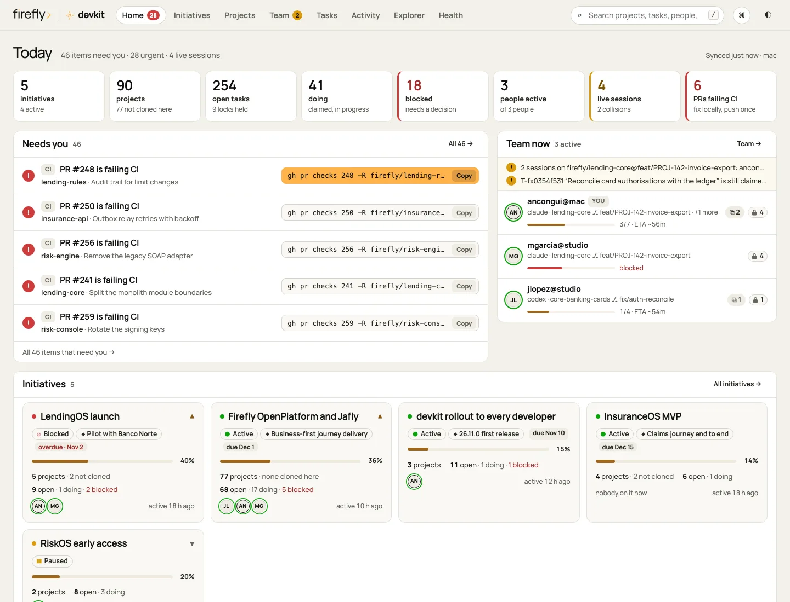
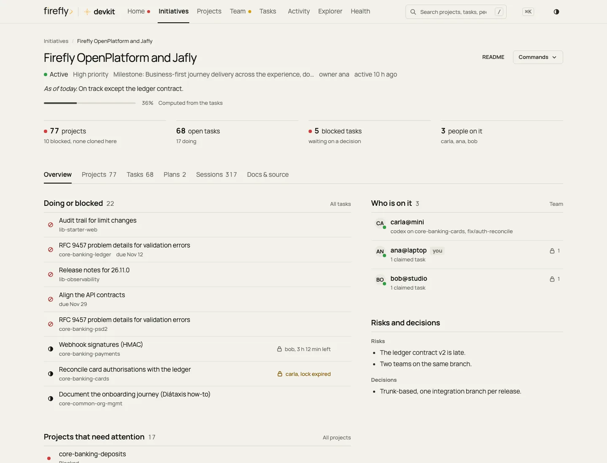

# Dashboard

`dev dashboard` opens the command center. **Home** summarizes everything on one screen. From there you drill into
an **initiative** or a **project** and down to a single **task**, and **Team** shows who is working on what across
machines. Every item comes with the one command that moves it forward. The page is a view over the handoff
repository, so it is as current as the last `dev sync`.

```bash
dev dashboard            # regenerate and open in your browser
dev dashboard --no-open  # regenerate only
dev dashboard --path     # print the file path
```

<picture>
  <source media="(prefers-color-scheme: dark)" srcset="images/dashboard/home-1440-dark.webp">
  
</picture>

## Views

| View | Keys | The job it does |
| --- | --- | --- |
| **Home** | `g o` | _Is anything wrong, and where do things stand?_ The title answers it, for example _28 urgent items need you_ or _Nothing needs you_. **Four figures** follow, each with its context and a link to the filtered list (PRs failing CI, blocked tasks, doing and the locks held, live sessions with people and collisions). **Needs you** lists the top five problems; problems of the same kind are grouped into one row (for example _5 of your PRs are failing CI_) that opens the filtered list. The first row has the page's one amber button, which copies its command; other rows have a copy icon. **Team now** has one row per person with their live session, run progress and ETA, after a one-line warning for each collision. Below sit one row per **initiative** (status, progress, next date, open and blocked tasks) and **Since yesterday** (sessions, commits, merged PRs, completed tasks). |
| **Initiatives** | `g i` | _How is each programme going?_ One table, filtered by status and sorted by priority, due date, progress, or activity: status, name and goal, progress, the next milestone and due date (overdue in red), open and blocked tasks, member projects (and how many are blocked), people, and last activity. A milestones-and-due-dates roadmap follows, then a link to the projects outside any initiative. Click an initiative to open its page. |
| **Projects** | `g p` | A dense table (cards optional) with the health dot, status and priority, progress, the task in progress and who holds it, the latest agent status, PRs with a CI dot each, 7-day activity (on screens wider than 1600 px), last activity and who is on it. It is sorted by _needs attention_, can be grouped by initiative, owner, status, or priority, and filtered by the facet row. Click a project to open its page. |
| **Team** | `g m` | _Who is doing what right now?_ One column per person (`user@host`) from the presence files in the handoff repo. Each live session appears once: project, branch, agent, and how long it has run; the run's goal with its progress and ETA (a blocked run says why, in red); then **Latest**, **Check**, and **Next**, taken from the run and, when the run does not say, from the saved status block. The tasks they hold follow, with the time left on each lock; recent sessions are behind a disclosure. **Collisions** are listed first: two sessions on the same project and branch, and expired locks that are still held, each with a copy icon for its command. |
| **Tasks** | `g t` | Every work item across projects and initiatives, as a board (Now · Next · Later · Closed) or grouped by scope. Filter by status, scope, and who claimed it (anyone, or only you). Every card shows who holds the lock and opens the task drawer. |
| **Activity** | `g a` | A timeline first: live sessions, the session logs of every project and initiative (who, agent, branch, status), completed and blocked tasks, merged PRs, operations, and canary misses (the last 7 or 30 days). A commits-per-day chart (with a table view) and the most active projects follow. |
| **Explorer** | `g e` | The handoff repository as a tree, with a safe Markdown viewer and find-in-file (`↵` / `⇧↵` step through matches). Up to 2 MB is embedded, newest first. |
| **Health** | `g h` | Providers (sign-in, plan, quota, and reset time) and **Time** (see below). Guard decisions grouped by rule, the instruction canary per agent, configuration drift, every worktree, and disk usage per project. |

<picture>
  <source media="(prefers-color-scheme: dark)" srcset="images/dashboard/team-1440-dark.webp">
  
</picture>

### Initiative page (`#/initiatives/<slug>`)

_What is its state, what is in progress, and who is on it?_ The page opens with a breadcrumb and a header: one line
with status, priority, milestone, due date, owner, and last activity; the current state from the README as a lead
sentence; and honest progress with where it comes from. A **README** link and a **Commands** menu hold
`dev initiative show <slug>`, `dev task -i <slug> add "…" --now`, and `dev initiative add <slug> <owner/repo>`, each
with a copy icon. Four figures come next (member projects and how many are blocked, open tasks, blocked tasks, people
on it), then the tabs:

| Tab | Content |
| --- | --- |
| Overview | **Doing or blocked** (with who holds each lock); **Projects that need attention** (blocked or at-risk members); goal and scope; who is on it; risks and decisions; links |
| Projects | The member projects in collapsible groups, searchable (name, status, workstream, task in progress, people). Group by family, status, owner, workstream, or none. Each row has its status, progress, what is in progress or the latest status, who is on it and `dev clone <id>` when not cloned here. A 77-repository platform is a few groups, not a wall of chips |
| Tasks | The initiative's own items **plus member-project items linked to it** (`links: initiative:<slug>`, the same rule as `dev task -i`). Filter by status (open, doing, blocked, to do, closed) and source (initiative, from projects), grouped Now · Next · Later · Closed |
| Plans | Versioned plans and specs from `plans/initiatives/<slug>/`: status (draft, approved, superseded), version, last change and who made it, the full history, and _edited · needs a revision_ with the `dev plan revise … --why` command when the body changed without one |
| Sessions | The session log of the initiative and its member projects, by day, with who, agent, and branch |
| Docs & source | The source archives and the documents under `initiatives/<slug>/docs/` |

<picture>
  <source media="(prefers-color-scheme: dark)" srcset="images/dashboard/initiative-1440-dark.webp">
  
</picture>

### Project page (`#/projects/<owner>/<repo>`)

_What is the state of this repo?_ The page opens with a breadcrumb (Projects / owner / name) and a header: the name
with its health dot; one line with status, initiatives, branch, and last activity (live sessions count as activity);
the health reasons in one sentence (for example, that a PR is failing CI); and progress. The amber button copies
`dev claude <id>`; **More commands** holds `dev codex`, `dcd`, and `dev handoff`. A project that is **not cloned on
this Mac** has `dev clone <id>` as its amber button instead; its note, tasks, plans, and sessions still come from the
handoff repo. Four figures follow (open tasks, blocked tasks, open PRs and how many fail CI, live sessions). The tabs
are **Overview** (live sessions, each shown once; doing or blocked and up next; purpose and current state; the latest
status; repository facts; and, behind a disclosure, how long work takes here), **Tasks**, **Pull requests** (CI,
review, merge state, size, a command each), **Worktrees** (`dev wt rm`), **Plans**, **Sessions**, and **Handoff note**
(the full note, rendered).

A member of an initiative that has no handoff note yet still gets a page: the not-cloned call to action and the
initiatives that list it.

<picture>
  <source media="(prefers-color-scheme: dark)" srcset="images/dashboard/project-1440-dark.webp">
  
</picture>

### The task drawer (`?task=<id>`)

Every task, wherever it appears (Home, an initiative or project page, Tasks, Team, search, the palette), opens the same
drawer:

- **Header.** The title and one line with status, bucket, priority, type, due date, and version.
- **Lock state.** One sentence: who holds it, with which agent, since when, and how long the lock still runs. An
  expired lock is amber text and says that anyone can release it.
- **The next command.** The amber button names the next step (Start, Mark done) and copies its command, which is shown
  under it.
- **Description**, then **Other commands**: `dev task -p <id>|-i <slug> start|done|release|move|block|cancel|history
  <task-id>`, each on its own row with a copy icon, with `--why "…"` wherever the change must be explained. `-p` and
  `-i` work before or after the verb.
- **Details.** Id, project or initiative, assignee, created and updated (who and when), links, and the item file in
  the handoff repo.
- **History.** Every version, newest first: version, operation, detail, who (user@host and agent), when, and why.

Checkbox tasks from notes that have no work items yet are shown read-only, with their `dev task` number. The next
`dev sync` imports them.

<picture>
  <source media="(prefers-color-scheme: dark)" srcset="images/dashboard/drawer-1440-dark.webp">
  
</picture>

### Live runs and time

Agents report progress on long runs (`dev progress start|step|block|done`). Wherever a live session appears (Home
_Team now_, Team, the project page) it shows:

- the run's goal, a thin progress bar, steps done of the total, elapsed time against the estimate (the calibrated one
  when known), and the time left;
- **Latest**, **Check**, and **Next**, each once: from the run, and from the saved status block when the run does not
  say. **Blocked** runs say so in red, with the blocking reason;
- _N subagents running_, and how long the current turn has been running. That is flagged when it is longer than 90%
  of turns here.

**Time** (Health, and on a project page behind _How long work takes here_) shows how predictable the work is:

- the median and p90 turn length over 30 days;
- **actual / estimate**, the median ratio over finished runs that had an estimate; new estimates are scaled by it;
- the slowest commands of the last 7 days, with credentials masked;
- subagent durations, and recent runs with their actual time against the estimate.

### The status block

Agents start every final message with the status block: a `**[Firefly> DevKit]** <project> · <branch> · <task>`
header followed by **Done**, **Check** (a `✓`, `⚠`, `✗`, or `–` glyph, then the evidence), **Progress**, and **Next** (see
[Concepts › The status block](concepts.md#the-status-block)). devkit saves it as one line,
`<project> · <branch> ❯ <task> ❯ <done> ❯ <✓ check> [❯ ▸ <progress>] ❯ next → <next>`.

The dashboard parses saved lines in Python (`status_parts`) and draws them as a quiet list: the task, then labeled
Done, Check (colored by its glyph), Progress, and Next rows. The agent and the time sit under them. Tables and lists
use a compact one-line form (the check glyph, what was done, and the next step). Lines saved in older one-line forms, including the legacy
`DevKit ·` marker, keep rendering as written, with the marker removed.

## The action list

It is ordered by what blocks you most. Each item has its command behind a copy icon, and the most important one is
the single amber button on the page. Home groups items of the same kind into one row; **Needs you** (`#/actions`) lists
them all, with a filter per kind.

| Order | Item | Command |
| --- | --- | --- |
| 1 | One of **your** PRs is failing CI | `gh pr checks <n> -R <owner/repo> --watch` |
| 2 | Changes requested on your PR | `gh pr view <n> -R <repo> --comments` |
| 3 | Your PR has merge conflicts | `cd <its worktree> && git fetch origin && git rebase origin/<default>` (or `dcd … && gh pr checkout …`) |
| 4 | Your PR waits for review · someone else's PR needs a review | `gh pr view <n> -R <repo> --web` · `gh pr diff <n> -R <repo>` |
| 5 | An expired lock is still held · two sessions on the same branch | `dev task -p <id> release <task-id> --why "lock expired"` · `dev team` |
| 6 | A project or initiative is blocked · a task you hold is blocked | `dev handoff <id>` · `dev initiative show <slug>` · `dev task -p <id> show <task-id>` |
| 7 | Overdue tasks and initiatives | `dev task -p <id> done <task-id>` · `dev task -i <slug> done <task-id>` · `dev initiative show <slug>` |
| 8 | Uncommitted or unpushed work left idle | `cd <checkout> && git status -sb` |
| 9 | Finished worktrees (PR merged or closed, clean) | `dev wt rm <branch>`, or `dev gc --apply` for more than one |
| 10 | A repo outside the layout · a handoff note behind the code | `dev adopt <path>` · `dev handoff <id>` |
| 11 | Configuration drift · a provider not signed in | `dev config diff` · `claude` / `codex login` |

## Progress, health, people

- **Progress is honest.** It is the share of work items done, `done / (done + open)`, unless the note sets
  `progress:` manually. Hover any bar to see which; on an initiative or project page the text next to the bar says
  it (_4 of 8 tasks done_ or _Set manually in the note_), and it quotes counts only when they produce the percentage.
  With no tasks and no manual value it shows _no tasks_, never a guess.
- **Health.** A project is _at risk_ (red) when one of its PRs fails CI or has changes requested, it is blocked, a
  task is overdue, or it is past its due date. It _needs a look_ (amber) for merge conflicts, idle uncommitted or
  unpushed work, or a checkout outside the layout.
- **People** are `user@host`. This Mac's own sessions come from the local registry, which is fresher than its
  presence file. Presence older than 24 hours is ignored.
- **Locks** appear wherever tasks appear, as a lock icon with who holds it and the time left ("bob, 3 h left"). Yours
  read _you_; an expired lock is amber text.

## Search, filters, and the command palette

- **Search** (`/`) covers initiatives, projects, people, tasks (by id or title), PRs, notes, plans, session logs and
  every Markdown file in the handoff repo. Results have type facets and highlighted matches. In Initiatives,
  Projects, Tasks and Activity it filters the view in place.
- **Filters**: the project facet row (health, CI, status, priority, owner, stack, tag, live session, open PRs, not
  cloned, outside initiatives) sits at the top of Projects, Activity, and Search. Pages use segmented controls for their own
  filters.
- **Command palette** (`⌘K` / `Ctrl K`) jumps to any view, initiative, project, person, task, PR, or file with fuzzy
  matching, and copies every command.

## Keyboard

| Keys | Action |
| --- | --- |
| `/` | Search |
| `⌘K` · `Ctrl K` | Command palette |
| `g` then `o` `i` `p` `m` `t` | Home · Initiatives · Projects · Team · Tasks |
| `g` then `a` `e` `h` | Activity · Explorer · Health |
| `u` | Up: from a page back to its list |
| `←` `→` (`Home` `End`) | Switch tabs when the tab bar has focus · read the chart day by day when it has focus |
| `j` / `k` | Next / previous item in the current list or drawer |
| `↵` | Open the focused item |
| `Esc` | Close the task drawer, palette or sheet; clear the search |
| `?` | Shortcut sheet |

## Routes and the URL hash

Every page, tab, open task and filter lives in the URL, so any view can be bookmarked, shared with someone who has
the same handoff repo, or reached with the back button. The format is `#/<view>[/<id>][?<key>=<value>&…]`, with
defaults omitted. Ids keep their slashes and dots (`#/projects/gitlab.com/firefly/platform/api`). Links from earlier
versions (`#/portfolio`, `?p=<project>`, `?i=<initiative>`) still resolve.

| Key | Values | Example |
| --- | --- | --- |
| view (path) | `overview` `initiatives` `projects` `team` `tasks` `activity` `explorer` `health` `search` `actions` | `#/team` |
| id (path) | an initiative slug · a project id | `#/initiatives/lending` · `#/projects/acme/api` |
| `tab` | initiative: `projects` `tasks` `plans` `sessions` `docs` · project: `tasks` `prs` `worktrees` `plans` `sessions` `note` | `#/projects/acme/api?tab=prs` |
| `task` | a task id: opens the task drawer | `#/projects/acme/api?tab=tasks&task=T-fwk6cesh07u` |
| `mq` · `mg` | member search · grouping (`family` `status` `owner` `ws` `none`) | `#/initiatives/jafly?tab=projects&mg=status` |
| `tst` · `src` | task status (`open` `doing` `blocked` `todo` `done` `all`) · initiative task source (`all` `own` `projects`) | `#/initiatives/lending?tab=tasks&tst=blocked` |
| `q` | search text | `#/search?q=export` |
| `health` `ci` `status` `priority` `owner` `stack` `tag` | comma-separated values | `#/projects?ci=failing` |
| `live` `prs` `nc` `loose` | `1` (live session · open PRs · not cloned · outside initiatives) | `#/projects?loose=1` |
| `sort` `group` `layout` `dense` | Projects: `attention` `activity` `priority` `tasks` `name` `size` · `none` `initiative` `owner` `status` `priority` · `table` `cards` · `1` | `#/projects?group=initiative` |
| `ist` `psort` | Initiatives: status · `priority` `due` `progress` `activity` (older links with `ilayout` still open the page) | `#/initiatives?psort=due` |
| `tp` `who` `tmode` | Tasks: scope · claimed by (`me` or `user@host`) · `board` `list` | `#/tasks?who=me&tst=doing` |
| `kind` | Needs-you kind filter | `#/actions?kind=CI` |
| `f` · `fq` | Explorer file · find-in-file text | `#/explorer?f=initiatives/lending/README.md` |
| `range` | `7` or `30` (Activity) | `#/activity?range=30` |
| `types` | search result types | `#/search?q=api&types=initiative,task` |

## Where it comes from

| | |
| --- | --- |
| File | `~/.local/state/devkit/dashboard/index.html`: one self-contained HTML file (inline CSS, JS and SVG) |
| Regenerated | by `dev dashboard`, after every `dev sync` (session ends, debounced turn ends) and by the hourly background job |
| Refresh | an open tab reloads every 2 minutes while visible (not while a task drawer is open), keeping its view, filters, and scroll position |
| Data | The registry (projects, git state, worktrees, PRs, initiatives, live sessions with progress, providers, drift). From the handoff repo: **work items** (`items/<scope>/<id>.md`, with lock and changelog), **presence** (`presence/<user>@<host>.json`), **session logs** (`sessions/<scope>/<YYYY-MM>.md`), **versioned plans** (`plans/<scope>/*.md`), notes, and initiative READMEs. Also the PR cache, the instruction canary, guard decisions, the operations log, **timing records**, and **active runs** |

The decisions are computed in Python (`lib/devkit/dashboard.py`) and unit-tested (`tests/test_dashboard.py`):

- action priority and commands, project health, _since yesterday_, guard rule grouping, task numbering;
- lock state, collisions, people, initiative-linked items and KPIs;
- session-log and status-line parsing, plan status, timing summaries, and credential masking.

The page only renders them.

## Design

The page follows the Firefly Software brand, and each view answers one question in its first screen: the answer
first, then the work in progress, then the detail. Long commands live in menus and drawers.

- **Identity.** The official Firefly logo (the paper version on dark, the charcoal one on light) next to the devkit
  spark; charcoal and paper surfaces; Manrope.
- **Amber**, the firefly's light, appears once per screen at most: on the button for the most important next action.
  Progress bars and chart marks are neutral (ink on light, stone on dark). Status colors appear only as small dots or
  short text, always with a label.
- **Type.** Four sizes (13, 15, 18, and 28 px) and two weights (400 and 600), sentence case everywhere. Monospace is
  only for commands and paths.
- **Components.** One set used everywhere: sections (a heading, a count, one quiet link, no box), rows divided by
  hairlines whose title is a real link, quiet tables, a few figures with context, thin progress bars, dot-and-text
  status, avatars, underlined tabs, breadcrumbs, quiet buttons, copy icons, command menus, and the drawer. Icons are
  drawn SVG in one stroke. Sticky table headers (a table wider than the page scrolls inside itself), empty states that
  say what to do next, and instant rendering with no skeletons.
- **Layout.** One spacing scale (4, 8, 12, 16, 24, 32, 48, 64 px) on a 1280 px column, and a dense mode. Responsive at
  1440, 1280, 1024, 768, and 390 px with no horizontal page scroll; copy icons on rows appear on hover and focus, and
  always on phones and tablets. Keyboard-first with visible focus rings; with reduced motion the drawer fades instead of
  sliding; prints cleanly. The theme toggle (the half-filled circle, or the palette) is remembered, and _Theme: follow
  system_ resets it.


## Privacy and security

The file stays on your Mac; the only network request is the Manrope web font (the page falls back to the system sans
offline). All text from notes, items, presence, logs, PR titles and git is inserted with DOM text APIs, never as HTML.
Links are limited to `http(s)`, `mailto` and in-page anchors, and the embedded data escapes `<`, `>` and `&`. Command
lines in timing records are masked for tokens, passwords and long secrets before they reach the page. The tests
render hostile content (``, a `</script>` breakout) through every surface to keep it that way.

See also [Concepts](concepts.md), [Commands](commands.md), [Teams and machines](teams.md), and [Agents](agents.md).
