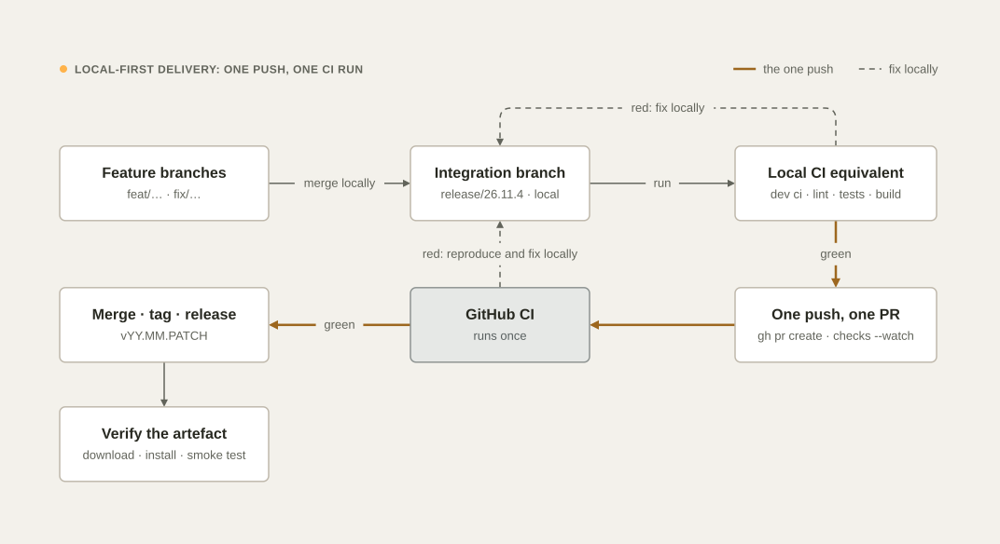
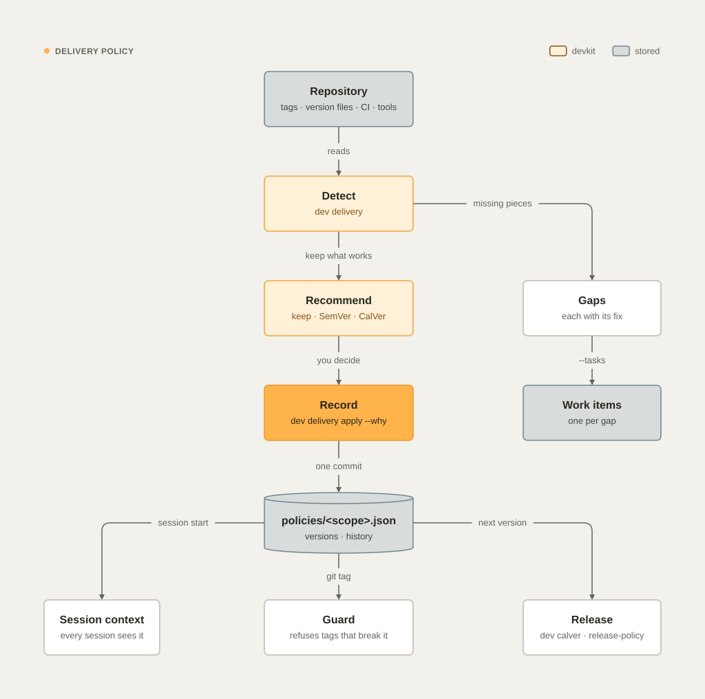

# Delivery

GitHub CI confirms that work is ready; it is not where you find out whether it works. Each push costs a full CI
cycle (often 30 minutes or more), and each merge to the default branch can trigger the CI of every other open PR
again. devkit's method, which the global instructions and the devkit `delivery` skill teach both agents, is
**integrate and verify locally, push once, get one CI run.** The `dev` commands for git and GitHub
([Git and GitHub](git-and-github.md)) apply it at every step: `dev push`, `dev pr create`, and `dev release` refuse
to run without local CI evidence.

<picture>
  <source media="(prefers-color-scheme: dark)" srcset="images/diagrams/delivery-dark.svg">
  
</picture>

## The delivery policy

Every project has one recorded way to version, test, release, and ship: its delivery policy. devkit detects what the
repository does today, recommends a policy that keeps what works, and records the one you choose in the handoff
repository, where every session sees it and the guard enforces it.

<picture>
  <source media="(prefers-color-scheme: dark)" srcset="images/diagrams/delivery-policy-dark.svg">
  .json, versioned with its history, and --tasks opens a work item per gap; every session sees the policy, the guard refuses tags that break it, and releases follow it." width="100%">
</picture>

### Detect and recommend

```bash
dev delivery            # detected · recorded or recommended policy · gaps, each with its fix
dev delivery --json     # the same, for tools and agents
```

devkit reads the repository:

| It looks at | For example |
| --- | --- |
| Version tags and version files | `v26.11.0` tags; `package.json`, `pom.xml`, `pyproject.toml`, `composer.json`, `gradle.properties`, `build.gradle.kts`, `Cargo.toml`, `VERSION` |
| Release tools | `release-please`, `semantic-release`, `goreleaser`, `git-cliff`, `changesets`, `bump-my-version`, `commitizen`, `maven-release-plugin` |
| Changelog | `CHANGELOG.md` in Keep a Changelog format, or another changelog file |
| CI and the test gate | GitHub Actions, GitLab CI, Bitbucket Pipelines, Azure Pipelines, Jenkins; the commands CI runs |
| Branch model | Trunk-based, GitFlow (`develop`), release branches |
| What it publishes and deploys | Maven, npm, PyPI, Packagist, container images; GitHub Pages, Kubernetes, containers, platform configs |

Then it recommends, keeping what works:

| Situation | Versioning |
| --- | --- |
| The repository already has a consistent scheme | Keep it |
| A library others depend on (it publishes to Maven, npm, PyPI, or Packagist) | SemVer, `vMAJOR.MINOR.PATCH`, bumped from Conventional Commits |
| An app, service, platform, or internal tool | CalVer, `vYY.MM.PATCH` (`dev calver --next`) |
| Projects that release together as one set | A release train on their initiative (`-i <slug>`) |

The gaps are what stands between the project and a release you can trust, by severity: no recorded policy, no CI,
no test gate (high); no version scheme, no changelog, artifacts published without a release workflow (medium); a
version file out of step with the tags, a long-lived `develop` branch (low).

### Record it

```bash
dev delivery apply --why "first release policy: service, CalVer, Maven verify gate" --tasks
dev delivery apply --set versioning=semver --set test_gate="./mvnw -B verify" --why "it is a library now"
```

`dev delivery apply` writes `policies/<project id>.json` (or `policies/initiatives/<slug>.json`) in the handoff
repository: the versioning and tag format, the version source, the release flow, the changelog, the test gate, the
CI, the branch model, what it publishes and deploys, the bump rule, and an optional release train. Each change bumps
the policy's version, adds a history line (who, when, what changed, why), and makes one commit. `--tasks` opens a
work item for each gap. The guard refuses direct edits of `policies/`.

The optional field `job_timeout_minutes` (default 30, from 5 to 360) is the CI job limit that `dev ci audit` suggests,
`dev ci audit --fix` writes, and `dev ci init` gives every job it generates (see
[CI/CD pipelines › Job timeouts](ci-cd.md#job-timeouts-and-the-delivery-policy)). The policy's test gate is also what
the test job of a generated pipeline runs.

```bash
dev delivery apply --set job_timeout_minutes=45 --why "integration tests take 35 minutes"
```

### What the policy does

- **Every session sees it.** The session context shows the policy in one line: versioning and tag format, release
  flow, and test gate. A project without one gets a reminder to run `dev delivery` before its first release.
- **The guard refuses tags that break it.** In a CalVer project, `git tag v2.0.0` is refused with the next version
  to use (`dev calver --next`); in a SemVer project, a tag that is not `vMAJOR.MINOR.PATCH` is refused. Prefix the
  command with `DEVKIT_TAG_ANY=1` to tag anyway, or change the policy.
- **Release work requires the `release-policy` skill.** Requests about releases, tags, version bumps, changelogs and
  publishing, and changes to `CHANGELOG.md`, `VERSION`, or release-tool configuration, require the `delivery` and
  `release-policy` skills (see [Skills and plugins › Required skills](skills-and-plugins.md#required-skills)).

devkit records its own policy this way, with CalVer `vYY.MM.PATCH` from `VERSION`, a Keep a Changelog `CHANGELOG.md`,
and a test gate that compiles the code and runs the suite with Homebrew's Python and with the macOS system Python 3.9.

## 1. Know the pipeline

```bash
dev ci                 # workflows, triggers, jobs, runners, matrices, setup actions, every run: command
dev ci --commands      # only the commands, in order
dev ci --runs          # plus the recent runs
dev ci --run --dry-run # which of those steps run on your Mac, and why the others do not
dev ci audit           # what makes the pipeline slow, unreliable, or unsafe, with the fixes
```

Use the same tool versions as the setup steps (`setup-node`, `setup-java`, `setup-python`). To diagnose, fix, or set up
the pipeline itself, see [CI/CD pipelines](ci-cd.md).

## 2. A single change

```bash
dev branch new feat/x                   # from an up-to-date origin/main
# … small steps, targeted tests while iterating …
dev commit -a -m "feat(scope): summary" --body "why"
dev ci --run            # the full local equivalent of CI: lint, types, unit, integration (Testcontainers), build
dev sec scan            # secrets, dependencies, code patterns, IaC, workflows
dev push                # one push, only with local CI evidence for exactly these files
dev pr create --dry-run | sed '1,/^---$/d' > body.md   # the pre-filled body; fill "What and why", then:
dev pr create --body-file body.md
dev pr checks --watch
```

The pull request description follows the template in [Templates › Pull request
description](templates.md#pull-request-description): what and why, changes, how to verify (with the local results),
risk and rollback, links. `dev pr create` fills the changes, the local CI result, and the links, and refuses a PR
whose "What and why" or "How to verify" is still empty. The title is a Conventional Commit.

## 3. Branches or PRs that land together

```bash
dev branch new release/26.11.4
git merge --no-ff origin/feat/a          # oldest dependency first
git merge --no-ff feat/b                 # local branches of other worktrees work too: same repository
# resolve conflicts once; bump the version, CHANGELOG and docs once
dev ci --run                             # the full local suite on the result
dev push
dev pr create --title "chore(release): 26.11.4" --body-file body.md   # "Integrates #12, #17, #22"
dev pr checks --watch
```

Ask the sessions working on those branches to commit locally and stop pushing. Never merge the individual PRs one
after another to see what CI says; the integration PR supersedes them. `dev calver` prints the next version and the
release branch name when the project uses CalVer.

## 4. Follow CI

Watch the single run instead of polling it:

```bash
dev ci status            # the branch's runs: state, jobs, current step, elapsed, ETA
dev ci status --watch    # refresh every 15 seconds until nothing runs
dev pr checks --watch    # the PR's checks; prints only the result, with the failing jobs' logs
```

`dev ci status` works with GitHub Actions, GitLab CI, Bitbucket Pipelines and Azure Pipelines; the ETA comes from
the last successful runs of the same pipeline. The details and the sign-in each host needs are in
[Commands › dev ci status](commands.md#dev-ci-status---watch---branch-name----all-branches---all-jobs---limit-n---json).

## 5. When CI fails

After every push, `dev ci watch` follows the run and, when it fails, reports the first error, its class, and one next
action (see [CI/CD pipelines › Watch every run](ci-cd.md#watch-every-run)).

1. Read the real error: `dev run view --failed` (or `dev pr checks`) shows the failing step and the relevant lines of
   its log.
2. Reproduce it locally with the same command and versions, fix it, and run the full local suite (`dev ci --run`).
3. Push once. One fix per push, never a "try this and see."
4. If the failure truly cannot be reproduced on macOS (Linux-only paths, case-sensitive file system, a CI-only
   secret, runner limits), say so, make the smallest targeted fix, push once, and explain it in the PR.
5. A flaky failure is re-run only with evidence (passes locally repeatedly, unrelated to the change, known history),
   recorded in the handoff note, with an explicit acknowledgement:

   ```bash
   dev run rerun <run-id> --flaky "PaymentIT times out on the runner; passed 5 times locally, unrelated to this change"
   ```

   devkit records the reason in the project's session log and re-runs only the failed jobs.

## 6. Release

Release by the recorded policy (see [The delivery policy](#the-delivery-policy)); `dev delivery` shows it.

1. Run `dev sec scan` on the integration branch and fix or justify every finding.
2. From the verified, green integration branch, merge with the repository's strategy: `dev pr merge` (squash or merge
   commit). A squash message repeats the PR title and says what changed and why in one or two sentences, with no
   attribution lines; `dev pr merge` writes it from the PR.
3. Tag with the policy's format (signed if the project signs tags), push the tag, and create the release with notes
   from the CHANGELOG: `dev release` (`--dry-run` first) does all three, after it checks the version files, the local
   CI evidence, and the CI of the commit. `dev calver` gives the next CalVer version.
4. Download or install the published artifact and smoke-test it.
5. Update the handoff note (version, what shipped, follow-ups) and mark the tasks done with `dev task done <n>`.

## 7. GitOps rules

- Git is the source of truth for code, configuration, infrastructure, and deployment manifests.
- Environments change only through merged PRs and tags that pipelines deploy; no manual changes, no drift. An
  emergency manual change is captured in git immediately.
- Secrets live in the secret manager or CI secrets, referenced by name, never in the repository. The guard refuses a
  commit when gitleaks finds a secret in it.
- Workflows use least-privilege `permissions:` and actions pinned to a full commit SHA; `dev sec scan` checks them with
  zizmor.

## How the guard enforces it

| Rule | Behavior |
| --- | --- |
| Push budget | The third push of the same branch within 60 minutes is denied with instructions to reproduce locally. `dev push` with evidence from `dev ci --run` passes it; prefix a raw push with `DEVKIT_LOCAL_CI_PASSED=1` only when the full local suite has just passed in the session. |
| Blind re-runs | `gh run rerun` is denied unless prefixed with `DEVKIT_FLAKY=1`; `dev run rerun` needs `--flaky` with the reason. |
| Merges and releases | Raw `gh pr merge` and `gh release create` are denied in favor of `dev pr merge` and `dev release` (prefix `DEVKIT_RAW_GH=1` to bypass); `gh pr merge --admin` is always denied. |
| Pipes | A commit, push, or tag chained after a pipe without `pipefail` is denied: the `&&` would see the pipe's last command, not the check. |
| Force pushes | Plain `--force`, `-f`, and `+refspec` are denied; `--force-with-lease` is allowed on your own branch, never to `main` or `master`. |
| Branch names | A branch that breaks `<type>/<ticket>-<topic>` cannot be created, renamed to, or pushed. |
| Secrets | A commit that contains a secret found by gitleaks is denied. |
| Tags | A tag that breaks the recorded delivery policy is denied unless prefixed with `DEVKIT_TAG_ANY=1`. |
| Policies | Direct edits of `policies/` in the handoff repository are denied; use `dev delivery apply`. |

The budget counts push attempts per repository and branch on this machine
(`~/.local/state/devkit/ci-pushes.json`). The full rules are in [Guard rules](guard.md).

See also [Git and GitHub](git-and-github.md), [Guard rules](guard.md),
[Commands › dev ci](commands.md#dev-ci-query---commands---runs) and [Templates](templates.md).
