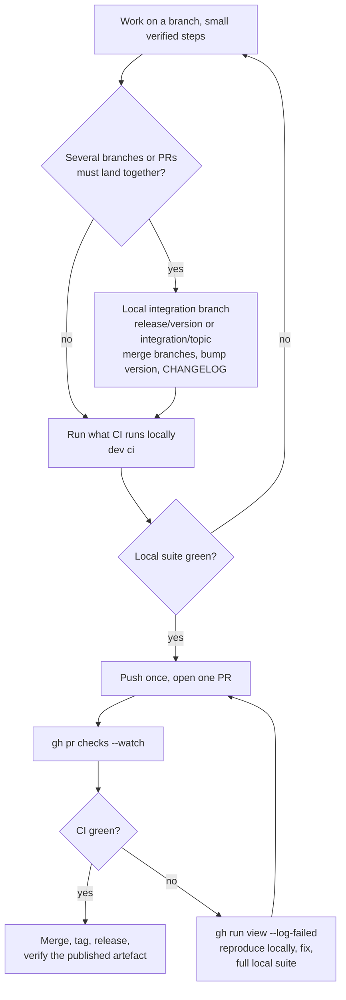

# Delivery

GitHub CI confirms that work is ready; it is not where you find out whether it works. Each push costs a full CI
cycle (often 30 minutes or more), and each merge to the default branch can re-trigger the CI of every other open
PR. devkit's method, taught to both agents by the global instructions and the devkit `delivery` skill:
**integrate and verify locally, push once, get one CI run.**



## 1. Know the pipeline

```bash
dev ci                 # workflows, triggers, jobs, runners, matrices, setup actions, every run: command
dev ci --commands      # only the commands, in order
dev ci --runs          # plus the recent runs
```

Use the same tool versions as the setup steps (`setup-node`, `setup-java`, `setup-python`).

## 2. A single change

```bash
git fetch origin && git switch -c feat/x origin/main
# … small steps, targeted tests while iterating …
# full local equivalent of CI: lint, types, unit, integration (Testcontainers), build, package
git push -u origin feat/x
gh pr create --fill
gh pr checks --watch
```

## 3. Several branches or PRs together

```bash
git fetch origin
git switch -c release/1.4.0 origin/main
git merge --no-ff origin/feat/a          # oldest dependency first
git merge --no-ff feat/b                 # local branches of other worktrees work too: same repository
# resolve conflicts once; bump the version, CHANGELOG and docs once
# run the full local suite on the result
git push -u origin release/1.4.0
gh pr create --fill --title "Release 1.4.0" --body "Integrates #12, #17, #22"
gh pr checks --watch
```

Ask the sessions working on those branches to commit locally and stop pushing. Never merge the individual PRs one
after another to see what CI says; the integration PR supersedes them.

## 4. When CI fails

1. `gh run view <run-id> --log-failed` — read the real error.
2. Reproduce it locally with the same command and versions, fix it, run the full local suite.
3. Push once. One fix per push, never "try this and see".
4. If the failure truly cannot be reproduced on macOS (Linux-only paths, case-sensitive file system, a CI-only
   secret, runner limits), say so, make the smallest targeted fix, push once and explain it in the PR.
5. A flaky failure is re-run only with evidence (passes locally repeatedly, unrelated to the change, known history),
   recorded in the handoff note, with an explicit acknowledgement:

   ```bash
   DEVKIT_FLAKY=1 gh run rerun <run-id> --failed
   ```

## 5. Release

1. From the verified, green integration branch: merge with the repository's strategy (squash or merge commit).
2. Tag (signed if the project signs tags), push the tag, create the release with notes from the CHANGELOG:
   `gh release create vX.Y.Z --notes-file <notes>`.
3. Download or install the published artefact and smoke-test it.
4. Update the handoff note: version, what shipped, follow-ups.

## 6. GitOps rules

- Git is the source of truth for code, configuration, infrastructure and deployment manifests.
- Environments change only through merged PRs and tags that pipelines deploy; no manual changes, no drift. An
  emergency manual change is captured in git immediately.
- Secrets live in the secret manager or CI secrets, referenced by name, never in the repository.

## How the guard enforces it

| Rule | Behaviour |
|---|---|
| Push budget | The third push of the same branch within 60 minutes is denied with instructions to reproduce locally. Prefix the push with `DEVKIT_LOCAL_CI_PASSED=1` only when the full local suite has just passed in the session. |
| Blind re-runs | `gh run rerun` is denied unless prefixed with `DEVKIT_FLAKY=1`. |
| Force pushes | Plain `--force` / `-f` / `+refspec` denied; `--force-with-lease` allowed on your own branch, never to `main`/`master`. |

The budget counts push attempts per repository and branch on this machine
(`~/.local/state/devkit/ci-pushes.json`). Details: [Guard rules](guard.md).

See also: [Guard rules](guard.md) · [Commands › dev ci](commands.md#dev-ci-query---commands---runs)
