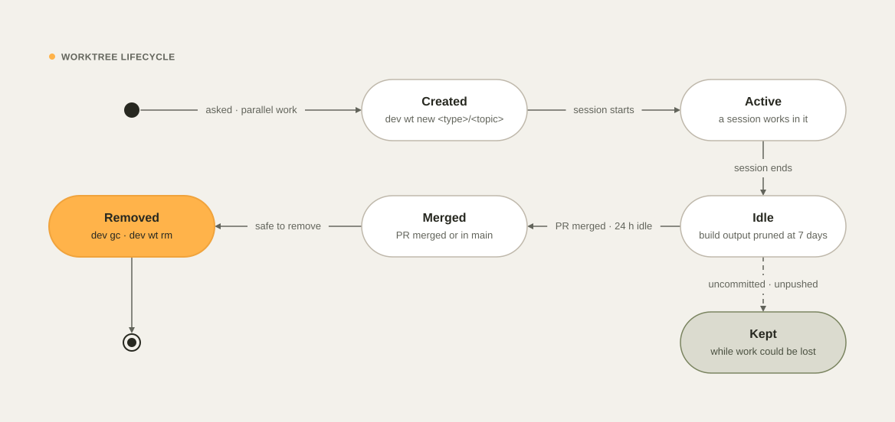
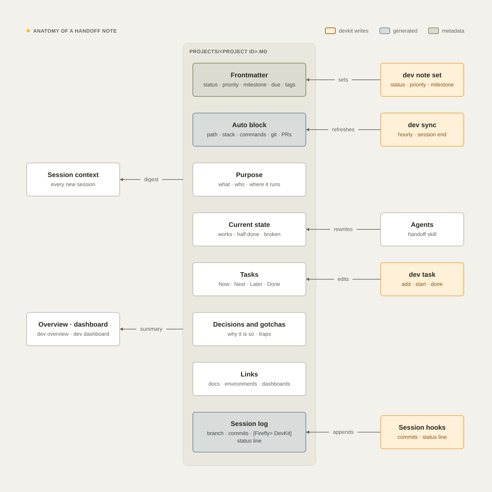

# Diagrams

devkit draws diagrams as code: a small JSON spec becomes a branded SVG in a dark and a light version, laid out on a
grid, routed automatically, and **validated** before it is accepted. The same engine draws every diagram in these
docs, and agents use it through the `diagrams` skill.

<picture>
  <source media="(prefers-color-scheme: dark)" srcset="images/diagrams/worktree-lifecycle-dark.svg">
  
</picture>

## Commands

```bash
dev diagram new flow checkout --dir docs/diagrams   # scaffold a spec (flow · c4 · state · sequence · er · timeline)
dev diagram render docs/diagrams/checkout.json --png
dev diagram render docs/diagrams                    # every spec; docs/diagrams/*.json → docs/images/diagrams/
dev diagram check docs/diagrams/checkout.json       # exit 1 when there are problems
dev diagram check docs/images/diagrams              # light checks for any SVG files
```

`render` writes `<name>-dark.svg` and `<name>-light.svg` (and 2x PNG previews with `--png`, for looking at; do not
commit them). Specs under a `diagrams/` folder render to the sibling `images/diagrams/` folder by default.

## Writing a spec

```json
{
  "kind": "flow",
  "name": "checkout",
  "title": "Checkout",
  "desc": "The web app sends orders to the Orders API, which stores them in the orders database.",
  "nodes": [
    {"id": "web", "label": "Web app", "col": 0, "row": 0},
    {"id": "api", "label": "Orders API", "sub": "Spring Boot", "col": 1, "row": 0, "emphasis": true},
    {"id": "db", "label": "Orders", "shape": "store", "family": "slate", "col": 2, "row": 0}
  ],
  "edges": [
    {"from": "web", "to": "api", "label": "POST /orders"},
    {"from": "api", "to": "db", "label": "insert"}
  ]
}
```

- **Kinds:** `flow` (architecture, pipelines), `c4`, `state`, `sequence`, `er`, `timeline`. Every key of every kind,
  with an example each: [`plugin/skills/diagrams/reference/kinds.md`](../plugin/skills/diagrams/reference/kinds.md).
- **Placement** is yours (`col`, `row`, fractions allowed, `span`); **sizing** and **routing** are the engine's: boxes
  grow to their text, columns, and rows size to their content and to the labels that cross them, edges route
  orthogonally with rounded bends, ports spread along a side, and an edge goes straight whenever it can.
- **Groups** draw boundaries (`dashed` for system boundaries) and can be edge endpoints when the group acts as one.

## What the validator refuses

| Code | Means |
| --- | --- |
| `overlap` | nodes closer than 8 px, groups overlapping without nesting, a node straddling a group |
| `overflow` | text that does not fit its box (boxes grow; a fixed `width` can still be too small) |
| `crossing` | an edge through a node it does not connect, through a label, or through a group title |
| `label` | edge labels colliding with each other, with nodes, group titles, the kicker, legend, or caption |
| `contrast` | text below 4.5:1 (3:1 for large text) or meaningful marks below 3:1, in either theme |
| `type` | text below 12 px |
| `bounds` | anything outside the live area |
| `a11y` | missing `title` or `desc` |
| `amber` | more than one focal element (one `emphasis` node or one `primary` path) |

`dev diagram check` on an SVG file (any SVG, not only devkit's) checks the viewBox, `<title>`, scripts, and external
references, type size, and text contrast against the shape painted underneath each text.

## Design rules

The full method is in the [`diagrams` skill](../plugin/skills/diagrams/SKILL.md); the essentials:

- Draw a **mechanism** (what flows where, who calls whom, what state follows which), not an inventory. If a sentence
  says it, write the sentence.
- One reading direction; arrows go with it; the few that go back are dashed.
- **Every edge is labelled** with a verb or a payload.
- **Amber is punctuation:** one focal element per diagram. Color families mean something: steel is a third party, slate
  is data, olive is automation and control, and firefly is anything devkit or Firefly owns.
- Labels short, at most two lines, never below 12 px; boxes grow, type never shrinks.
- Docs and READMEs: keep diagrams within about 1200 px wide so text stays legible in GitHub's column (a test enforces
  ~1320 for devkit's own); prefer a layered, top-to-bottom layout to a wide one.
- Always a dark and a light file, embedded with `<picture>`; `desc` doubles as the `alt` text.

<picture>
  <source media="(prefers-color-scheme: dark)" srcset="images/diagrams/handoff-note-dark.svg">
  
</picture>

## The brand

The engine follows the Firefly diagram system (`fireflysoftwaresolutions/brand-kit`, `docs/diagram-system.md` and
`data/diagram-system.json`): paper `#F3F1EB` and charcoal `#10110F` grounds; neutral, firefly, steel, slate, and olive
families with their light and dark tokens; group bands; Manrope (label 16/600, secondary 13/400, group titles 12/600
in capitals with 0.04 em tracking); 8 px grid and 64 px margins; 6 px node and 12 px group radii; 1.5 px structure;
1.5–2 px connectors with 8 px arrowheads and 12 px rounded bends; the kicker with its amber point at the top left and
the legend at the top right. Text widths come from Manrope's measured advance widths with a 4 % margin, so the
system-font fallback never overflows a box.

## devkit's own diagrams

| Spec | Shows | Used in |
| --- | --- | --- |
| `docs/diagrams/architecture.json` | How devkit fits together | README |
| `docs/diagrams/session-lifecycle.json` | A session with devkit, hook by hook | [Concepts](concepts.md) |
| `docs/diagrams/work-hierarchy.json` | Portfolio, initiatives, projects, and their records | [Concepts](concepts.md), [Initiatives](initiatives.md) |
| `docs/diagrams/handoff-note.json` | Anatomy of a handoff note | [Concepts](concepts.md), this page |
| `docs/diagrams/status-flow.json` | Progress and the status block, from the agent to every view | [Concepts](concepts.md) and [Progress and communication](progress-and-communication.md) |
| `docs/diagrams/work-item-lifecycle.json` | The states of a work item: claim, release, expire | [Teams and machines](teams.md) |
| `docs/diagrams/handoff-sync.json` | Locks and sync between two machines | [Teams and machines](teams.md) |
| `docs/diagrams/delivery.json` | Local-first delivery: one push, one CI run | [Delivery](delivery.md) |
| `docs/diagrams/worktree-lifecycle.json` | Worktree lifecycle | this page |

After changing a spec, run `dev diagram render docs/diagrams`; `tests/test_diagram.py` fails when a rendered SVG is
stale or any spec has a problem.

See also [Concepts](concepts.md), [Delivery](delivery.md), and [Developing devkit](development.md).
