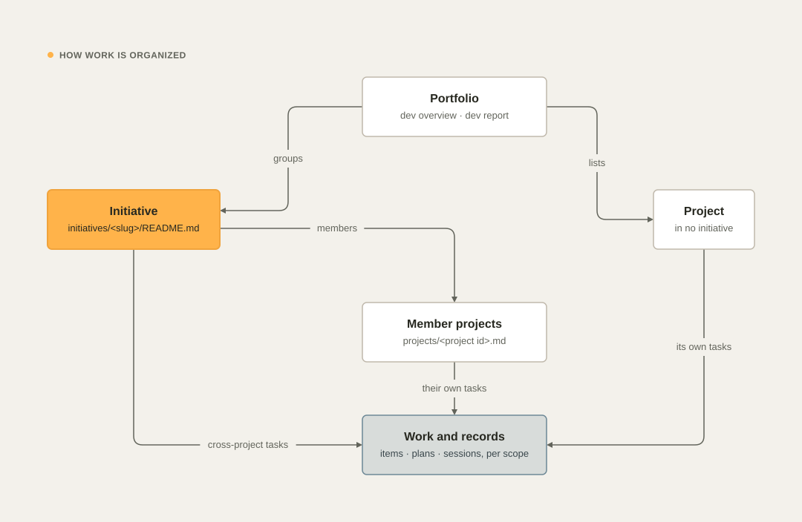

# Initiatives

An initiative groups the projects that work toward one goal: an integration, a platform, a program, a migration. It
holds what no single repository can: the goal, the scope, one workstream per member project, the cross-project tasks,
and the decisions and contracts (APIs, events, versions) that every member must respect.

Initiatives are optional. A project that belongs to none works the same way.

<picture>
  <source media="(prefers-color-scheme: dark)" srcset="images/diagrams/work-hierarchy-dark.svg">
  
</picture>

## Create an initiative

Run these from `~/Development` (a portfolio-level session); the guard refuses membership changes from inside a
project session.

```bash
dev initiative new payments --title "Payments platform" --projects acme/billing,acme/checkout
dev note set owner=maria milestone="Refunds live" due=2026-12-15 -i payments
dev initiative add payments acme/ledger      # a new member, with its workstream heading
dev initiative rm payments acme/ledger
```

`dev initiative new` writes `initiatives/<slug>/README.md` in the handoff repository. Open it and fill the sections.

```markdown
---
kind: initiative
title: Payments platform
status: active          # active | paused | blocked | done | archived
priority: normal        # high | normal | low
owner: maria
milestone: Refunds live
due: 2026-12-15
progress:               # empty: computed from tasks; a number overrides it
projects: [acme/billing, acme/checkout]
tags: []
source: []              # set by dev handoff-import
---
# Payments platform

## Goal
## Scope
## Current state
## Workstreams
### acme/billing
### acme/checkout
## Tasks
## Decisions and gotchas
## Risks and open questions
## Links
```

| Section | What goes in it |
| --- | --- |
| Goal | The outcome, for whom, and how you can tell it is done, in one to three sentences |
| Scope | What is in and what is out |
| Current state | What is done and verified, half done, or broken, across all members |
| Workstreams | One `###` heading per member project: its role, its state, its next step |
| Tasks | Generated from the initiative's work items; change them with `dev task -i <slug>` |
| Decisions and gotchas | Cross-project decisions and contracts every member must respect |
| Risks and open questions | What could stop the initiative, and what still needs a decision. `dev report` lists the bullets |
| Links | Specs, environments, boards, related initiatives |

## Work in an initiative

```bash
dev initiative                                # every initiative: status, priority, progress, milestone, due, members, open tasks
dev initiative show payments                  # progress and its source, goal, members with status and progress, Now tasks
dev task -i payments                          # the work items of the initiative
dev task add "Agree on the refund event schema" --type feature --now -i payments
dev task link 3 --to payments --why "…"      # a project task that counts toward the initiative
dev plan new "Refund events" --kind spec -i payments
dev delivery apply -i payments --set release_train="ledger, billing, checkout; monthly" --why "…"
dev report -i payments                        # a status report for this initiative
```

Agents learn about initiatives from their session context. When the session's project is a member, the context names
the initiative, its status and progress, the members, this project's workstream, the initiative's Now tasks, and the
path of its README, which the agent updates with cross-project facts.

Who may write what:

- **Member projects** update the initiative's README, its plans, and its tasks. A session in a project that is not a
  member is refused by the guard.
- **Membership** (`new`, `add`, `rm`) is a portfolio decision. Run it from `~/Development`, or ask the developer.
- A project session never edits another project's note. Facts that concern another project go into the shared
  initiative.

## Progress

An initiative's progress is the share of its work items that are done: `done / (done + open)`, where cancelled items
do not count. The items are:

- the initiative's own items (`items/initiatives/<slug>/`), and
- items of member projects that carry the link `initiative:<slug>`.

A manual `progress:` value in the frontmatter (`dev note set progress=40 -i payments`) overrides the computed one;
`dev initiative show`, `PROJECTS.md`, and the dashboard mark it as manual. Set it back to empty to compute it again.

To count a project task toward an initiative, link it from the project:

```bash
dev task link 3 --to payments --why "billing's refund endpoint is part of the payments milestone"
```

`dev handoff-import` adds the same link to tasks tagged with a member project (see the next section). New
cross-project work goes into the initiative itself with `dev task -i <slug>`.

## Release trains

When member projects must release together (a platform, a bill of materials, a parent POM and its services), record
the order and the rhythm as the initiative's delivery policy:

```bash
dev delivery apply -i payments --set release_train="ledger, billing, checkout; monthly" --why "they share the event schema"
dev delivery -i payments      # prints the recorded policy
```

Each member keeps its own version scheme in its own policy (see [Delivery › The delivery
policy](delivery.md#the-delivery-policy)). Sessions see their project's own policy, so set `release_train` in a
member's policy too when its sessions should see the train.

## Adopt an existing handoff repository

`dev handoff-import` turns an older handoff or program repository into an initiative, without touching the old
repository. Five older handoff repositories were adopted this way during the 26.11.0 rollout.

You prepare a staging folder first (an agent can do it by analyzing the old repository), check it, and then import it:

```bash
dev handoff-import ~/Development/.tmp/staging-payments --slug payments --dry-run
dev handoff-import ~/Development/.tmp/staging-payments --slug payments
```

### The staging folder

| File | Required | Content |
| --- | --- | --- |
| `README.md` | yes | The initiative note in devkit's format. Its frontmatter must have `kind: initiative` and lists the member `projects` and the `source` repositories as `owner/repo@sha` (a short SHA is resolved through `gh`). Its `## Tasks` section holds the tasks as checkboxes under `### Now`, `### Next`, `### Later`, and `### Done` |
| `projects.json` | no | The member projects: `[{"id": "owner/repo", "role": "…", "state": "…"}]`. `role` and `state` fill the Purpose and Current state of member projects that have no note yet |
| `docs.txt` | no | Key documents to import as they are, one `<repo>/<path>` per line (a line without a known repository prefix uses the first source). Lines that start with `#` are ignored |
| `source.md` | no | Provenance and a complete index of the old repository, with permalinks at the pinned SHA |
| `report.md` | no | The migration analysis: confidence, overlaps, inconsistencies, secrets found |

A task tagged with a member project, `- [ ] [acme/api] Add the push-token endpoint` (the tag may also come last, or in
backticks), becomes a work item on that project's board, linked to the initiative. Other tasks become the
initiative's own items. Checked tasks are imported as done.

### What the import creates

- `initiatives/<slug>/README.md` from the staging note, `source.md`, and `MIGRATION.md` from `report.md`;
- `initiatives/<slug>/docs/<repo>/<path>` for every document in `docs.txt`, fetched with `gh` at the pinned SHA;
- one versioned work item per task, each with the changelog entry "imported from `<source>`";
- a handoff note for every member project that has none;
- a session-log line for the initiative and an entry in the operations log;
- one commit in the handoff repository, which the next sync pushes.

The import refuses to run when the staging `README.md` is missing, is not an initiative note, or when the initiative
already exists.

See also [Teams and machines](teams.md), [Concepts › How work is organized](concepts.md#how-work-is-organized) and
[Commands › dev initiative](commands.md#dev-initiative-new--add--rm--ls--show).
