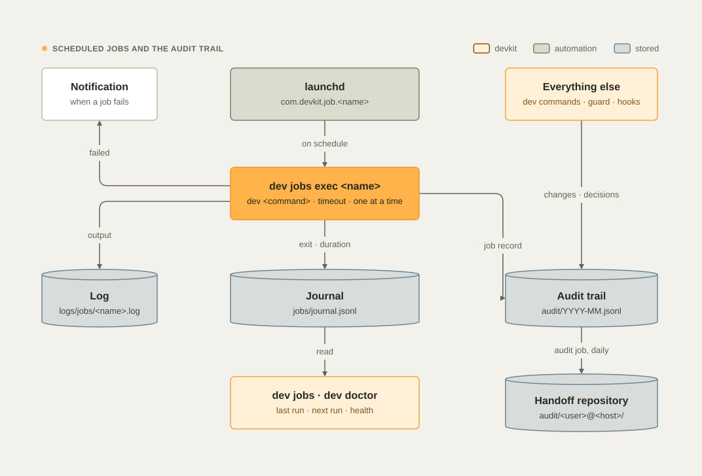

# Scheduled jobs and the audit trail

devkit does part of its work in the background: it syncs the handoff repository, reclaims disk, repairs settings,
consolidates lessons, and checks its own health. Each of these is a named **scheduled job** that you can see, run,
reschedule, and turn off. Everything devkit changes or decides, in the background or in a session, is written to an
**audit trail** that the whole team can read.

<picture>
  <source media="(prefers-color-scheme: dark)" srcset="images/diagrams/jobs-audit-dark.svg">
  , which runs the job's dev command one at a time and with a timeout; the output goes to the job's log, the result to the journal, and a job record to the audit trail, which also receives every changing dev command, guard decision, and handoff write; a failed job sends a notification; dev jobs and dev doctor read the journal; the daily audit job publishes this machine's audit trail to audit/<user>@<host>/ in the handoff repository." width="100%">
</picture>

## The jobs

| Job | Default schedule | Runs | What it does |
| --- | --- | --- | --- |
| `sync` | Every hour, and when you log in | `dev sync --scheduled --quiet` | Pulls the handoff repository, releases expired locks, refreshes PR states and sizes, rewrites the map, notes, presence, and dashboard, commits, and pushes |
| `sleep` | Daily at 03:30 | `dev sleep --quiet` | Merges, forgets, and caps lessons; trims devkit's old records, caches, and logs (see [Lessons › Sleep](lessons.md#sleep)) |
| `gc` | Daily at 04:00 | `dev gc --apply --yes --auto-only` | Reclaims disk safely: merged worktrees, idle build output, stale temp, Docker build cache (see [Disk and cleanup](disk-and-cleanup.md)) |
| `repair` | Every 6 hours | `dev config repair --quiet` | Restores devkit-managed agent settings and Codex hook trust if anything drifted |
| `audit` | Daily at 05:00 | `dev audit --publish --quiet` | Publishes this machine's audit trail to the handoff repository and prunes month files past their retention, 13 months by default (see [The audit trail › Retention](audit.md#retention)) |
| `update-check` | Daily at 09:15 | `dev update --check --quiet --record` | Checks, read-only, whether a newer devkit release is out and records the answer; the first session of the day and `dev status` then tell you, without reaching the network themselves |
| `doctor` | Mondays at 09:00 | `dev doctor` | The full health check; you get a notification when a check fails |
| `lessons` | Fridays at 16:00 | `dev lesson review` | Lists recurring lessons to automate and stale ones to retire, and always notifies you |

If your Mac is asleep at a scheduled time, launchd starts the job when it wakes. Turning off `gc.auto` (the wizard's
"report only") keeps the `gc` job off.

## How a job runs

`dev install` (its `launchd` step) writes one launchd agent per enabled job,
`~/Library/LaunchAgents/com.devkit.job.<name>.plist`, and loads it. The agents run at background priority, with
low-priority disk access, and start `dev jobs exec <name>`, which:

1. **Runs one at a time.** A run that finds the previous one still going is recorded as skipped.
2. **Runs the job's `dev` command with a timeout.** A run that times out ends with exit code `124`.
3. **Logs the output** to `~/.local/state/devkit/logs/jobs/<name>.log` (launchd's own messages go to
   `<name>.launchd.log`).
4. **Writes the journal**, `~/.local/state/devkit/jobs/journal.jsonl`: start, end, exit code, duration, and the last
   line of output.
5. **Writes an audit record**, `job.<name>`, with the outcome.
6. **Notifies you** when the job failed, or after every run for a job with `"notify": "always"`.

Inside a job, `DEVKIT_AGENT` is `job` and `DEVKIT_JOB` is the job's name, so the records it writes say that a job made
them.

These jobs replace the single `com.devkit.sync` agent of earlier versions: `dev install` unloads it and deletes its
file. Sessions do not wait for the hourly job: they sync the handoff repository within seconds of every delivery
event (see [Teams and machines › Near-real-time sync](teams.md#near-real-time-sync)).

## See and run them

```bash
dev jobs                  # every job: state, schedule, last run, next run
dev jobs show sync        # one job with its command, timeout, log, and recent runs
dev jobs run sleep        # run a job now, in the foreground, with the same log, journal, and audit record
dev jobs logs gc -n 100   # the end of the log of one job
dev jobs journal --days 7 # past runs of every job: start, result, duration, last line
```

```text
  Scheduled jobs (launchd) ─────────────────────────────────────────────────────
  JOB      STATE  SCHEDULE           LAST RUN  NEXT         WHAT
  ───────  ─────  ─────────────────  ────────  ───────────  ───────────────────────────────────────────
  sync     on     every 1 h          never     11-05 23:49  Projects map, PRs, sizes, presence, locks, …
  sleep    on     daily at 03:30     never     11-06 03:30  Lessons: decay, merge, forget, cap; trims …
  gc       on     daily at 04:00     never     11-06 04:00  Reclaims disk safely: merged worktrees, idl…
  repair   on     every 6 h          never     11-06 04:49  Restores devkit-managed agent settings and …
  audit    on     daily at 05:00     never     11-06 05:00  Publishes this machine's audit trail to the…
  doctor   on     weekly, mon 09:00  never     11-09 09:00  Weekly health check of the whole setup; not…
  lessons  on     weekly, fri 16:00  never     11-06 16:00  Weekly lesson review: recurring lessons to …
```

`STATE` is `on` (loaded), `not loaded` (enabled but not loaded: run `dev jobs install`), or `off`. `dev doctor` checks
every enabled job: it must be loaded, and its last run must have passed.

## Change a schedule

```bash
dev jobs set sync --every 30m --why "a team of six claims tasks all day"
dev jobs set gc --at 02:00
dev jobs set doctor --weekly "fri 08:30"
dev jobs disable lessons --why "we review lessons in the retro"
dev jobs enable lessons
```

`--every` takes minutes or hours (`30m`, `2h`), `--at` a 24-hour time, and `--weekly` a day and a time. The change is
saved under `jobs.<name>` in `~/.config/devkit/config.json`, recorded in the audit trail with its reason, and applied
at once, so it survives reinstalls. `dev jobs install` writes and loads every job from the configuration again.

## Add your own job

Any `dev` command can be a job. Add it to the configuration, then run `dev jobs install`:

```json
{
  "jobs": {
    "standup": {
      "cmd": ["standup", "--days", "1"],
      "at": "08:45",
      "about": "Yesterday's work, before the daily meeting",
      "notify": "always",
      "timeout": 5
    }
  }
}
```

| Key | Meaning |
| --- | --- |
| `cmd` | The `dev` arguments, as a list (required for a new job) |
| `every` · `at` · `weekly` | The schedule: minutes, `"HH:MM"`, or `"mon 09:00"`; give one |
| `timeout` | Minutes before the run is stopped (default 30) |
| `notify` | `failure` (the default), `always`, or `never` |
| `enabled` | `false` turns the job off |
| `about` | The description that `dev jobs` shows |
| `run_at_load` | `true` also runs the job when you log in |

The same keys under a built-in job's name change that job; you write only what you change.

## The audit trail

Every record says who acted (user, machine, and agent: `claude`, `codex`, `job`, or `human`, and the crew member when
one acts), when, what (the action and its target), the details, the outcome, and, for an override, the reason. The
full record, its categories and levels, the hash chain, and the exports are in [The audit trail](audit.md).

| Action | Recorded when |
| --- | --- |
| `dev.<command>` | A `dev` command that changes something runs: its arguments, the result (`ok` or `exit N`), the duration, and the folder. Read-only commands and dry runs are not recorded, unless `audit.level` is `all` |
| `guard.deny` · `guard.ask` | The guard refuses a command or a file write, or asks you about one, with the reason |
| `config.blocked` | ConfigChange refuses an edit to a devkit-managed setting, or a `DEVKIT_*` variable in a settings file |
| `config` | `dev config repair` restores a setting |
| `canary.miss` | A final message lacks the status block |
| `crew.<event>` | A crew member's lane starts, binds, ends, or is lost; a crew gate sends a member back (`crew.gate`); a crew message is sent (its id, sender, recipient, and length, never its text); a decision is asked or made |
| `handoff.<folder>` | devkit commits to the handoff repository: `handoff.items`, `handoff.plans`, `handoff.lessons`, `handoff.policies`, and so on |
| `handoff.record-skipped` | A lock job left an item it can't rewrite without dropping lines: the target is the file, the detail is `<id>: <op>`, the outcome is `blocked` |
| `handoff.push` | The handoff repository is pushed, or the push fails |
| `ops` | Cleanups, worktree removals, adoptions, and sleep summaries |
| `job.<name>` · `jobs.set` · `jobs.install` | A job runs, a schedule changes, the jobs are installed |
| `audit.<event>` | The audit trail itself: a prune, a settings change, a verify, an export, or a publish that was refused |

**Secrets are redacted, as far as the redactor knows their shape.** Tokens, keys, passwords, credentials in URLs,
and the secrets that common commands take are redacted in every text field before a record is written. A secret in
a shape the redactor does not know can still reach a record, so keep secrets out of commands. Crew message text and
decision questions are never recorded, and `/Users/<name>` becomes `~`. See
[The audit trail › What a record holds](audit.md#what-a-record-holds-and-what-it-never-holds).

**Where it lives.** Each machine appends to `~/.local/state/devkit/audit/YYYY-MM.jsonl` and keeps 13 months by
default (`audit.retention.local_months`). Every day at 05:00 the `audit` job copies this month's file and the two
before into the handoff repository as `audit/<user>@<host>/YYYY-MM.jsonl`, in one commit, so the team shares one
history and git keeps it. Set `audit.publish` to `false` to keep the trail on your Mac. Retention, the legal hold, and
what git history keeps are in [The audit trail › Retention](audit.md#retention).

### Read it

```bash
dev audit                         # this machine, the last 7 days (the newest 60 records)
dev audit --days 30 --action guard
dev audit --action dev.push --actor maria@laptop
dev audit --team --days 1         # every machine, from the handoff repository
dev audit --json -n 500           # for tools and agents
```

```text
  Audit · last 1.0 days · 17 record(s) ─────────────────────────────────────────
  2026-11-05 22:49 dev.branch                   new feat/Invoice Export --ticket PROJ-142  octo@mac claude
  2026-11-05 22:49 dev.commit                   -m Added invoice export  octo@mac claude  exit 2
  2026-11-05 22:49 dev.commit                   -m feat(invoice): add CSV export --body Finance needs monthly invoices  octo@mac claude
  2026-11-05 22:49 dev.push                       octo@mac claude
  2026-11-05 22:49 handoff.lessons              lessons/acme/billing/L-fwqyx0ywj1x.md  octo@mac claude
```

`--action` matches the start of the action (`guard`, `job`, `dev.pr`, `handoff`), and `--actor` any part of
`user@host agent`. Refusals, failures, and misses are highlighted.

For one whole record, statistics, the settings, the chain check, and exports, see
[The audit trail › Query and export](audit.md#query-and-export) and [Verify the chain](audit.md#verify-the-chain).

See also [The audit trail](audit.md), [Commands › Tracking and disk](commands.md#tracking-and-disk),
[Configuration](configuration.md#jobs-and-audit), and [Troubleshooting](troubleshooting.md#a-scheduled-job-fails-or-does-not-run).
