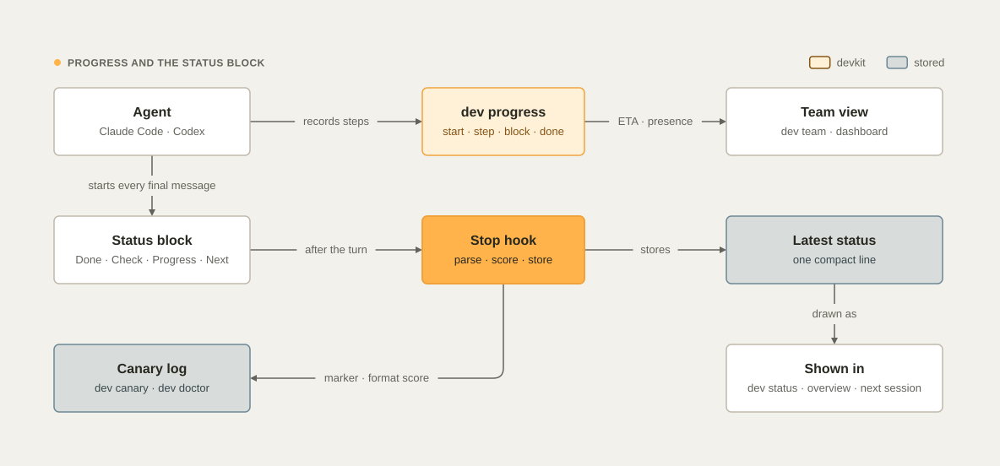

# Progress and communication

You should never have to ask an agent how it is going. This guide explains how devkit keeps you informed: live
progress with an ETA computed from the real pace, estimates corrected by history, reminders when an agent goes quiet,
desktop notifications, timing reports, written templates for every kind of message, and status reports for the team.

<picture>
  <source media="(prefers-color-scheme: dark)" srcset="images/diagrams/status-flow-dark.svg">
  
</picture>

## Live progress with `dev progress`

Agents run these commands; you can too. The global instructions and the `communicating` skill tell agents when.

```bash
dev progress start "Export invoices as CSV" --plan "api=30m; ui=30m after api; tests=20m after ui; docs=15m"
dev progress step "the API endpoint streams CSV" --check "12 tests pass" --next "UI button"
dev progress block "need the export permission name" --next "a decision from Finance"
dev progress done "CSV export merged"
dev progress                      # every run on this Mac, and the runs of other machines
```

`dev progress step` prints the update to send, and the update is the status block itself, with the plan under it:
each step's state, owner, and time. An update that ends a turn therefore always starts the way the global instructions
require:

```markdown
**[Firefly> DevKit]** billing · `feat/invoice-export` · Export invoices as CSV
- **Done:** the API endpoint streams CSV
- **Check:** ✓ 12 tests pass
- **Progress:** 1/4 · 24m active of ~1h35m · ETA ~1h00m–1h35m
- **Next:** UI button

✓ 1. api · 24m of ~30m
▸ 2. ui · 0m of ~30m
○ 3. tests · ~20m
○ 4. docs · ~15m
```

`--check` fills the Check bullet with the evidence for the step (`✓` is added when you give no glyph). A blocked run
shows `✗ blocked` and `Next: unblock: …`.

| Command | What it records |
| --- | --- |
| `start "<goal>" [--plan "a=30m; b=1h after a; c"] [--estimate 2h] [--steps N]` | A run for the current session: the goal and the plan. Each step can carry an estimate (`=30m`) and the steps it waits for (`after a, b`); steps without an estimate share what `--estimate` leaves. It prints how long similar work took here |
| `step "<what finished>" --check "<evidence>" [--step <n or name>] [--next "…"]` | Closes the running step (or the one named), with its evidence; prints the update |
| `add "<name>=<estimate> [after …]" [--why "…"]` | A step found during the work |
| `assign <step> --to <member> [--scope "<globs>"]` | Hands a step to a crew member ([The crew](crew.md)); its time is that member's time |
| `begin <step>` | Starts a step in parallel with the running one (work you do yourself) |
| `reopen <step> --why "…"` · `skip <step> --why "…"` | Undoes a wrong close, or skips a step on purpose |
| `history` | Every step change: when, from → to, by whom, why |
| `block "<why>" [--next "…"]` | The run is blocked; you get a desktop notification |
| `done "<outcome>"` | The run is finished; the actual time is recorded against the estimate; you get a notification |

A run belongs to the agent session that started it. Claude Code sessions export `DEVKIT_SESSION` at session start, so
devkit knows exactly which session runs the command. For Codex, devkit uses the most recent devkit session in the same
repository (within 12 hours); from a plain shell, the run belongs to that shell.

### Keeping the plan true

The status, the dashboard, the handoff and the next session all read the plan, so devkit checks every change to it:

- **Evidence.** Closing a step needs `--check "<evidence>"`, or `--no-check` when there is nothing to verify (the
  update then shows ⚠).
- **The right step.** The description must describe the step it closes: a close of "integrate dev test" with "time
  model built" is refused, and devkit names the step it sounds like or suggests `dev progress add`. When more than one
  step is running, name it with `--step`.
- **Not someone else's step,** while the crew member who owns it is still working, and **not before its
  dependencies** are done.
- **Not finished with open steps:** `dev progress done` refuses while steps are pending; close or skip each one.
- **Fixable and visible:** `reopen` and `skip` need a reason, and every change (by you, by a crew member, or by
  devkit) is in `dev progress history`. The output of `step` ends with the exact change it made, for example
  `changed: 2. ui running → done`.

`--force` skips the checks when the description really does mean that step.

Add a step when the work **starts**, not when it ends: `dev progress add "<step>=30m"`, then `dev progress begin
<step>`. Time is measured per step from its start, so a step added after the fact gets no time of its own, and its
minutes count for the step that was running.

### Time and estimates

devkit measures time the same way every time, so ETAs and calibration are comparable:

- **Active time, not wall-clock time.** A run is worked on while the main agent's turn runs (from your prompt to
  its final message) or a subagent works (from its start to its report). The union of those intervals is the active
  time: waiting for you is not counted, and parallel agents are not counted twice. The update shows wall-clock time
  next to it when they differ by five minutes or more.
- **A step's time** is the active time between its start and its end; for a step owned by a crew member, that
  member's own time.
- **Pace** is actual ÷ estimate over the steps finished in this run, weighed against the project's history in
  proportion to the evidence (a single step does not swing it), and kept between 0.5× and 2.5×. A step closed in
  under a tenth of its estimate is bookkeeping and does not count.
- **ETA** is the critical path through the plan: a step starts when the steps it waits for are done and its lane is
  free; the main agent and each crew member are separate lanes that run in parallel. The ETA is the time the last
  step ends, shown as a range: ±25% once finished steps set the pace, wider before.

Every number is computed from recorded timestamps, and the tests run the model with a fixed clock.

### How estimates are calibrated

When a run with an estimate finishes, devkit records its active time, and each step records its own time against its
estimate. For the next run in the same project, it takes the median ratio of actual to estimated time over the
finished runs of the last 60 days, and uses it as the starting pace. `dev progress start` says so:

```text
✓ run started · Export invoices as CSV · estimate 1h35m
  runs here take 1.4× their estimate → plan for ~2h13m · median turn 3m, p90 11m
```

Agents are told to use that number, to re-plan at 1.5 times the estimate, and to say so.

### Where progress shows up

| Where | What you see |
| --- | --- |
| The agent's messages | The status block that `dev progress step` prints, with the plan's checklist |
| The status block | The `Progress:` bullet, while a run is active (see [Concepts › The status block](concepts.md#the-status-block)) |
| `dev progress` | Runs on this Mac, and other machines' runs from their presence |
| `dev team`, the dashboard | Each live session with its run, steps, ETA, and subagents |
| Desktop notifications | A run blocks or finishes; a long turn finishes |

Progress is published to the team in the background (at most once a minute) through a sync that updates this
machine's presence file and session line.

## Notifications

devkit sends a macOS notification when:

- a run is blocked (`dev progress block`) or done (`dev progress done`);
- an agent turn that lasted `progress.notify_after_minutes` (10) or more finishes;
- a scheduled job fails, and after every run of a job with `"notify": "always"`, such as the weekly lesson review (see
  [Scheduled jobs and the audit trail](jobs-and-audit.md)).

Turn them off with `progress.notify: false` in [Configuration](configuration.md), or for one process with
`DEVKIT_NO_NOTIFY=1`.

## What the hooks add

| Hook | What it does |
| --- | --- |
| UserPromptSubmit | Starts the turn clock. When your prompt asks for status, devkit adds the real records to the agent's context (the session's runs with their headline, last update, and running subagents, and the CI/CD runs of the branch with their current job, step, elapsed time, and ETA) and asks for the overall status template. It understands English and Spanish phrasings such as `how is it going?`, `where are we`, `what's left`, `status?`, `ETA`, `give me an update`, `¿cómo va?`, or `¿qué falta?`. Background notifications (subagent results, system notices) are not treated as your request |
| PostToolUse | Times each tool call and records the ones slower than `progress.slow_tool_seconds` (20). After `progress.nudge_minutes` (8) without an update to you, it reminds the agent to send one and to record it with `dev progress step`, at most six times per turn |
| SubagentStart, SubagentStop | Track running subagents (shown in progress and status answers) and record how long each one took |
| Stop | Records the turn's duration and sends the long-turn notification |

The same UserPromptSubmit hook is also a safety net: a session that never ran SessionStart (a hook failure, an
untrusted Codex hook, an old client) is registered at its first prompt and receives the full devkit context then.
See [Agents › Hooks](agents.md#hooks).

## Pipelines

When the work has CI/CD pipelines, agents report them in progress updates and status answers, one line per run:

```text
CI/CD: ci #142 running · job tests (Python 3.13) step 4/7 "Unit tests" · 12m elapsed · ETA ~6m · <link>
```

`dev ci status` gives them the facts for GitHub Actions, GitLab CI, Bitbucket Pipelines, and Azure Pipelines, with
an ETA from the last successful runs, and `dev ci status --watch` follows a run to the end instead of polling (see
[Commands › dev ci status](commands.md#dev-ci-status---watch---branch-name----all-branches---all-jobs---limit-n---json)).

## Where the time goes: `dev time`

```bash
dev time                  # the last 7 days
dev time --days 30 -p acme/billing
```

It reports turn length (median, p90, longest), how accurate past estimates were and the factor applied to new ones,
subagent durations, the ten slowest commands by total time (with runs and median), and the runs in progress. The
records are in `~/.local/state/devkit/timing/YYYY-MM.jsonl`, one line per slow tool call, turn, subagent, and finished
run.

## How agents write to you

The `communicating` skill holds a template for every kind of message. Its rules apply to all of them: use American English
by default, the status block first and then the answer, plain words, no filler or buzzwords, real evidence instead of
claims, short updates, and honest estimates given as ranges.

**Nothing comes before the status block.** A message that ends the agent's turn (everything it writes after its last
tool call) opens with the block, and the template's own content goes below it: the verdict, a correction, a greeting,
or a comment on the last command never comes before it. "Lead with the point" applies to the first line under the block.
A note that the agent is waiting for background work is a final message too, so it starts with the block, with what
runs in Next.

| Template | When the agent uses it | Shape |
| --- | --- | --- |
| Kickoff | Before any task longer than a few minutes | The status block (Progress `0 of N steps`), then the plan with the estimate and steps; checks, risks, what it needs from you |
| Progress update | After each step, every 8–10 minutes of tool work, when background work finishes | The status block that `dev progress step` prints: done, check, progress with ETA, next, and the checklist |
| Status answer | When you ask "how is it going?" or "what's left?" | The status block, then a one-line verdict, a table per workstream (state, evidence, ETA), the CI/CD pipelines (state, current job and step, elapsed, ETA), what is left, risks, what it needs from you |
| Background work | When subagents, parallel sessions, or long commands start and end | What runs, what it produces, and when; then the result in one or two lines |
| Decision request | Only for decisions that are yours: scope, behavior, cost, risk, irreversible, or external effects | The status block (Check `– a question`), then context, options with gains, costs, and effort, a recommendation, and what it does if you do not answer |
| Explanation | When you need to understand something | The answer in one sentence, how it works, an example from your code, what it means for you, where to read more |
| Final report | At the end of a turn | The status block, then only what the block does not say: what changed, what is not done |
| Failure or incident | When something fails | The status block (Check `✗` with the error), then what failed and its impact, cause, evidence, what was tried, next step |
| Pull request description | When it opens a PR | What and why, changes, how to verify, risk and rollback, links |
| Merge message | When it squash-merges | The PR title, then the what and why in one or two sentences |
| Review comments | When it reviews code | `blocking:`, `suggestion:`, `nit:`, or `question:`, then what is wrong, why, and what to do |
| Handing work to a teammate | When you want someone else to take a task | The message `dev task delegate` writes (see [Teams and machines](teams.md#hand-a-task-to-a-teammate)) |

Records have one shape each, and commands create them: plans and specs (`dev plan new --kind …`), tasks
(`dev task add --type … --why … --done …`), run steps (`dev progress start --plan …`), session lines
(`dev handoff --log`), the status block, and status reports (`dev report`). The shapes are in
[Templates](templates.md).

## Status reports

`dev report` writes a Markdown status report from the handoff repository only, so every machine produces the same
report.

```bash
dev report                          # every initiative, then the projects outside initiatives, last 7 days
dev report --days 14 -i payments    # one initiative
dev report -p acme/billing -o ~/Desktop/billing-status.md
```

It starts with a summary table (initiative, health, progress, done, in progress, blocked, due date). Then each
initiative gets its health with the reason, progress (done of total tasks), milestone, due date, owner, and member
count, the goal, what was **done this period** and by whom, what is **in progress**, what is **next**, **blockers and
risks** (blocked tasks and the bullets of the README's risks section), and the **team** (people who logged sessions,
with their session counts). Projects outside initiatives follow in one table. Tasks that were imported as already done
do not count as done this period.

Health follows plain rules, in this order, so you can always explain it:

| Health | When |
| --- | --- |
| ✅ Done | The status is `done` |
| ⏸ Paused | The status is `paused` or `archived` |
| 🔴 Off track | The status is `blocked`, or the due date has passed |
| 🟡 At risk | A task is blocked; or the due date is within 14 days and progress is below 70%; or there has been no activity for two weeks |
| 🟢 On track | None of the previous rows applies |

`dev standup` is the short version for yourself: what happened since yesterday and what is in progress.

See also [Teams and machines](teams.md), [Templates](templates.md), and [Models and tokens](models-and-tokens.md).
