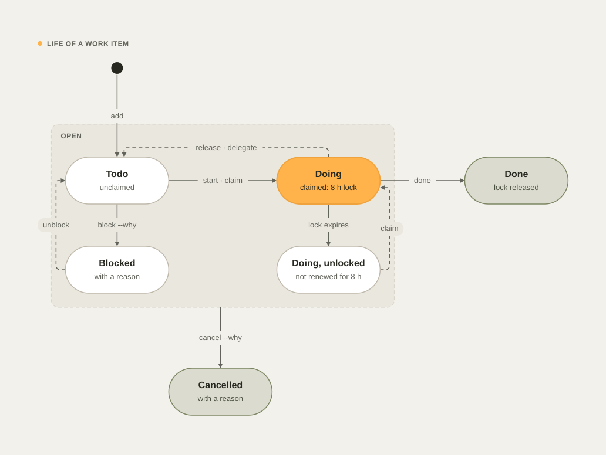

# Teams and machines

This guide explains how a team of developers, their Macs, and their agents share one handoff repository without
stepping on each other: work items with locks, a reason for every change of scope, versioned plans, append-only
session logs, presence, and merge rules that keep git from conflicting.

It applies equally to one developer with a laptop and a desktop, and to a team that shares a handoff repository.

## The rules in one minute

- **Claim before you work.** `dev task start <n>` takes a lock on the item and pushes it at once. Other machines see
  it, and their agents are told not to work on it.
- **Every change has a reason.** Changes of scope (`edit`, `move`, `block`, `cancel`, `link`) need `--why "…"`. Each change bumps the
  item's version, adds a changelog line (who, machine, agent, when, why), and makes one commit.
- **Write through `dev`.** Work items, session logs, and presence are written only by `dev`; the guard blocks direct
  edits, so versions, locks, and history stay correct.
- **Finish or give back.** `dev task done <n>` when the work is verified, `dev task release <n>` when you stop
  without finishing. A lock that nobody renews expires after 8 hours.
- **Look before you start.** `dev team` shows who is working on what, on every machine.

## Set up a shared handoff repository

Each developer gets a private `<login>/handoff` by default. To share one, point everyone at the same repository
before they install:

1. Create the repository once (for example `acme/handoff`, private) and give the team write access.
2. On each Mac, set `handoff_repo` in `~/.config/devkit/config.json` (or answer the `dev setup` question):

   ```json
   { "handoff_repo": "acme/handoff" }
   ```

3. Run `dev install --only handoff`. It clones the repository into `~/Development/.handoff` and writes the merge
   rules (see [Merge rules](#merge-rules)).

The same steps connect your second Mac to your own handoff repository.

## Work items

Each task, feature, bug, or spike is one Markdown file, `items/<scope>/<ID>.md`, where the scope is a project id
(`acme/billing`) or `initiatives/<slug>`. One file per item means two machines never edit the same file unless they
change the same item.

```markdown
---
id: F-fwmj1ge0dlf
type: feature
title: Define the refund event schema
scope: initiatives/payments
status: doing
bucket: now
priority: normal
assignee: maria
claimed_by: maria@laptop (claude)
claimed_at: 2026-11-05T17:13:59Z
lock_expires: 2026-11-06T01:13:59Z
due: 2026-11-20
links: []
version: 3
created: 2026-11-05T17:13:49Z
created_by: maria@laptop
updated: 2026-11-05T17:13:59Z
updated_by: maria@laptop
---
# Define the refund event schema

## Why
Both services must agree on the event before either ships.

## Done when
- [ ] The schema is merged in both repositories.

## Changelog
- v3 · 2026-11-05T17:13:59Z · maria@laptop (claude) · claim: lock until 2026-11-06T01:13:59Z
- v2 · 2026-11-05T17:13:55Z · maria@laptop (claude) · move: bucket=now — why: billing needs it first
- v1 · 2026-11-05T17:13:49Z · maria@laptop (claude) · create: feature “Define the refund event schema” in next — why: both services must agree on the event
```

| Field | Meaning |
| --- | --- |
| `id` | `T-` task, `F-` feature, `B-` bug, `S-` spike, then a time-ordered code that is unique across machines |
| `status` | `todo`, `doing`, `blocked`, `done`, or `cancelled` |
| `bucket` | `now`, `next`, or `later`: where it sits on the board |
| `assignee` | Who is expected to do it: the claimer by default, or the teammate from `dev task delegate` |
| `claimed_by`, `claimed_at`, `lock_expires` | The lock: who holds it (`user@host` and the agent) and when it ends |
| `links` | Links such as `initiative:<slug>`, which count the item toward an initiative's progress |
| `version`, `created*`, `updated*` | The audit trail; the changelog has one line per version |

The actor is your GitHub login, the machine's short host name, and the agent: `claude` or `codex` when an agent runs
the command (detected from its environment), `human` otherwise.

### Lifecycle

<picture>
  <source media="(prefers-color-scheme: dark)" srcset="images/diagrams/work-item-lifecycle-dark.svg">
  
</picture>

| Command | From | To | Lock |
| --- | --- | --- | --- |
| `dev task add "…"` | — | todo, in Next (or `--now`, `--later`) | none (`--claim` takes it at once) |
| `dev task start <n>` · `claim <n>` | todo | doing, in Now | taken for `work.lock_hours` (8), pushed at once |
| `dev task release <n>` | doing | todo | given back, pushed at once |
| `dev task done <n>` | any open state | done | given back, pushed at once |
| `dev task block <n> --why "…"` | todo or doing | blocked | unchanged |
| `dev task unblock <n>` | blocked | doing while it is claimed, todo otherwise | unchanged |
| `dev task cancel <n> --why "…"` | any open state | cancelled | cleared |
| `dev task delegate <n> --to <login>` | any open state | todo when you held the lock | yours is given back; the teammate claims it |
| `dev task link <n> --to <slug> --why "…"` | any state | unchanged; it now counts toward the initiative | unchanged |
| Lock not renewed for 8 hours | doing | doing, unlocked | cleared by the hourly sync on any machine |

Claiming a blocked item keeps it blocked; run `dev task unblock <n>` when the blocker is gone.

### Locks across machines

<picture>
  <source media="(prefers-color-scheme: dark)" srcset="images/diagrams/handoff-sync-dark.svg">
  
</picture>

1. **Claim.** `dev task start` pulls the handoff repository, checks the lock, writes it, commits, and pushes before it
   returns. If another machine claimed the item first, the push fails, devkit pulls again, and the claim is refused
   with the name of the holder.
2. **Respect.** Each session's context lists your claimed tasks and the tasks claimed by others with the line
   `Claimed by others — do NOT work on these`. It also names the people working on the same project right now.
   Changing an item that someone else holds is refused until the lock expires.
3. **Renew.** While a session works, the Stop hook's background sync (at most every 10 minutes) extends the locks your
   machine holds once less than half of the lock time is left.
4. **Expire.** The hourly sync on any machine releases locks whose time has run out. The item keeps its status, and
   the changelog says whose lock expired.
5. **Finish.** `done` and `release` give the lock back and push at once.

The lock length is `work.lock_hours` in [Configuration](configuration.md).

### Reasons and history

`edit`, `move`, `block`, `cancel`, and `link` refuse to run without `--why`. Every other verb accepts it too. The reason goes into the
changelog line and the commit message, so `git log` in the handoff repository reads like a history of decisions:

```text
27be6fb F-fwmj1ge0dlf: move bucket=next (maria@laptop (claude)) — waiting for the API review
10d13c6 F-fwmj1ge0dlf: claim by maria@laptop (claude)
676d924 F-fwmj1ge0dlf: create feature “Define the refund event schema” (maria@laptop (human)) — both services must agree
```

`dev task show <n>` prints the fields, the description, and the history; `dev task history <n>` prints only the
history.

### Hand a task to a teammate

```bash
dev task delegate 2 --to jordan --why "Jordan owns the event bus" --due 2026-11-20
```

devkit releases your lock if you held it, sets `assignee` and the due date, records the reason, and prints a short
message that it also copies to the clipboard (`--no-copy` skips that). Paste it into Slack, Teams, or email:

```text
Hi @jordan, could you take this task: "Define the refund event schema"?

Why it matters: Jordan owns the event bus
Done means: the change is merged with tests, and the task is marked done.
Deadline: 2026-11-20
Task F-fwmj1ge0dlf in initiative payments

To pick it up, run `dev task start F-fwmj1ge0dlf -i payments`. It locks the task so nobody else starts it,
and `dev task show F-fwmj1ge0dlf -i payments` shows its full history. Ask me anything here.
```

Read it before you send it; it should sound like you. The `communicating` skill has the template for other messages
to teammates.

## Versioned plans

Plans and specs live in `plans/<scope>/` with frontmatter (id `P-…`, title, kind, scope, status, version, a hash of
the body, who created and last changed it) and a changelog at the end.

```bash
dev plan new "Refund events" --kind spec -i payments    # draft, version 1, from the spec template
$EDITOR ~/Development/.handoff/plans/initiatives/payments/2026-11-05-refund-events.md
dev plan revise ~/Development/.handoff/plans/initiatives/payments/2026-11-05-refund-events.md --why "added the retry rule"
dev plan approve <file>                                 # status approved, new version
dev plan supersede <file> --why "replaced by the v2 spec"
dev plan ls                                             # flags plans edited without a revision
```

devkit compares the body with the hash it recorded. When the body changed without `dev plan revise`, `dev plan ls`
shows `✎ needs dev plan revise`, and the Stop hook does not let the agent finish its turn until it records the reason
for each plan it changed in that session. A plan written by another tool (Superpowers writes to the same folder) is
adopted into the format on its first revision. The kinds and their sections are in
[Templates](templates.md#plans-and-specs).

## Session logs

Every session that changes something adds one line to `sessions/<scope>/YYYY-MM.md`:

```text
- 2026-11-05 18:40 · maria@laptop · claude · `feat/refund-events` · 3 commit(s): … · status: … <!-- s:5f2c9a1b7d3e -->
- 2026-11-05 19:02 · maria@laptop · human · reviewed the schema with Jordan; next: publish from billing
```

The hooks write and refresh the first kind; `dev handoff --log "…"` adds the second. The files are append-only and
there is one per scope and month, so concurrent machines never conflict.

## Presence and `dev team`

Each machine writes only its own file, `presence/<user>@<host>.json`, on every sync: its live sessions (agent,
project, branch, start time, latest status, progress of the current run, running subagents, turn start) and the locks
it holds.

```bash
dev team               # machines active in the last 24 hours
dev team --hours 4
```

The session context, `dev progress`, the dashboard's Team view and `dev report` read the same files.

## Merge rules

`dev install --only handoff` appends these lines to the handoff repository's `.gitattributes` and sets the `ours`
merge driver:

| Path | Merge rule | Why |
| --- | --- | --- |
| `sessions/**` | `union` | Append-only logs: both machines' lines are kept |
| `presence/*.json` | `ours` | Each machine writes only its own file |
| `PROJECTS.md`, `TASKS.md`, `ACTIVITY.md`, `registry.json` | `ours` | Generated views: the local copy is kept and regenerated after the pull |

Work items are separate files, and syncs pull with `--rebase --autostash` before they push, so conflicts are rare. When
two people change the same item at the same moment, git reports the conflict in the handoff repository; resolve it
there like any other conflict.

## What the guard protects

| Action | Decision |
| --- | --- |
| Writing a file under `items/`, `sessions/`, or `presence/` | Denied: use `dev task` or `dev handoff --log` |
| Writing `PROJECTS.md`, `TASKS.md`, `ACTIVITY.md`, `registry.json`, or `log/` | Denied: `dev sync` generates them |
| Writing a file under `policies/` | Denied: use `dev delivery apply` |
| Writing another project's note or plans from a project session | Denied |
| Writing an initiative the session's project is not a member of | Denied |
| `dev task -p <other project>` or `-i <initiative it is not in>` from a project session | Denied |
| `dev initiative new\|add\|rm` from a project session | Denied: membership is a portfolio decision |

A portfolio-level session (started in `~/Development` or in the handoff repository) may work across projects when you
ask it to. The full rules are in [Guard rules](guard.md#the-handoff-repository).

See also [Initiatives](initiatives.md), [Progress and communication](progress-and-communication.md) and
[Commands › dev task](commands.md#dev-task--p-project---i-slug---all-verb-).
