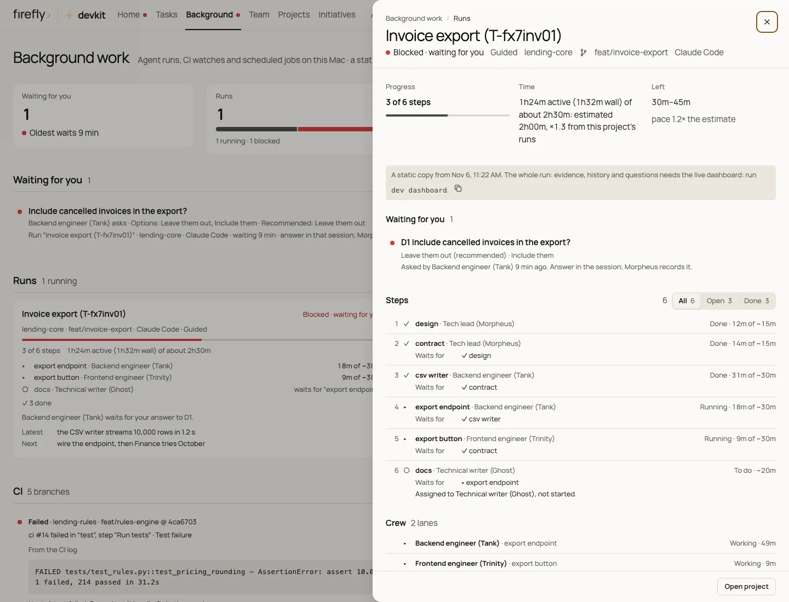

# Tutorial: your first task with Claude Code

In this tutorial you open a new project in Claude Code, check that devkit is active, and give devkit's crew a real
task: a small reading-list web page. On the way you learn to read everything devkit shows you: the status block, the
progress updates, the moments it waits for you, the crew graph, and the dashboard. It takes about 30 minutes, most of
it while the crew works.

Claude Code runs in Terminal, in VS Code, and in JetBrains IDEs. This tutorial uses Terminal; the last section shows
the IDEs. For the app with buttons and menus, follow [Claude Desktop's Code tab](claude-desktop.md) instead.

## What you need

- devkit installed on your Mac, with every line of `dev doctor` showing `✓`. If you have not installed it yet, follow
  [Your first install, step by step](../getting-started.md#your-first-install-step-by-step).
- A Claude account with Claude Code, signed in. The setup wizard offers the sign-in; if you skipped it, run `claude`
  once and sign in through the browser window that opens.
- Terminal open. Press Command-Space, type `Terminal`, and press Return.

## Step 1: open a project

A project is a folder with your code in it. Create one for this tutorial and start Claude Code there:

```bash
dev new reading-list
dcd reading-list
claude
```

- `dev new reading-list` creates the folder `~/Development/_local/reading-list` and prints its path.
- `dcd reading-list` moves Terminal into that folder.
- `claude` starts Claude Code in it. The window shows a box where you type. Under the box, devkit's status line shows
  the project, the branch, the model, and how much of the context and of your usage you have used, for example
  `reading-list · main · … · ctx 4% · 5h 12% · 7d 36%`.

For a project that already exists, `dcd <name>` and `claude`, or `dev claude <name>` in one step. To get a project from
GitHub first, run `dev clone <owner>/<repo>`.

## Step 2: check that devkit is active

Type this and press Return:

```text
What is this project, and what is its status?
```

The reply starts with a bold line that begins with `[Firefly> DevKit]`, followed by three bullets. For example:

```markdown
**[Firefly> DevKit]** reading-list · `main` · Project status
- **Done:** read the project: an empty git repository with no commits and no tasks yet.
- **Check:** – nothing to verify, a status question
- **Next:** tell me what to build; I plan it and bring in the crew.
```

That block is the **status block**. Every development reply starts with it, so it also proves that devkit's rules are
loaded in this session. If the reply has no such line, go to [When something goes wrong](#when-something-goes-wrong).

## Step 3: give the crew a task

Type this request and press Return:

```text
Build a one-page web app in this folder where I can add books to a reading list and mark them as read. Keep the
list in the browser, add tests, and write a short README that explains how to open it.
```

Here is what happens, and what you see:

1. **devkit routes the request.** Along with your request, devkit tells Claude which kind of work this is and who on
   the crew does it. For this request: front-end work, done by the Frontend engineer (Trinity) and approved by the
   Code reviewer (Seraph). You do not see this hint; you see its effect in the plan.
2. **Claude answers as Morpheus, the tech lead.** Work that takes less than ten minutes, he does himself. Bigger work
   gets a plan first: a status block, then the steps with an estimate. For example:

   ```markdown
   **Plan · Reading list** — ~45 min (4 steps)
   1. design (Morpheus) 2. page (Trinity) 3. tests (Mouse) 4. review (Seraph)
   Checks: the tests pass in a browser · Risks: none yet · I need from you: nothing
   ```

3. **The crew starts.** Morpheus launches each member as an agent. Claude Code shows each one in the conversation
   while it runs, with its description, for example `Frontend engineer (Trinity): reading list page`. Members work
   in parallel only when their steps do not change the same files.
4. **Progress updates arrive** after each finished step, and every ten minutes or so while a long step runs. Each one
   is a status block with a **Progress** line.
5. **The final report** closes the run: what changed, the evidence, what is not done, and the next step.

You can keep typing while the crew works. A question such as `How is it going?` gets an answer built from devkit's
records, not from memory.

## Step 4: read what devkit shows you

### The status block, line by line

```markdown
**[Firefly> DevKit]** reading-list · `main` · Reading list
- **Done:** the page adds books and marks them as read; the list stays after a reload.
- **Check:** ✓ 6 tests pass in a headless browser
- **Progress:** 3 of 4 steps · 31 min of ~45 · ETA 10–15 min
- **Crew:** Trinity ✓ the page · Mouse ✓ the tests · Seraph ▸ the review
- **You:** nothing yet; I ask before anything leaves this Mac.
- **Next:** Seraph finishes the review, then I write the final report.
```

| Line | What it tells you |
| --- | --- |
| Header | The project, the branch in backticks, and the task in a few words |
| **Done** | What was done or found, in one sentence |
| **Check** | The proof. `✓` checked in this session, `⚠` partly or not checked, `✗` failed, `–` nothing to check |
| **Progress** | Only while a run is going: steps done, time spent, and when it is likely to finish |
| **Crew** | Only when crew members work: each one with `▸` working, `✓` done, or `✗` failed |
| **You** | Only when something waits for you: a decision, an approval, or an action on your Mac or account |
| **Next** | The next step, and who takes it |

### Progress updates

The **Progress** line counts steps and active minutes, and the ETA comes from the real pace of this run and how long
similar work took on this Mac. When a run goes past its estimate, the update says so and gives a new one. macOS shows a
notification when a run finishes or gets blocked, so you can leave the window.

### When devkit waits for you

devkit stops and asks in three cases. The **You** line names each one:

- **A decision that is yours.** A crew member reaches a choice, for example whether finished books move to the
  bottom of the list. In guided mode, the default, the member stops and Morpheus asks you, with the options and his
  recommendation. Answer in the conversation; Morpheus records your answer and the member goes on.
- **An action that cannot be undone or leaves your Mac**, such as a push to GitHub, a pull request, a merge, a release,
  or deleting data. It waits for your OK in every mode, unless you approved it in advance.
- **A file outside your development folder.** devkit's guard asks you to confirm before Claude Code writes a file
  somewhere unusual, for example on your Desktop.

With the recommended setup, Claude Code does not ask before each command it runs: the guard blocks the unsafe ones
and tells Claude the right way. When it blocks something, you see the reason in the conversation; that is expected,
and Claude follows it.

### The crew graph

The crew graph shows the whole run at once, with Morpheus, every step and what it waits for, the crew member on each
step, and what waits for you. Open a second Terminal window (Command-N) and run:

```bash
dev crew graph --latest
```

`--latest` means the newest run on this Mac; in the session itself, ask Claude to `show the crew graph`. The
output looks like this:

```text
  Session graph · reading-list ──────────────────────────────────────────────
  ✓ done  ▸ running  ◇ ready  ○ waiting  ✗ blocked  – skipped  ! recheck · [kind of work] · after: the steps it waits for
  ● Tech lead (Morpheus) · main session · claude 3f2a9c1e
  ├─ Run · Reading list
  │  running · mode guided · 2/4 · ETA ~15m
  │  ├─ ✓ 1. design · done · Tech lead (Morpheus)
  │  ├─ ▸ 2. page · running · Frontend engineer (Trinity) · [frontend] · after 1
  │  │  └─ ● Frontend engineer (Trinity) · Trinity: reading list page · running · 12m
  │  ├─ ○ 3. tests · waiting for 2 · QA engineer (Mouse) · after 2
  │  └─ ○ 4. review · waiting for 2, 3 · Code reviewer (Seraph) · after 2, 3
  └─ Approvals owed
     └─ Code reviewer (Seraph) approves 2. page
```

`✓` done, `▸` running, `◇` ready to start, `○` waiting for another step, `✗` blocked, `–` skipped, and `!` reopened to
check again. A decision waiting for you shows under **Decisions waiting for the developer**.

### The dashboard

Run `dev dashboard`. Your browser opens devkit's dashboard, a page on your Mac that updates by itself while it is
open. Open **Background** (or press `g` then `b`): your run is there with every step, who owns it, how long it took,
and anything waiting for you. **Team**, then **Crew** (`g c`), lists the crew members working now.

<picture>
  <source media="(prefers-color-scheme: dark)" srcset="../images/dashboard/run-1440-dark.webp">
  
</picture>

The [Dashboard](../dashboard.md) guide describes every view.

## Step 5: finish

The run ends when every approver has reviewed the work they own: here, Seraph reviews Trinity's page. The final
report starts with the status block, then lists what changed and what is not done. Ask Claude how to open what it
built: a one-page app is a file that opens in your browser.

To end the session, type `/exit`. devkit records the session in the project's handoff note, so the next session, yours
or a teammate's, starts from where this one stopped.

## In VS Code or a JetBrains IDE

The IDEs run the same Claude Code with the same `~/.claude` settings, hooks, and skills, so everything in this tutorial
works there. No IDE session has been recorded in devkit's checks yet: if something differs, `dev doctor` and
`dev canary` show it.

- **VS Code.** Install the **Claude Code** extension (Command-Shift-X, search for `Claude Code`, and choose
  **Install**). Open the project folder with **File › Open Folder…**, then click the spark icon at the top right of
  the editor. Type your requests in that panel.
- **JetBrains IDEs** (IntelliJ IDEA, PyCharm, WebStorm, and the rest). Open the project folder, open the IDE's
  **Terminal** tool window, and run `claude` there.

`dev open reading-list` opens the project in your editor.

## When something goes wrong

| What you see | What to do |
| --- | --- |
| The reply has no `[Firefly> DevKit]` line | Type `/exit`, start `claude` again, and ask again. Still missing: run `dev doctor` in Terminal and follow the fix it prints. `dev canary` lists the replies that missed it |
| Claude Code asks before every command | The setup chose **Ask for everything**. Run `dev setup`, choose **Customize**, and in **Agents** choose **No prompts** for Claude Code |
| A message says the guard denied something | Expected: the guard blocked an unsafe or wasteful action and told Claude the right way. Let Claude follow it |
| The work seems stuck | Look at the **You** line, or run `dev crew graph --latest`: a step that says `waiting for decision D1` waits for your answer. Answer the question in the conversation |
| Claude replies again right after it finished | devkit's last check of the turn found something missing, such as the status block, and asked for one more pass. It never loops |
| Claude says you reached a usage limit | `dev agents` shows how much of your plan's usage is left and when it resets |
| `dev`, `dcd`, or `claude` is not found | Open a new Terminal window. Still not found: run `dev doctor` from `~/.local/bin/dev doctor` |

[Troubleshooting](../troubleshooting.md) has more problems and their fixes.

See also [Where to use devkit](../surfaces.md), [The crew](../crew.md), and
[Progress and communication](../progress-and-communication.md).
