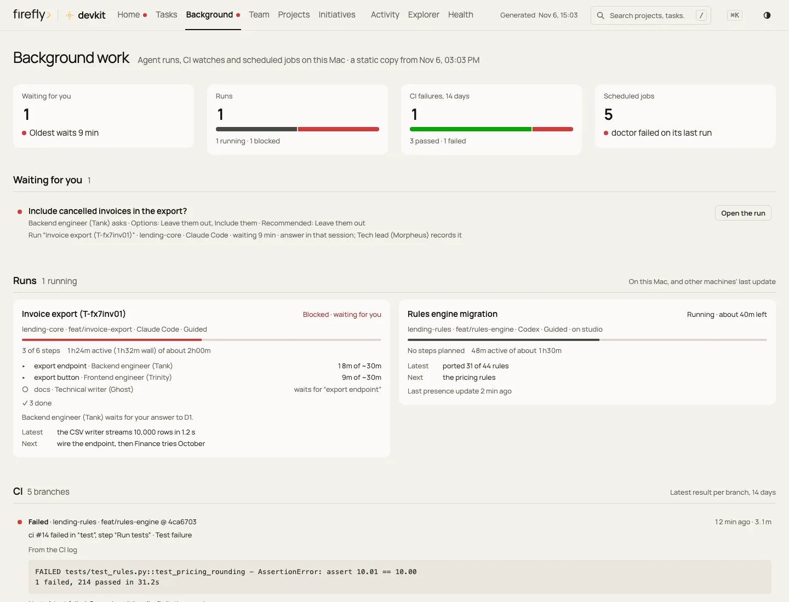

# Tutorial: your first task in Claude Desktop's Code tab

In this tutorial you open a project in the **Code** tab of Claude Desktop, check that devkit is active, and give
devkit's crew a real task: a small reading-list web page. On the way you learn to read everything devkit shows you:
the status block, the progress updates, the moments it waits for you, the crew graph, and the dashboard. It takes
about 30 minutes, most of it while the crew works.

In Claude Desktop, development happens in the **Code** tab. It runs Claude Code on your Mac with the same settings,
hooks, guard, skills, and crew as Claude Code in Terminal. The **Chat** and **Cowork** tabs do not change code: they
report and plan (see [Claude Desktop chat and Cowork](desktop-chat-and-cowork.md)).

## What you need

- devkit installed on your Mac, with every line of `dev doctor` showing `✓`. If you have not installed it yet, follow
  [Your first install, step by step](../getting-started.md#your-first-install-step-by-step).
- Claude Desktop for Mac, signed in with a Claude account that includes Claude Code.
- Bypass mode allowed, for the setup devkit recommends. In Claude Desktop, open **Settings › Code** and turn on
  **Allow bypass permissions mode**. devkit never turns it on for you, because that switch is your consent. On Team
  and Enterprise plans there is no switch, and your organization decides; `dev doctor` tells you which case you are
  in. Without it, choose **Accept edits** in step 2.

## Step 1: create the project folder

A project is a folder with your code in it. Create one in Terminal (Command-Space, type `Terminal`, press Return):

```bash
dev new reading-list
```

It creates `~/Development/_local/reading-list` and prints that path. For a project from GitHub, run
`dev clone <owner>/<repo>` instead; it goes to `~/Development/<owner>/<repo>`.

## Step 2: open the project in the Code tab

1. In Claude Desktop, click **Code** at the top of the window.
2. Open the environment selector under the box where you type, and choose **Local**. A **Cloud** or **SSH** session
   runs on another computer, without devkit.
3. Click the project folder control next to it and choose `~/Development/_local/reading-list`. In the folder window,
   Command-Shift-G lets you type the path.
4. Leave **Worktree** off. When you need a separate copy of a branch, devkit makes one in its own place
   (`dev wt new`), and its guard keeps the workspace tidy.
5. In the mode selector, choose **Bypass permissions**. Claude then works without asking before each command, and
   devkit's guard blocks the unsafe ones. Check the selector before your first message, because Claude Desktop remembers the
   mode per folder.

## Step 3: check that devkit is active

Type this and press Return:

```text
What is this project, and what is its status?
```

The reply starts with a bold line that begins with `[Firefly> DevKit]`, followed by three bullets. For example:

```markdown
**[Firefly> DevKit]** reading-list · `main` · Project status
- **Done:** read the project: an empty git repository with no commits and no tasks yet.
- **Check:** – nothing to verify, a status question
- **Next:** tell me what to build; I plan it and bring in the crew.
```

That block is the **status block**. Every development reply starts with it, so it also proves that devkit's rules are
loaded in this session. If the reply has no such line, go to [When something goes wrong](#when-something-goes-wrong).

## Step 4: give the crew a task

Type this request and press Return:

```text
Build a one-page web app in this folder where I can add books to a reading list and mark them as read. Keep the
list in the browser, add tests, and write a short README that explains how to open it.
```

What happens, and what you see:

1. **devkit routes the request.** Along with your request, devkit tells Claude which kind of work this is and who on
   the crew does it: front-end work, done by the Frontend engineer (Trinity) and approved by the Code reviewer
   (Seraph).
2. **Claude answers as Morpheus, the tech lead.** He posts a plan and an estimate. Work under ten minutes he does
   himself; this request gets steps for the crew.
3. **The crew starts.** Each member Morpheus launches appears in the conversation as an agent with its description,
   for example `Frontend engineer (Trinity): reading list page`.
4. **Progress updates arrive** after each finished step, and every ten minutes or so while a long step runs.
5. **The final report** closes the run: what changed, the evidence, what is not done, and the next step.

You can keep typing while the crew works. A question such as `How is it going?` gets an answer built from devkit's
records.

## Step 5: read what devkit shows you

### The status block, line by line

```markdown
**[Firefly> DevKit]** reading-list · `main` · Reading list
- **Done:** the page adds books and marks them as read; the list stays after a reload.
- **Check:** ✓ 6 tests pass in a headless browser
- **Progress:** 3 of 4 steps · 31 min of ~45 · ETA 10–15 min
- **Crew:** Trinity ✓ the page · Mouse ✓ the tests · Seraph ▸ the review
- **You:** nothing yet; I ask before anything leaves this Mac.
- **Next:** Seraph finishes the review, then I write the final report.
```

| Line | What it tells you |
| --- | --- |
| Header | The project, the branch, and the task in a few words |
| **Done** | What was done or found, in one sentence |
| **Check** | The proof. `✓` checked in this session, `⚠` partly or not checked, `✗` failed, `–` nothing to check |
| **Progress** | Only while a run is going: steps done, time spent, and when it is likely to finish |
| **Crew** | Only when crew members work: each one with `▸` working, `✓` done, or `✗` failed |
| **You** | Only when something waits for you: a decision, an approval, or an action on your Mac or account |
| **Next** | The next step, and who takes it |

macOS shows a notification when a run finishes or gets blocked, so you can switch to other work.

### When devkit waits for you

- **A decision that is yours.** A crew member reaches a choice, for example whether finished books move to the
  bottom of the list. The member stops, and Claude shows you the question with its options and a recommendation. Pick an option
  or type your answer; Morpheus records it and the member goes on.
- **An action that cannot be undone or leaves your Mac**, such as a push to GitHub, a pull request, a merge, a release,
  or deleting data. It waits for your OK, unless you approved it in advance.
- **A file outside your development folder.** devkit's guard asks you to confirm before Claude writes a file somewhere
  unusual, for example on your Desktop.

When the guard blocks a command, the conversation shows the reason. That is expected, and Claude follows it.

### The crew graph

The crew graph shows the whole run at once, with every step, what it waits for, the crew member on it, and what
waits for you. Ask in the session:

```text
Show the crew graph.
```

Or, in Terminal, run `dev crew graph --latest` (the newest run on this Mac). The steps carry `✓` done, `▸` running,
`◇` ready to start, `○` waiting for another step, `✗` blocked, `–` skipped, and `!` reopened to check again; the
[Claude Code tutorial](claude-code.md#the-crew-graph) shows a full example.

### The dashboard

Run `dev dashboard` in Terminal, or ask Claude to open the dashboard. Your browser opens devkit's dashboard, a page on
your Mac that updates by itself while it is open. It opens on **Now**, which says in one sentence whether anything
needs you and when your run lands. Open **Background** (or press `g` then `b`): your run is there with
every step, who owns it, and anything waiting for you.

<picture>
  <source media="(prefers-color-scheme: dark)" srcset="../images/dashboard/background-1440-dark.webp">
  
</picture>

The [Dashboard](../dashboard.md) guide describes every view.

## Step 6: finish

The run ends when every approver has reviewed the work they own: here, Seraph reviews Trinity's page. The final
report starts with the status block, then lists what changed and what is not done. Ask Claude how to open what it
built: a one-page app is a file that opens in your browser.

devkit records the session in the project's handoff note, so the next session, in any app or terminal, starts from
where this one stopped.

## When something goes wrong

| What you see | What to do |
| --- | --- |
| The reply has no `[Firefly> DevKit]` line | Check that the environment is **Local**. Then start a new session in the same folder and ask again. Still missing: run `dev doctor` in Terminal and follow the fix it prints |
| No **Bypass permissions** in the mode selector | Turn on **Settings › Code › Allow bypass permissions mode**. On a Team or Enterprise plan, ask your administrator, or use **Accept edits** |
| Claude asks before every command | The mode selector shows another mode. Choose **Bypass permissions** (or **Accept edits**) |
| devkit changed, but the session behaves as before | Sessions read devkit's rules and hooks when they start. After `dev update` or `dev install`, start a new session |
| A message says the guard denied something | Expected: the guard blocked an unsafe or wasteful action and told Claude the right way |
| The work seems stuck | Look at the **You** line, or ask for the crew graph: a step that says `waiting for decision D1` waits for your answer |
| You asked for a code change in **Chat** or **Cowork** | Those tabs send you here: open the project in the **Code** tab |

[Troubleshooting](../troubleshooting.md) has more problems and their fixes.

See also [Where to use devkit](../surfaces.md), [The crew](../crew.md), and [Agents › Claude Desktop and the ChatGPT
app](../agents.md#claude-desktop-and-the-chatgpt-app).
