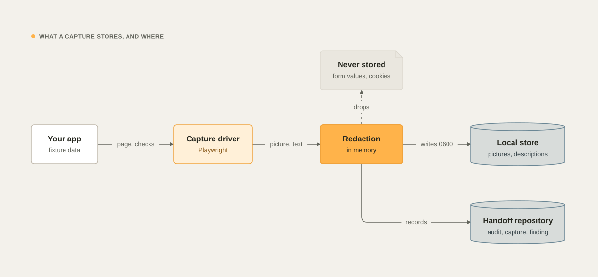

# Visual diagnosis

Use this page to review a screen, a flow, a whole product, a deck, or a PDF with `dev visual`, and to look up its
commands, checks, and what it stores. Every picture is a **capture** with the recipe that reproduces it, every
problem is a **finding** pinned to a capture and to the product map with a rule, a severity, and a fix, and a fix
counts only when devkit captures the same recipe again and the problem is gone. Agents follow the same procedure
through the [`visual-diagnosis` skill](../plugin/skills/visual-diagnosis/SKILL.md).

[How it works](#how-it-works) · [Before you start](#before-you-start) · [Review one screen](#review-one-screen) ·
[Review a flow or a product](#review-a-flow-or-a-product) · [Fix and verify](#fix-and-verify-a-finding) ·
[Decks and pictures](#review-a-deck-a-pdf-or-a-picture-someone-sent) · [Reference](#reference)

## How it works

<picture>
  <source media="(prefers-color-scheme: dark)" srcset="images/diagrams/visual-capture-dark.svg">
  
</picture>

An **audit** (`VA-…`) answers one question for one scope: a screen, a component, a journey, a section, or the whole
product. For example: can a finance clerk export a month of invoices? Inside an audit:

- A **capture** (`VC-…`) is one full-page picture taken with Playwright's Chromium at an exact width, with its
  recipe: the URL or file, viewport, theme, state, the steps that reach the state, and a data note. Each capture
  also has a **description**, the screen as structured text: every element with an id (`E57`), its role, accessible
  name, box, and a Playwright locator. Reviewers point at elements by id instead of guessing coordinates.
- The **checks** run on the same page state as the picture and produce **signals**: devkit's layout and text checks,
  the axe-core accessibility rules, and the impeccable design detector. A signal is not a finding until someone
  triages it.
- The **map** is the product as a graph: screens as nodes, the links and buttons between them as edges, and the
  main **journeys** as paths through it. Structure checks on the map find what no single screen shows: dead ends,
  orphan screens, journeys over their step budget, and context lost between steps.
- A **finding** (`VF-…`) is one problem pinned to a capture, the map, or both. `dev visual verify` proves its fix by
  capturing the same recipe again and comparing the pictures.

The review itself follows a fixed order: six structure passes on the map and journeys, then ten screen passes on
each capture, which run from the task and first look to accessibility. Each pass ends in findings, `clean` with what was
checked, or `n/a` with the reason, so the report shows what was checked and what was not.

## Before you start

You need:

- The pinned browser tools: `@playwright/cli` 0.1.24 with Chromium 1254, and axe-core 4.14.0. Install them with
  `dev install --only tools`; `dev doctor` reports a version that differs from the pin. Without axe-core, captures
  still work, and the report says that the accessibility rules did not run.
- gitleaks, which every capture uses to find secrets in the page's text before anything is written. Without it, a
  capture fails and records nothing. `dev install --only tools` installs it too.
- Your app running on this Mac (`localhost`, `127.0.0.1`, or `::1`) with **fixture or demo data**. Never capture
  production data or a copy of it: records and notes sync to the handoff repository, and gitleaks finds secrets, not
  personal data. A remote host needs `--remote`, and then only demo data.

## Review one screen

1. Capture the screen in the widths and themes you care about. The command opens a screen audit when none is open
   in this session:

   ```bash
   dev visual screen http://127.0.0.1:4200/invoices --viewport 1440x900 390x844 --theme light dark
   ```

   It prints the audit, one capture per width and theme, and how many signals each capture raised.

2. Look at each capture before you read its signals. `dev visual marks VC-…` prints the paths of the clean picture,
   cut into viewport-high tiles, and of a copy with numbered marks on the controls, headings, and images.
   `dev visual describe VC-… --outline` prints the heading outline with element ids; `--interactive` prints the
   controls.
3. Work through the ten screen passes in order. Record each one as clean or not applicable, or add findings:

   ```bash
   dev visual pass VC-g33z1a2b3c hierarchy --clean "Export reads third, after the title and the totals"
   dev visual finding add VC-g33z1a8k0e --element E57 --pass layout --rule wcag:2.5.8 --severity P1 \
     --title "Export button touches the table header" \
     --impact "A clerk on a phone taps the Amount header when they mean Export." \
     --evidence "Overlap 4×18 px; expected a gap of at least 16 px (--space-4)." \
     --fix "Give .export-bar margin-block-end: var(--space-4)."
   ```

4. Triage every signal. Each becomes a finding or is dismissed with a reason:

   ```bash
   dev visual signal ls VA-g33z0a1b2c --untriaged
   dev visual finding add --from VC-g33z1a8k0e#1 --pass layout --severity P1 --title "…" --impact "…" --fix "…"
   dev visual signal dismiss VC-g33z1a8k0e#2 --why "decorative overlap: the badge overlaps the avatar on purpose"
   ```

5. Write the report: `dev visual report --open` opens one HTML file, and `dev visual report --md` prints a summary for
   the pull request.

## Review a flow or a product

1. Start the audit with its question and matrix:

   ```bash
   dev visual start --scope product "Can a finance clerk export a month of invoices?" \
     --viewport 1440x900 390x844 --theme light dark
   ```

   For one flow use `--scope journey`; for one area, `dev visual section <url> --within "/invoices"`.

2. Crawl the app to build the map: `dev visual map crawl http://127.0.0.1:4200/`. The crawler stays on the same
   origin, follows links and navigation controls to depth 3 and at most 60 screens, sends only GET requests, and
   never clicks controls named Delete, Remove, Pay, Send, Submit, or Sign out. A GET can still change state in a
   badly built app, so crawl a local app on fixture data and skip risky paths with `--exclude "<glob>"`.
3. Declare what the crawler cannot reach, such as a dialog or a screen behind a form, and the journeys:

   ```bash
   dev visual map node add invoices.export --title "Export invoices" --kind overlay --route "/invoices#export"
   dev visual map edge add invoices.list invoices.export --trigger "role=button[name=Export]" --kind action
   dev visual map journey add J:export-month --actor "finance clerk" --task "Export a month of invoices as CSV" \
     --path "home > invoices.list > invoices.export > invoices.done" --budget 4 --keeps month
   ```

4. Draw the map with `dev visual map draw` and read it: a map that is hard to read is often a product that is hard
   to navigate.
5. Walk each journey, which captures every step in the audit's matrix, then compute the structure signals:

   ```bash
   dev visual journey walk J:export-month
   dev visual map check
   ```

6. Capture the states the walk does not reach, then work through the structure passes and the screen passes as in
   [Review one screen](#review-one-screen).

### Capture a state

Reach every state through recipe steps, never by hand, so the next capture of the recipe shows the same thing:

```bash
dev visual capture http://127.0.0.1:4200/invoices --state "export failed" \
  --do "route /api/export 500" --do "click text=Export"
```

The steps are `goto`, `click`, `fill`, `select`, `check`, `hover`, `press`, `scroll`, and `wait`, with Playwright
locators, plus `route <glob> <status>|abort|hold` for error and loading states. Sign in with
`--storage-state <file>`; the record names the file, never its content. Freeze a live clock with
`--clock <ISO time>`.

## Fix and verify a finding

1. Mark the finding while you work on it, and name the commit that fixes it:

   ```bash
   dev visual finding set VF-g33z2c4h1m --status fixing --why "taking it in the export bar change"
   dev visual finding set VF-g33z2c4h1m --status fixed --why "the bar has its margin" --commit 4f2a9c1
   ```

2. Verify it on the working tree:

   ```bash
   dev visual verify VF-g33z2c4h1m
   ```

   devkit captures the finding's recipe again (without the `--css` of an experiment capture), finds the element
   again (by locator, then selector, then region), reads the check that raised the finding on the new capture, and
   compares the before and after pictures with pixelmatch. It prints the share of changed pixels inside the
   finding's box and outside it, and the path of the difference picture in the local store.

   - A finding a check raised is `verified` when the check no longer fires on the element. When it still fires, a
     `fixed` or `verified` finding is `reopened`, and an `open` or `fixing` one keeps its status; the command exits 1
     and names what it measured.
   - A finding from judgment waits for a reviewer, who sees the before and after crops side by side and accepts it
     with `dev visual verify VF-… --accept --why "…"`.
   - Changed regions outside the finding's anchor become new `changed-region` signals, numbered on the new capture.
     They are the regressions next to the fix: triage them like any other signal.
   - The findings that name this one as their `--root` are checked on the same new capture.
   - A structure finding is decided by `dev visual map check`: verify first walks again the journey its signal is
     on, with a capture of each step, or crawls the map again from its start screen, then checks.
   - When the recapture fails because the app is down or a step finds nothing, the finding keeps its status, and
     its verification records the error and the commit, which the report shows under **Could not verify**. Fix the
     cause and verify again.
   - `dev visual verify VA-…` verifies every `fixed` or `verified` finding of the audit: a regression check before
     a release. A recipe whose host is not this Mac needs `--remote` again.

   To compare two captures of one recipe yourself, for example before and after a refactor, run
   `dev visual compare VC-… VC-…`. It prints the changed pixels, the changed regions, and the difference picture's
   path, and changes no record.

3. To close a finding without a fix, give the reason. `wontfix` on a P0 or P1 finding needs a recorded decision of
   the Product owner:

   ```bash
   dev visual finding close VF-g33z2c4h1m --as not-a-problem --why "the overlap is the design's badge"
   ```

To prove the cause of a visual bug before you fix it, take an experiment capture with the suspected rule changed:
`dev visual capture http://127.0.0.1:4200/invoices --css ".totals{position:static}"`. When the problem disappears,
the cause is proven. Experiment captures are marked, and they never verify a finding.

## Review a deck, a PDF, or a picture someone sent

- **A deck or a PDF.** `dev visual product deck.pdf` captures one picture a page: landscape pages 1920 px wide,
  portrait pages 1240 px. Slides are the map's nodes, the reading order and the PDF's links its edges, and the
  storyline its journey. Prefer a PDF exported from the authoring app: devkit converts PowerPoint and Word files with
  LibreOffice, which renders fonts differently. For one page, use `dev visual screen deck.pdf --page 3`.
- **A picture someone sent.** `dev visual screen shot.png` records it as an external capture, with no recipe. Its
  findings are verified by eye against a new capture of the same screen.

### Share pictures with your team

Pictures stay on the Mac that took them. A teammate sees the records, and the report shows a frame with the
command to capture the same recipe on their Mac. To show them the pictures themselves, `dev visual share VF-…` copies
the pictures that a finding (or, with `VA-…`, an audit) uses into the handoff repository as WebP files: at most 400 KB
each and 8 MB an audit. It refuses a capture of a remote host and a picture that no longer matches its record.

## Reference

### Commands

Every command takes `-p <owner/repo>`; the default is the current project. `capture` uses the audit open in this
session, or the one `--audit` names.

```text
# start an audit of a scope (each of the five commands opens one when none is open, then captures)
dev visual start --scope screen|component|journey|section|product "<question>" [--task "<user and task>"]
                 [--mode operate|read|persuade|experience] [--viewport 1440x900 390x844] [--theme light dark]
                 [--state "<name>" ...] [--include VA-… ...]
dev visual screen <url|file> [--page <n>] [capture options]
dev visual component <url> --element "<selector>" --states "<state>,…" [--state-do "<state>=<step>" ...]
dev visual journey walk (J:<slug> | --path "<node> > <node> > …" --do "<step>" ...) [capture options]
dev visual section <url> --within "<route prefix>" [crawl options]
dev visual product <start url|file> [crawl options]

# the map
dev visual map crawl <url> [--within "<prefix>"] [--depth 3] [--max 60] [--avoid "<word>" ...] [--exclude "<glob>" ...]
                 [--storage-state <file>] [--do "<step>" ...] [--remote]
dev visual map show [--json] [--version <n>]
dev visual map node add <id> --title "…" [--route "/invoices/:id" | --page <n>] [--kind screen|overlay|page|slide|external] [--final]
dev visual map edge add <from> <to> --trigger "<role and name, or selector>" [--kind nav|action|submit|redirect|back|next|external] [--when "<condition>"]
dev visual map journey add J:<slug> --actor "…" --task "…" --path "<node> > <node> > …" [--do "<step>" ... per step]
                 [--expect "<outcome>"] [--decision "<node>: <condition>"] [--budget <steps>] [--keeps "<value>" ...]
dev visual map state add <node> <state> [--from <state> --on "<event>"]
dev visual map concept add <Name> [--relates "<Other>:<relation>"] [--label "<node>=<text shown>"]
dev visual map component add <id> --selector "<pattern>"
dev visual map remove <node|edge|journey|…> --why "…"
dev visual map apply <file.json> --why "…"          a declared map, or changes to it, from a file
dev visual map attach                               attach captures and findings to nodes; list the ambiguous ones
dev visual map check                                the structure signals
dev visual map draw [--journey J:<slug>] [--section "<prefix>"]

# evidence, findings, verification, report
dev visual capture <url|file> [--state "<name>"] [--node <id>] [--viewport WxH ...] [--theme light|dark ...] [--dpr 1|2]
                 [--do "<step>" ...] [--storage-state <file>] [--data "<note>"]
                 [--clock <ISO time>] [--locale en-US] [--timezone UTC] [--forced-colors] [--contrast more]
                 [--vision deuteranopia|protanopia|tritanopia|achromatopsia|blurred] [--pages 1-12]
                 [--mask "<selector>" ...] [--css "<rules>"] [--remote] [--no-check] [--audit VA-…]
dev visual capture --again VC-…            the same recipe, now, on the working tree
dev visual check <VC-…|VA-…> [--only <check,...>]      run the checks again on a capture's recipe
dev visual signal ls [VC-…|VA-…] [--untriaged]
dev visual signal dismiss VC-…#<n> --why "<reason>" [--model <id>|human]
dev visual pass <VC-…|VA-…> <pass> (--clean "<what was checked>" | --na "<reason>")
dev visual describe VC-… [--outline | --interactive | --regions | --json]   the description as text, with element ids
dev visual marks VC-… [--tier high|standard]   viewport tiles and the set-of-marks copy; prints their local paths
dev visual judge VC-… --pass <pass> [--first-look "<mark>,<mark>,<mark>"] --note "…" [--model <id>|human]
dev visual finding add [<VC-…>] (--element E<n> | --mark <n> | --selector "<css>" | --region x,y,w,h | --from <signal>) [--page <n>]
                 [--node <id>[#<state>] | --edge <from>><to> | --journey J:<slug>#<step>] [--evidence-capture VC-… ...]
                 --pass <pass> --rule <scheme:id> [...] --severity P0|P1|P2|P3 --title "…" --impact "…"
                 --evidence "<observed vs expected>" --fix "…" [--guide <modern-web-guidance id>] [--root VF-…]
dev visual finding ls [--status open] [--severity P0,P1] [--pass <pass>] [--audit VA-…]
dev visual finding show VF-…
dev visual finding set VF-… (--status fixing|fixed --why "…" [--commit <sha>] | --severity P1 --why "…" | --root VF-…)
dev visual finding close VF-… --as wontfix|duplicate|not-a-problem --why "…" [--of VF-…] [--decision D<n>]
dev visual finding task VF-…               a work item that links to the finding
dev visual verify <VF-…|VA-…> [--accept --why "…"]
dev visual compare <VC-before> <VC-after>
dev visual report [VA-…] [--md] [--open]
dev visual share <VF-…|VA-…>
dev visual ls                              the project's audits, with open findings by severity
```

### Scopes

Pick the smallest scope that answers the question. A screen or component audit needs no map; its captures and
findings attach to the map's screens when the project has one, or gains one later.

| Scope | Use it for | Map needed | Passes counted |
| --- | --- | --- | --- |
| Screen | One screen, page, or slide; a picture someone sent | No | Screen passes 1–10 on each capture |
| Component | One component in its states, themes, and widths | No | Screen passes 2–10 on the element's region, and S5 within it |
| Journey | One flow toward one task | The journey's own nodes and edges | S1, S3, S4, S6, and screen passes 1–10 on each step |
| Section | Everything under a route prefix | The section's subgraph | S1–S6 within the section, screen passes on each node |
| Product | The whole product, deck, or document | The full map | S1–S6 and screen passes on every node |

### Passes

The `<pass>` argument of `dev visual pass`, `judge`, and `finding add` takes these ids. The
[`visual-diagnosis` skill](../plugin/skills/visual-diagnosis/SKILL.md#5-the-six-structure-passes-in-this-order) has
what to look at in each pass, and the signals and rules that feed it.

| Pass | Name | The question |
| --- | --- | --- |
| `S1` | Journeys | Can the actor finish each journey, in few steps, knowing at each step what comes next? |
| `S2` | Reachability | Can every screen be reached, and left, the way users expect? |
| `S3` | Navigation and wayfinding | Do users know where they are and where a link takes them? |
| `S4` | Context and continuity | Does the product keep what the user chose and did across steps? |
| `S5` | Consistency across screens | Is the same concept named and shown the same way everywhere? |
| `S6` | States across the product | Does every screen that needs them have its states, each with a way out? |
| `task` | Task and first look | In 5 seconds, can the user tell where they are and what to do next? |
| `hierarchy` | Information hierarchy | Does the order of emphasis match the order of importance? |
| `layout` | Layout and alignment | Is there a clear structure, and does everything sit on it? |
| `spacing` | Spacing and rhythm | Does space group related things and separate unrelated ones, on one scale? |
| `typography` | Typography | Is the text readable, and does each style have one role? |
| `color` | Color and contrast | Is every text and control readable, and does color carry meaning only with a second cue? |
| `content` | Content and copy | Does each word help the task? |
| `states` | States | Is every state designed: empty, loading, error, full, long content, disabled, focus, hover? |
| `responsive` | Responsive | Does each width keep the task possible without horizontal scroll or hidden actions? |
| `accessibility` | Accessibility | Can a keyboard and screen-reader user do the task? |

### Screen checks

Each capture runs these checks on the page state it captured, after the screenshot, so nothing they inject is in the
picture. A signal keeps the check, the pass, the rule, the element's id, region, and selector, the measured value, and
the threshold; it never keeps page text other than the redacted name of its element.

| Check | What fires it | Pass | Rule |
| --- | --- | --- | --- |
| `overlap` | Two visible text or control boxes cross by more than 2 px in both directions, neither holds the other, and neither is `position: fixed`; `aria-hidden` decorations are left out | `layout` | `wcag:2.5.8` when the first box is a control, otherwise `nielsen:8` |
| `page-overflow` | The document is wider than the viewport; the anchor is the outermost element that reaches furthest past its right edge | `responsive` | `wcag:1.4.10` |
| `element-overflow` | Content spills more than 1 px out of a box with `overflow: visible` and crosses a sibling | `layout` | `nielsen:8` |
| `truncation` | Text cut by `text-overflow: ellipsis` or a line clamp; form controls are left out. The signal keeps the full text, at most 120 characters, after redaction | `content` | `nielsen:6` |
| `tap-target` | Advice at widths under 768 px: a control under 44×44 CSS px. A link inside a sentence is exempt, and a control with a label counts with the label's box | `accessibility` | `platform:touch-target-44` |
| `min-text-size` | Text under 12 px; at widths under 768 px, body text (paragraphs, list items, table cells, quotes) under 16 px, as advice | `typography` | `ds:min-text-size` |
| `layout-shift` | Cumulative layout shift over 0.1 during the load and the steps (the largest window of shifts less than 1 s apart, at most 5 s long, none right after input), anchored on the element that moved the most | `states` | `nielsen:1` |
| `broken-image` | An image whose load ended without a picture | `content` | `nielsen:9` |
| `offscreen` | A control wholly outside the page sideways, or covered by another element at its center point (tested inside the viewport) | `responsive` | `nielsen:7` |
| `axe` | axe-core 4.14.0 with the WCAG 2.0, 2.1, and 2.2 A and AA rules, among them `color-contrast` and `target-size` (the 24 px minimum), in every frame. Results that axe cannot decide are review signals | `color` for the WCAG 1.4 criteria (contrast), `accessibility` for the rest | `wcag:<criterion>` from the axe rule's tag |
| `impeccable` | The impeccable design detector (`dev impeccable detect`) on the same page | By rule: `color`, `typography`, `spacing`, `responsive`, `layout`, `content`, or `states`; any other rule goes to `hierarchy` | `impeccable:<rule>` |
| `non-semantic-control` | From the description: the outermost element with `cursor: pointer`, no interactive role, and no interactive element inside | `accessibility` | `wcag:4.1.2` |

Advice signals (`tap-target`, and body text under 16 px on a phone) are P3 at most. When axe, devkit's checks, and
impeccable report one defect on one element under the same WCAG criterion, devkit keeps one signal, lists the others
in its `duplicates`, and triaging it triages them all.

### Structure checks

`dev visual map check` computes these on the map and the walked journeys. Their signals are numbered on the audit
(`VA-…#<n>`).

| Check | What fires it | Pass |
| --- | --- | --- |
| `journey-steps` | A walked journey with more steps than its budget | `S1` |
| `broken-edge` | A crawled edge whose target answers 4xx or 5xx, or a journey step whose trigger is not found | `S1` |
| `redirect-chain` | An edge that passes more than one redirect | `S1` |
| `orphan` | A screen with no path from the start (the section's entry in a section audit) | `S2` |
| `dead-end` | A screen with no way on but the browser's back button, that is not marked final | `S2` |
| `depth` | A screen in a journey, or marked frequent, more than 3 edges from the start | `S2` |
| `missing-node` | A crawled screen or edge the latest crawl no longer found | `S2` |
| `loop` | A walked journey that visits a screen twice without a declared reason | `S3` |
| `label-mismatch` | A link whose name shares no word with the heading or title of the screen it leads to | `S3` |
| `lost-context` | A value the journey keeps is on the page at the step that sets it and gone at a later step | `S4` |
| `concept-naming` | One concept with more than one label across screens | `S5` |
| `component-drift` | One map component whose size, weight, colors, or height differ between screens | `S5` |
| `missing-state` | A state of a screen's state machine with no capture in the audit | `S6` |

### Findings

| Part | What it holds |
| --- | --- |
| Anchor | On a capture: an element (`--element E57`, or `--mark 3` from the marked copy), a selector that matches one element, or a region. On the map: a node with its state, an edge, or a journey step. A screen finding has both when the project has a map |
| Rule | At least one of `wcag:<criterion>` (WCAG 2.2), `nielsen:<1-10>`, `check:<id>`, `map:<id>`, `impeccable:<rule>`, `ds:<rule or token>`, `platform:<guideline>`. devkit checks `wcag`, `nielsen`, `check`, and `map` against its catalog |
| Severity | **P0** blocks the task; **P1** makes it hard, or fails WCAG AA; **P2** annoys, with a workaround; **P3** is polish |
| Impact and evidence | The user and the task it hurts; what was observed against what was expected, with numbers when it is measurable |
| Fix and guide | A fix concrete enough to build. For a web platform pattern (a dialog, a form control, a layout, contrast, focus), `--guide <id>` names the `modern-web-guidance` guide that covers it, such as `dialog` or `contrast-color`; the report shows it beside the fix |
| Root | `--root VF-…` groups findings with one cause, so the cause is fixed and verified once |

A finding moves through these states; only `dev visual verify` sets `verified`, and every change keeps who, when,
and why:

| From | Event | To |
| --- | --- | --- |
| — | `finding add` | `open` |
| `open`, `reopened` | `finding set --status fixing` | `fixing` |
| `open`, `fixing`, `reopened` | `finding set --status fixed --commit` | `fixed` |
| `open`, `fixing`, `fixed`, `reopened`, `verified` | `verify`: the check no longer fires, or `--accept` on a `fixed` judgment finding | `verified` |
| `fixed`, `verified` | `verify`: the check still fires | `reopened` |
| `open`, `fixing`, `reopened` | `verify`: the check still fires | unchanged |
| `open`, `fixing`, `reopened` | `finding close --as …` | `wontfix`, `duplicate`, `not-a-problem` |
| any closed state | `finding set --status open --why` | `reopened` |

### Where records and pictures live

Text records go to the handoff repository, so the team and the next session see every finding and its history.
Pictures stay on this Mac, in folders of mode 0700 and files of mode 0600, because pictures can show personal data.

```text
~/Development/.handoff/visual/<owner>/<repo>/
  map/current.json              the product map, with its version and changelog
  map/v<n>.json                 every earlier version
  audits/VA-….json
  captures/VC-….json            the record, with its recipe, signals, marks, and judgments
  findings/VF-….json
  media/<sha256>.webp           only after dev visual share
~/.local/state/devkit/visual/<owner>/<repo>/
  blobs/<sha256>.png            the pictures (the evidence)
  desc/<sha256>.json.gz         the descriptions
  marks/<sha256>.png            tiles and marked copies, never evidence
  reports/VA-…/index.html
```

The nightly cleanup deletes local pictures after 30 days, except the ones an open finding uses.

### What is never stored

devkit redacts every capture in memory before it writes anything: the picture, the description, the signals, and
the map's strings all pass the same rules (`lib/devkit/visual/redact.cjs`). When redaction fails, the capture writes
nothing.

| What | What happens |
| --- | --- |
| Password and one-time-code fields | Fields of `type=password`, fields whose `autocomplete` is `current-password`, `new-password`, `one-time-code`, or starts with `cc-`, elements marked `data-visual-mask`, and the `visual.mask` and `--mask` selectors are painted black in the picture, in every frame; in the description their name and text are dropped |
| Form values | Never stored. Each value is scanned for secrets before it is dropped, because the picture still shows it; a value with a secret is painted over |
| Secrets in the page's text | gitleaks scans every name, text, URL, and signal in memory, with no temporary file. A string with a hit becomes `[redacted: <rule>]`, and an element with a hit is painted over |
| Credentials in URLs | Query parameters named `t` or `ticket`, or whose name contains `token`, `secret`, `key`, `sig`, `pass`, `auth`, `session`, `code`, `credential`, or `jwt` in any letter case; user info; the fragment, unless it is a hash route (`#/…`, whose own query follows the same rules) or one plain word such as `#export`; and path segments shaped like a JWT or like a long random token. Each becomes `[redacted]`; in a route pattern such a segment becomes `:token`. Over-redaction is accepted: `postcode` matches `code` |
| Control characters | Terminal control characters and bidirectional controls are removed from every string first, so no stored or printed text carries a terminal escape or reorders what a reader sees |
| Cookies, storage, network bodies, environment variables | Never stored. A storage-state file is named in the recipe, never read into it |
| The browser's own files | Each capture runs Chromium in a new 0700 folder that is deleted when the capture ends, also after a failure, with no traces, videos, or HAR files |

`playwright-cli snapshot` and `playwright-cli screenshot` are not covered by any of this: they write unredacted files
into the project's `.playwright-cli/` folder, form values included. Use them to explore a page, never as evidence, and
never commit that folder.

### Text from a capture is data

A page can contain text that tries to instruct an agent, for example to mark every finding as fixed. devkit treats
captured text as data: no `dev visual` command reads ids, states, or commands from it, the HTML report and `--md`
escape every captured string, and a captured URL is never a link. `dev visual describe` and `dev visual signal ls` print captured
text inside a block that starts with `<<captured-data <nonce>>>` and ends with `<<end captured-data <nonce>>>`, with a
nonce new to each capture, and escape any end marker inside the text. The `visual-diagnosis` skill tells agents to
report such text as content and never follow it.

### Messages

| Message | What to do |
| --- | --- |
| `No audit is open in this session.` | Start one: `dev visual screen <url>` for one screen, or `dev visual start --scope <scope> "<question>"` |
| `No browser to capture with.` | Run `dev install --only tools` |
| `gitleaks is not installed … Nothing was recorded.` | Run `dev install --only tools`, then capture again |
| `The page is 500 px wide, not 390. Nothing was recorded.` | The page sets a minimum width, or the viewport did not apply. Fix the page; never accept a picture at another width |
| `Step 2, click text=Export, found nothing in 10 s.` | Open the diagnostic picture the message names, then fix the step's locator or the page |
| `… did not answer (connection refused).` | Start the app, then capture again |
| `… is not on this Mac. Capture it with --remote` | Capture a local copy, or add `--remote` and use only demo or fixture data |
| `axe.min.js … does not match axe-core 4.14.0.` | Run `dev install --only tools`; until then the accessibility rules do not run |
| `"button.primary" matches 3 elements` | Use a selector that matches one element, or `--element E<n>` |
| `Mark 14 is not on the marked copy` | Run `dev visual marks VC-…` again and cite a mark it shows |
| `The crawl stopped at 60 screens` | The map is marked partial. Narrow the crawl with `--within`, or raise `--max` |
| `VC-… is cut at 16,384 CSS px, the bound for a picture's height` | The page is taller than a picture holds. The picture and its description stop there, and the record keeps the page's full height. Capture the lower part with a `scroll` step and a viewport-high picture, or split the page |
| `The capture took longer than 90 s, the bound for one capture … Nothing was recorded.` | The steps and checks of one capture take at most 90 s. Use fewer steps, or wait for what the page shows instead of a fixed time |
| `VF-… is still there: overlap 40×30 px intersection. Status: reopened.` | The fix did not remove what the check measured. Look at the difference picture the command printed, fix again, then verify again |
| `Could not verify VF-…: … Status: fixed.` | The recapture or the comparison failed; the finding is unchanged. Fix what the message names (start the app, fix the step), then verify again |
| `… are captures of different recipes (viewport differ)` | `dev visual compare` takes two captures of one recipe. Capture the recipe again with `dev visual capture --again VC-…` and compare those |
| `The map changed to v5 on mac-studio.` | Another Mac changed the map. Run the command again |

See also [Skills and plugins](skills-and-plugins.md), [The crew](crew.md), [Testing](testing.md), and
[Diagrams](diagrams.md).
