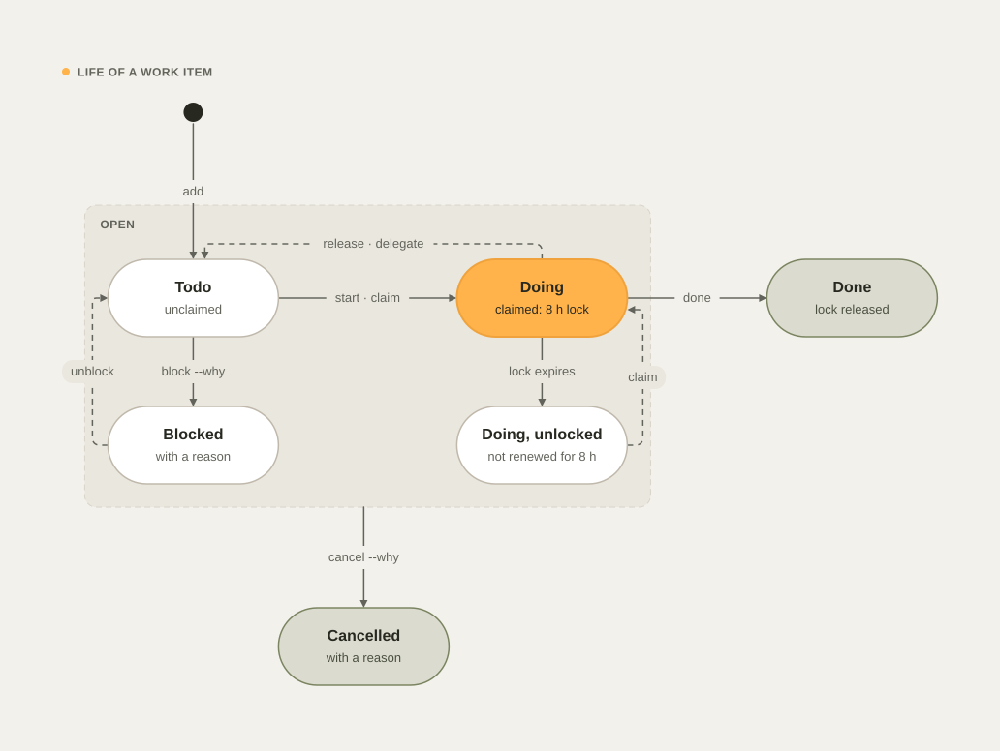
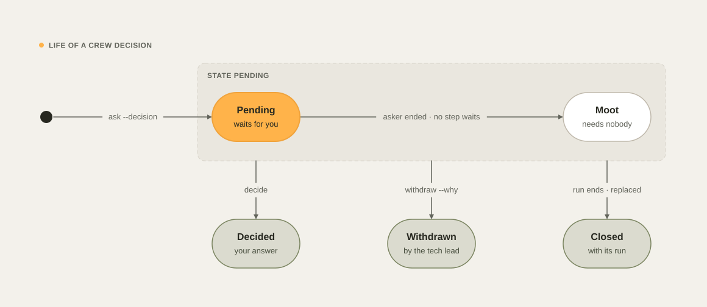

# Work states

devkit keeps a record of each piece of work in flight: work items and their locks, progress runs with their steps
and crew lanes, decisions and crew messages, CI watches, the pinned install, and branches. This page explains the
states each record moves through, what moves it, where you see it, and how to set it right when it no longer
matches what happened.

## Why records drift

A record changes only when devkit sees an event: a `dev` command, a hook, or a scheduled job. Some events never
reach it. A session ends without a word, GitHub merges a branch, an agent is stopped before its report, a lock
outlives the work it guarded. The record then keeps its last state, and what you read in `dev status`, the dashboard,
and the session context is no longer true.

devkit closes that gap in three ways:

- **It reads the event from another source.** A merge is in git's history and in the pull request, an interrupted
  crew member is in its transcript, and a session's end is in its session record.
- **It lets a claim run out.** A lock, a crew lane, and a CI watch each end on their own when nothing renews them.
- **It reports drift and leaves the fix to you.** The `work state` check of `dev doctor` and the **Work state**
  panel of the dashboard's Health view name each stale record with the command that fixes it. Neither changes
  anything.

| Record | States | What moves it | Repair |
| --- | --- | --- | --- |
| [Work item](#work-items-and-locks) | todo, doing, blocked, done, cancelled | `dev task`, the background sync, `dev pr merge` | `dev task reconcile --apply` |
| [Progress run](#progress-runs-steps-and-crew-lanes) | running, blocked, done, orphaned | `dev progress`, the session hooks | `dev progress done`, `dev session carry` |
| [Step](#steps) | pending, running, blocked, done, skipped, unverified | `dev progress`, crew reports | `dev progress reopen`, `skip`, `confirm` |
| [Crew lane](#crew-lanes) | running, done, unverified, stopped, lost | SubagentStart, SubagentStop, TaskStop | a new launch from `dev crew next` |
| [Decision](#decisions) | pending (or moot), decided, withdrawn, closed | `dev crew ask --decision`, `decide`, `withdraw`, the run's end | `dev crew withdraw` |
| [Crew message](#crew-messages) | question, notice, answer | `dev crew ask`, `dev crew answer`, devkit | `dev crew answer` |
| [CI watch](#ci-watches) | live, expired, ended | a push, a pull request, a merge, a release, `dev ci watch --wait` | the re-arm command `dev ci watches` prints |
| [Install](#the-install-pin) | pinned release, older session | `dev install`, `dev update` | restart the session |
| [Branch](#branches-after-a-merge) | open, merged, pruned | the merge test, `dev branch prune`, `gc` | `dev branch prune --apply` |

## Work items and locks

A work item is open while it is `todo`, `doing`, or `blocked`, and closed when it is `done` or `cancelled`. Starting
it takes a lock: your name and an expiry time, pushed to the handoff repository so that every machine sees it.

<picture>
  <source media="(prefers-color-scheme: dark)" srcset="images/diagrams/work-item-lifecycle-dark.svg">
  
</picture>

| Event | What changes |
| --- | --- |
| `dev task start <n>` (or `claim`) | todo becomes doing, with a lock for `work.lock_hours` (8). The command reports success only when the lock is on the remote. On a work branch, it links the item to that branch |
| `dev branch new`, `dev wt new` | Link the one item you hold with no branch to the branch they create, and say so |
| The Stop hook's background sync, at most every 2 minutes | Renews a lock once less than half its time is left, but only while one of your live sessions is on the item's branch |
| The hourly `sync` job, on any machine | Releases each lock whose time ran out, in one commit: doing goes back to todo, and blocked stays blocked |
| `dev pr merge` | Marks the open items linked to the merged branch done, with the pull request and the merge commit in their changelog |
| `dev release` | Refuses to tag while items linked to branches merged since the previous tag are open, unless you give `--why` |
| `dev task reconcile --apply` | Sends doing items without a lock back to todo, and marks open items of merged branches done, in one commit |
| `dev task start`, `release`, `done`, `move`, `block`, `cancel`, `unblock` | `start`, `release`, `done`, `move`, `block`, and `cancel` apply to open items only: a done or cancelled item keeps the state it was closed in, and the refusal names `dev task reopen <id> --why "<what is left>"`. `unblock` applies only to a blocked item |

Renewal follows the branch because the branch is where the work happens. When every live session renewed every lock
its machine held, a lock on work nobody touched stayed for days, and its item stayed doing. Now a lock lives only as
long as someone works on its branch.

**Where you see it.** The session context lists your claimed items and the items others hold. `dev task` and
`dev team` show the board and who holds what. `dev doctor` and the dashboard's Health view list three kinds of stale
item: doing without a lock, open although its branch is merged, and two items with one title.

**Repair.** `dev task reconcile` lists the stale items and changes nothing; `--apply` fixes the first two kinds.
Cancel a duplicate with `dev task cancel <n> --why "duplicate of <id>"`, and reopen an item a merge closed too early
with `dev task reopen <n> --why "<what is left>"`. [Teams and machines](teams.md#shipped-and-stale-items) has the
details, including how devkit tells that a branch was merged.

## Progress runs, steps, and crew lanes

A run is the plan of one agent session, started with `dev progress start`. Its steps belong to the main session or
to a crew member, and each crew member works in a lane of its own (see [The crew](crew.md#lanes-and-time)).

### Runs

A run is `running` or `blocked` while it is open, and `done` when `dev progress done` ends it. It becomes `orphaned`
when its session ends with the run still open. An orphaned run runs again in the session that works on it: when
its own session resumes, or when `dev session carry` moves it into the session that `/clear` started. The run's
history records why it ran again.

`dev progress done` refuses to end a run that does not match what happened:

- **A crew member still owns a running step.** Ending the run would close work its member is still doing. Wait for
  the report, or skip the step on purpose with `dev progress skip "<step>" --why "…"`. Neither `--force` nor `--why`
  passes this check.
- **A step is pending**, or an Accountable member has not approved the work they own, or a step is flagged for a
  recheck. `--why` ends the run anyway, and the reason is recorded.
- **A decision still needs you.** A moot decision does not count (see [Decisions](#decisions)).

When the run ends, every decision still pending in it, moot ones included, closes with the run.

### Steps

A step is `pending` until it starts, `running` while someone works on it, `blocked` while it waits on a decision,
and `done` or `skipped` at the end. A crew member's step ends `unverified` when the member stops without evidence.

When you reopen a step, the finished steps that used it keep their state and get a recheck flag, because their work
used the old version. The flag clears when such a step finishes again after the reopened steps are closed, or when
you confirm that its work still holds with `dev progress confirm <step> --why "…"`. `confirm` is refused while a
reopened step it used is still open, because there is nothing to check it against yet.

### Crew lanes

A lane is `running` from SubagentStart until its member reports. At SubagentStop it ends `done`, or `unverified` when
the member's report has no evidence. A SubagentStop that arrives while another hook holds the run's lock is saved
and replayed, so a report is never lost.

A member can also stop without a report:

- **TaskStop.** Claude Code fires no SubagentStop for an agent that TaskStop stops, so the PostToolUse hook ends its
  lane as `stopped`. Its crew slot frees at once, and its open steps go back to pending, waiting for a new launch.
- **An interruption.** When the member's transcript ends with its interruption, devkit ends the lane as `stopped`
  the same way.
- **Silence.** A lane that stops reporting for too long, or whose session ended, is `lost`, and its steps go back to
  pending. A lost lane that reports again runs again.

A member that works again after its lane ended takes a crew slot like a launch. While no slot is free, it may read
but not write, and the tech lead is told once; it takes its slot at its first tool call after one frees. When a
step and its files go to another lane, a lane that kept those files may read but not write until the tech lead
assigns it a step.

When Claude Code gives the main conversation a new session id after a compaction, the session's open run moves to
the new id with its working lanes, and the run's history and the audit trail (`session.adopt`) record the move.

Your answer to a decision never brings back a lane that ended. The step the decision blocked goes back to pending
instead, and the tech lead launches the member again with your answer.

**Where you see it.** The Progress and Crew lines of the status block, `dev progress`, `dev crew`, `dev crew next`,
and the dashboard's Now and Runs views. `dev time` lists only the runs that are still live. `dev doctor` and the
dashboard's Health view list a run with no step change for `work.lock_hours` (8), and a run that began before the
project's latest release tag.

**Repair.** In the run's own session, end a finished run with `dev progress done "<outcome>"`, or record where it
stands with `dev progress step`. After `/clear`, take the previous session's run with `dev session carry` (see
[Continuity](continuity.md#resume-and-clear)). Relaunch the step of a stopped or lost lane from `dev crew next`.

## Decisions and crew messages

### Decisions

A crew member asks for your decision with `dev crew ask --decision`. The decision is `pending` until one of three
things ends it.

<picture>
  <source media="(prefers-color-scheme: dark)" srcset="images/diagrams/decision-lifecycle-dark.svg">
  
</picture>

A pending decision is **moot** when the crew member that asked it has ended and no step is blocked on it: nobody
waits for the answer. A moot decision is shown on a quiet line of its own under its run, never under **Needs you**,
and it does not stop `dev progress done`. If you answer it anyway, your answer still counts.

| End | What causes it |
| --- | --- |
| `decided` | Your answer, which the tech lead records with `dev crew decide`, or the recommended option in auto mode |
| `withdrawn` | The tech lead's `dev crew withdraw <id> --why "…"`. It frees a step blocked on the decision, tells the asking member when it still works, and records the reason in the run's history and the audit trail (`crew.withdrawn`). It is never your answer, and it opens no irreversible action |
| `closed` | The run ended (`dev progress done`) or was replaced (`dev progress start --replace`). The reason goes in the run's history and the audit trail |

### Crew messages

Every crew message has a kind:

| Kind | Sent by | Waits for an answer |
| --- | --- | --- |
| `question` | `dev crew ask` by a member or the tech lead | Yes, until someone answers it |
| `notice` | CI watch and devkit: the result of a CI run, a step or launch notice, a decision's result | No: it closes once delivered |
| `answer` | `dev crew answer <id> "…"` | No: it closes once delivered, and it answers the question it names |

A message to the tech lead by role, such as `--to "Tech lead"` or `--to Morpheus`, reaches the main session.

**Where you see it.** `dev status` lists under **Needs you** the decisions that wait for you and the questions to
the tech lead that nobody answered, each with its command. The dashboard's Now view shows the same, with each moot
decision under its run. `dev crew decisions` marks moot decisions, and `dev crew decisions --pending` leaves them
out. After a compaction, the continuity brief lists only the messages that still wait.

**Repair.** Answer a waiting question with `dev crew answer <id> "…"`. Withdraw a decision that no longer matters
with `dev crew withdraw <id> --why "…"`, or end the run, which closes the decisions it still holds.

## CI watches

Two kinds of watch follow the CI runs of a commit:

- **devkit's background watch.** The PostToolUse hook starts it after a push, a pull request created or made ready,
  a merge, or a release in a main session: one per repository, branch, and commit. It follows only what reached
  `origin`: the pushed branch or tag, the merge commit on the default branch, the release tag. Its result reaches the
  session at the session's next hook.
- **The agent's wait.** `dev ci watch --wait` prints one line per finished job and a last line with the result, so
  its output wakes the agent that waits on it: through a Monitor or a background command on Claude Code, and in the
  foreground on Codex.

A watch is `live` while its process runs and before its expiry, and `expired` when it stopped before its runs
ended. It leaves the list once any watch sees its runs end; records older than three days are removed.

Each run's result is reported in the host's own word, and once. A ledger keeps every repository, run, and conclusion
already reported, so the same result never reaches you twice, across watches, sessions, and restarts. A failure that
a later passing run of the branch supersedes is dropped, and a session that waits on its own run hears the result
from its own watch only.

The background watch speaks only at a hook, and an idle session runs none. That is why the Stop hook sends back a
turn that sent work to `origin` and leaves its unfinished CI run with nothing that wakes the agent (see
[CI/CD pipelines › The end-of-turn check](ci-cd.md#the-end-of-turn-check)).

**Where you see it.** `dev ci watches` lists the live and expired watches, and `dev ci status` the runs themselves.
The dashboard's Now view shows a branch's CI failure only while it is the newest settled result of that branch, so
a later green run clears it. Each result is also in the audit trail (`ci.watch`).

**Repair.** Re-arm an expired watch with the command `dev ci watches` prints for it, or follow the run with
`dev ci status --watch`.

## The install pin

`dev install` pins a read-only copy of a devkit release and records it in `install.json`; the hooks, the guard, and
the installed `dev` run that copy (see [Getting started › The pinned copy](getting-started.md#the-pinned-copy)). A
Claude Code or Codex session keeps the hooks it started with, so after an install, a session that was already open
runs an older copy than the pinned one.

An older copy changes no setting that devkit manages: the agents' settings and hooks, `CLAUDE.md`, `AGENTS.md`, and
the global git config, and its `dev config repair`, `lock`, and `unlock` change nothing. It records `config.repair-skipped` with both versions,
tells you once to restart the session, and starts the pinned release for its background work (the sync, the CI
watch, and the repair). devkit trusts `install.json` only when the copy it names is a pinned copy whose manifest and
checksums match, so an edited record cannot make an older copy look current.

Copies from 26.11.5 and earlier have no such check, so `dev install` and `dev config repair` retire every other
pinned copy: its `bin/dev` becomes a link to the installed release's, and a session that started before the install
runs the installed release from its next hook. `dev install --version <version>` gives a retired copy its own
`bin/dev` back, for a rollback. The guard refuses an agent's command that runs devkit from another release folder.

Before they change anything, `dev install` and `dev update` list the Claude Code and Codex sessions that use devkit
and still run, and ask once in a terminal. Press Return to go on, or type `n` to stop with nothing changed. `--yes`
goes on without asking.

**Where you see it.** The one-time notice in the older session, the list that `dev install` prints, and `dev doctor`:
its `agents run the pinned release` row names a hook, the status line, or an instructions file that an older copy
wrote, with that copy, and its `older copies retired` row names a copy that still runs its own code.
`dev audit --action config.repair-skipped` lists what older sessions left alone, and
`dev audit --action install.retire` the copies retired.

**Repair.** Restart each session the list names. When `dev doctor` reports what an older copy wrote, or a copy not
retired, run the command it prints, such as `dev config repair` or `dev install --only instructions`.

## Branches after a merge

A branch is open until it reaches the default branch on `origin`. One merge test decides that for every command that
closes or keeps a branch, and each says which way the test held:

- its tip is in the default branch, after a merge commit or a fast-forward;
- a merged pull request of the branch had its tip as its head, whatever the merge method (merge, squash, or rebase);
- every commit it adds has an equivalent in the default branch, because it was cherry-picked or a release branch
  carried it.

`dev branch prune` lists every branch on this Mac and on `origin` with its state, each merged one with the way the
test held, and `dev branch prune --apply` deletes the merged ones nothing protects: the remote branch, the local one,
and its worktree when the worktree is clean. `--local` and `--remote` limit it to one side. Deleting on `origin` is
an irreversible action: a crew member never runs it, and the main session runs it under the
[irreversible-action gate](guard.md#git). `dev pr merge` and `dev release` delete the branches they merge, and the
nightly `gc` job deletes merged branches as [Disk and cleanup](disk-and-cleanup.md#merged-branches) describes.
`dev free`, the unpushed count of `dev wt ls`, and `dev branch clean` use the same test, so a branch merged by
squash or cherry-pick reads as merged. `dev doctor` reports whether GitHub deletes a pull request's branch when it
merges (the repository's `delete_branch_on_merge` setting), and `dev delivery apply` sets it.
[Git and GitHub](git-and-github.md) has the commands and their options.

See also [Teams and machines](teams.md), [The crew](crew.md),
[Progress and communication](progress-and-communication.md), [CI/CD pipelines](ci-cd.md), and
[Troubleshooting](troubleshooting.md).
